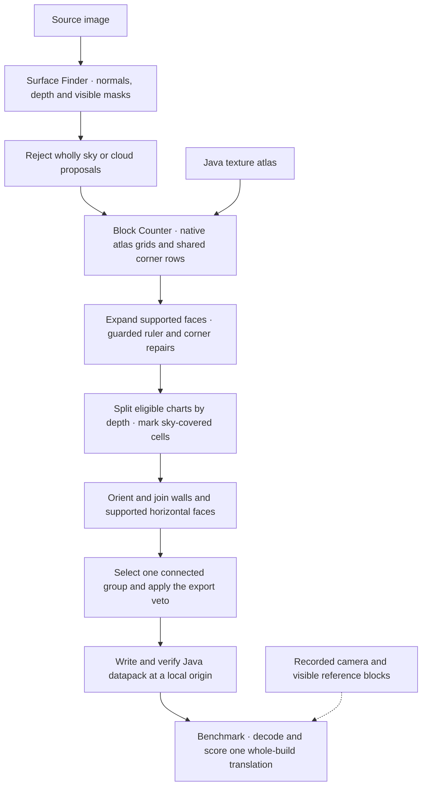

# Floating reconstruction architecture

Expanded Split-Border is the default Floating method on `main`. It measures and joins surfaces from one RGB screenshot using the selected Java texture atlas and pinned vision models. The build can be suspended in midair. Each exported block needs visible face evidence in the source image. [Product intent](PRODUCT_INTENT.md)

| Stage | What it does | What you can inspect |
| --- | --- | --- |
| Surface Finder | Pinned MoGe-2 normals and Depth Anything V2 relative depth guide the source masks. A border-connected sky check removes wholly background proposals before counting. | Native mask outlines, masked crops and the surfaces handoff. |
| Block Counter and shared rows | Straightened views give initial grid estimates. Native samples and atlas texture matches corroborate unit-face pitch, grid origin and material IDs. Shared rows at observed corner junctions register neighboring walls and support additional chart seeds. | Counts, source charts, atlas witnesses and shared-row decisions. |
| Surface expansion and repairs | Resample projected unit faces against native image pixels, expand within photographed support and rank block IDs. The frozen guards can contract an implausibly dense chart, replace its ruler with a verified edge-aligned repeat, or repair a shared-corner pair. | Chart cells, contraction and ruler decisions, and selected corner repairs. |
| Split-border checks | Eligible charts group their existing cells by native depth region and keep the fitted ruler. A second sky check votes across each projected cell footprint and marks covered cells for exclusion from the export. | Depth child charts and per-chart projected sky vetoes. |
| Relative assembly | Orient charts with signed local axes and propose joins from shared edges and compatible coplanar grids. An observed top or underside needs corroborating rims from two perpendicular walls. Rank connected groups on complete charts and apply the sky veto to the selected group's exported cells. | Assembly orientation, joins, selected charts and assigned material coordinates. |
| Export and scoring | The Java 26.3 pack writer verifies decoded coordinates and IDs against the selected group. The benchmark registers the exported orientation, applies one whole-build integer XYZ translation, and compares strict and facade placement and exact block IDs on the same transform. | Pack, case scores and aligned placement evidence. |

The [single-image CLI](README.md#run-floating) and [Front 100 replay launcher](benchmark/FLOATING_SHARED_DATASETS.md#replay-front-100) call the same [predictor](engine/floating.py). It keeps the input charts in `charts.json`, the charts considered during assembly in `oriented-charts.json`, and the selected group and orientation in `assembly.json`. Scene recreation and reference-assisted diagnostics can read recorded poses, labels and world coordinates. Benchmark scoring uses those records after prediction.

The [detailed pipeline and stage report](benchmark/FLOATING_PIPELINE.md) explain the archived V1 comparison with the guarded depth-first refit and how to inspect saved handoffs. The [mobile review guide](benchmark/MOBILE_REVIEW.md) covers source masks, visible references, attempted grids and exported blocks.

## Archived floor-and-camera architecture

The previous pavement-based pipeline establishes viewing scale from the staging floor and uses that fit for projected placement. Its diagram, call paths and scoring notes are preserved at `e3bd220` on the `floor-with-camera` branch. [Archived architecture](https://github.com/jeremyepling/minecraft-image-reconstruction/blob/e3bd220188f224a0a6cf2841c8f495fd0ac9d090/ARCHITECTURE.md) · [Archived README](https://github.com/jeremyepling/minecraft-image-reconstruction/blob/e3bd220188f224a0a6cf2841c8f495fd0ac9d090/README.md)
