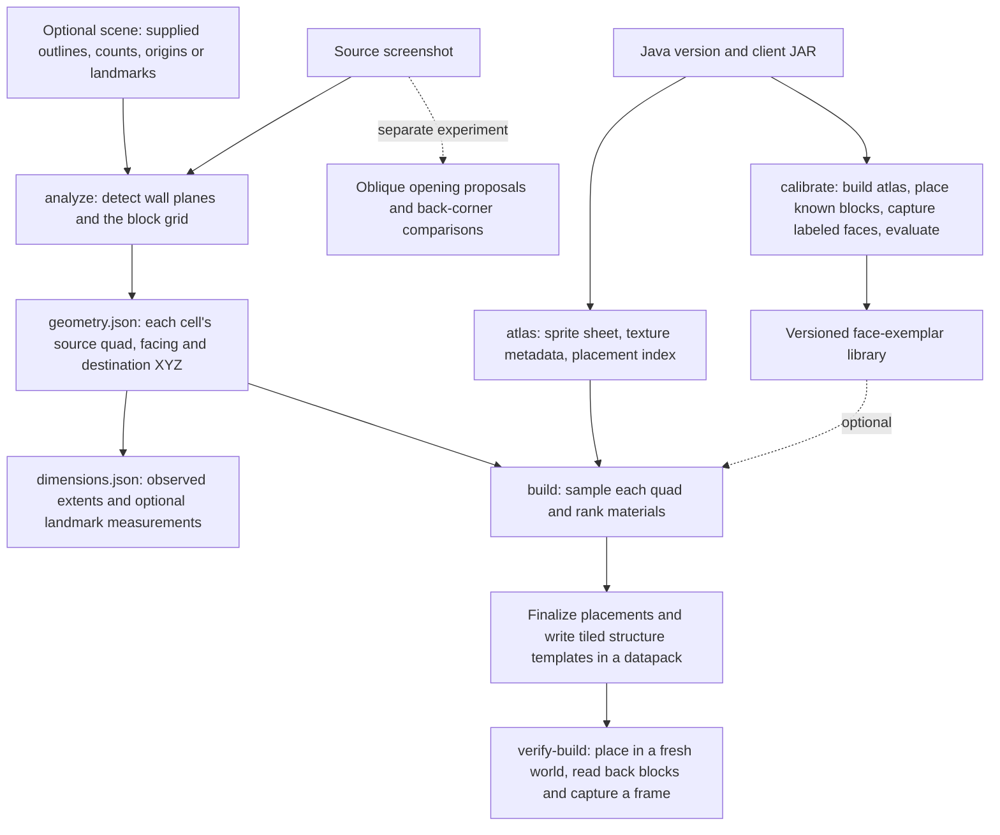

# How a screenshot becomes a Minecraft build

The entry point is [reconstruct.py](reconstruct.py). A plain `build` uses baseline geometry and ranks block textures at the image's current brightness. Newer algorithms have their own switches or research commands. The normal build never runs a tournament of algorithms on the user's image.

For a single exterior, `build --through counts` runs the Surface Finder (Regions First), Surface Straightener and Block Counter (masked repetition). Add `--material-match atlas` to rank block IDs for complete cells. The [stage guide](benchmark/SURFACE_FINDER.md) documents the image inputs, masks and abstentions. The [count experiment](benchmark/COUNT_ROUND.md) measures how often each stage succeeds on the frozen suite.



### Geometry and dimensions

| Entry point or switch | What actually runs |
| --- | --- |
| **Default** `analyze` or `build` | Propose a wall outline, map it to a rectangle, estimate periodic block seams, and project a quadrilateral for each occupied cell. A second proposed plane can represent a return. |
| **Optional input** `--scene` | Use supplied wall planes, directions, counts, origins, openings or landmark hints. Known grid counts take precedence over estimating counts. With scene hints, `remap` does not run its automatic frontal depth detector. |
| **Experimental, available to builds** `--geometry-method texel` | Partition a foreground silhouette into surfaces and estimate spacing from repeated texture and native texel transitions. Unanchored image-only proposals become a common front elevation. |
| **Experimental, available to builds** `--geometry-method remap` | Fit a shared lattice from local repetition and silhouette boundaries. Use a visible pavement grid when it gives reliable perspective calibration. On supported near-frontal views, project candidate back rims, test connecting edges and texture alignment, and move cells to measured depths. This path can export recessed backs, returns and visible setbacks. |
| **Reuse** `build --geometry geometry.json` | Check the source image fingerprint and use the saved quads and coordinates directly. Geometry detection, dimensions and depth inference are skipped. This makes material-only comparisons reproducible. |

Dimensions are a separate **output and measurement concern** within `analyze`. The extent on each axis is the span of measured cell coordinates. Supplied scene landmarks can invoke an additional measurement function. Material predictions do not determine building height. A one-block Z extent can mean only the front surface was recovered. [Geometry dispatcher and artifact writers](engine/reconstruction.py) · [Landmark measurement](engine/dimensions.py)

### Materials, lighting and export

| Mode | How the material is chosen |
| --- | --- |
| **Default** | Sample each visible face on its measured quad. Compare color, spatial detail and texture variation against placeable faces of the same direction. Without a library, use the versioned atlas plus softened examples and multiscale distance. `--library` uses the calibrated exemplars and ranking method stored with them. |
| **Opt-in** `--match-exposure` | Permit a bounded brightness gain per candidate, penalizing large adjustments. |
| **Experimental options** `--match-appearance local/shared/motif/adaptive` | All four require a rendered library. Local compares distributions of brightness and color. Shared favors reusing materials on a plane. Motif adds matches to repeating atlas details at different scales and offsets. Adaptive trusts the calibrated exposure ranking when the cropped texture aligns and uses motif evidence elsewhere. Choose one appearance mode or exposure matching. |
| **Opt-in** `--white-balance` | Estimate an image-wide cast and apply correction when the neutral-patch estimator reports moderate confidence. It runs before material sampling. |
| **Lighting diagnostics with remap** | Compare paired, rectified neighboring cells for brightness shifts, smooth gradients, sharp steps, color change and texture continuity. Record the assessments in `appearance_boundaries`. This diagnostic does not directly assign recess depths or block IDs. |
| **Export** | Resolve competing placements at a coordinate, handle unsupported falling materials, and write `matches.json`, `placements.json` and `reconstruction.zip`. A user-supplied `--depth` extrapolates a hollow shell on an eligible flat wall. `verify-build` checks whether Minecraft placed what was exported. Reference-world accuracy requires separate ground truth. |

[Material ranking](calibration/retrieval.py) · [Appearance models](engine/appearance.py) · [Adaptive routing](engine/routing.py) · [Datapack writer](engine/export.py)

### Research path for angled openings

**Cube constraints are opt-in.** `inspect-form --cube-turns` fits a common three-axis camera frame using the detected segments, adjusts supported stretches of the silhouette and tests whether a proposed face and its connecting edges follow the frame. `analyze --geometry-method cube` and `build --geometry-method cube` send the same silhouette into the existing elevation, lattice and frontal depth stages. Local qualitative relief labels are review evidence. [Call paths and limitations](benchmark/CUBE_TURNS.md)

`inspect-form` traces coarse and fine straight segments across the frame, groups the coarse edges into an outline with background-color evidence, then looks for smaller faces and angled junctions within it. The output records a qualitative relief label independently of block depth. `outline.png` shows the general form before local predictions. `relief.png` and `form.json` expose individual predictions for review. This path is experimental and has no connection to block placement. [Algorithms, failures and comparative scores](benchmark/LINE_FORM.md)

The user-facing diagnostic is `reconstruct.py inspect-openings IMAGE --out REVIEW`. It loads a fixed entrance policy, rectifies the facade, proposes opening outlines, then estimates depth from local texture scale. The JSON distinguishes a supported depth, a flush surface, an unresolved measurement and an extra outline for review. The review image labels each outline. The selection benchmark compares these decisions against known Minecraft worlds. The build command and the atlas matcher run independently of this diagnostic. [Selection rule, live results and limitations](benchmark/ENTRANCES.md)

`python -m benchmark.oblique_recess --image IMAGE --out result.json` runs the pavement-based oblique rectification, proposes dark opening rims, projects alternative back edges, and checks the local wall texture to reject flush inlays. Back-corner experiments compare competing depth estimates on those same candidates. World geometry and recorded camera poses are used for scoring after prediction. These experiments have no call path into normal block placement. The frontal depth estimator in `remap` is wired into placement. [Frontal and oblique experiments](benchmark/RECESSES.md)

### Two ways to follow a run

The opt-in `fit-voxels` command follows a separate geometry path. It fits a perspective camera and a bounded cell grid, proposes solid block occupancy, then renders the visible faces back into the screenshot. The default for this command uses depth symmetry. Full-cube geometry is exported in smooth stone when an atlas is supplied. [Candidates, results and reproduction instructions](benchmark/VOXEL_FIT.md)

```console
python reconstruct.py build wall.png --atlas runs/26.3/atlas --out runs/default
```

This is the default path, including its own geometry analysis. To inspect an experimental geometry result and reuse it for rendering, run the stages separately:

```console
python reconstruct.py analyze wall.png --geometry-method remap --out runs/grid
python reconstruct.py build wall.png --geometry runs/grid/geometry.json --atlas runs/26.3/atlas --library runs/26.3/face_textures/softened-library.npz --match-appearance adaptive --out runs/build
python reconstruct.py verify-build runs/build --version 26.3 --out runs/check
```

Read `grid.png` for the crop boundaries, `dimensions.json` for extent, `geometry.json` for the coordinates and depth evidence, and `matches.json` for material decisions. Inspect `runs/check/captures` to see the resulting blocks in Minecraft.

To compare the newer back-corner methods on one screenshot, run `python -m benchmark.back_corners --image IMAGE --out RESULT.json`. The result includes the previous estimate, snapped edges, texture-spacing hypotheses and the agreement rules. These return diagnostics, including abstentions. [Algorithms and measured results](benchmark/BACK_CORNERS.md)
