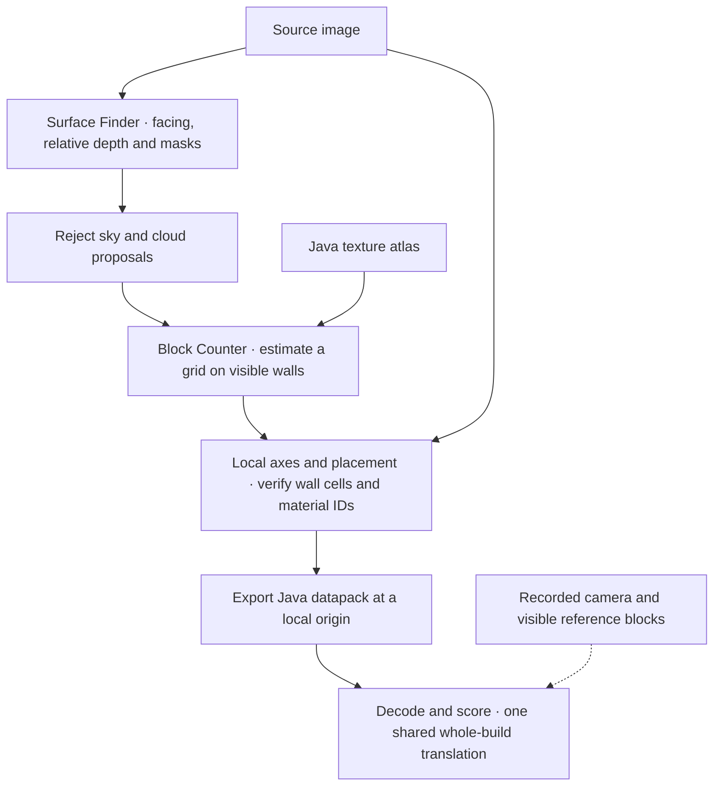

# Floating reconstruction architecture

Floating is the default on `main`. It estimates a block grid from the build’s visible geometry and texture. A source image can show the build in midair. Only blocks with observed face evidence belong in the export. [Product intent](PRODUCT_INTENT.md)

| Stage | What it does | What you can inspect |
| --- | --- | --- |
| Surface Finder | Source-image normals and relative depth help group pixels into wall and other surface proposals. A sky check rejects wholly background masks before counting. | Mask outlines, cropped support pixels, and the source handoff. |
| Block Counter | Estimate block size and grid origin from repetitions, boundary cues and atlas agreement. A straightened crop helps inspect a face. Fitting and verification can also use native source pixels. | Counts, attempted grids and surface masks. |
| Local placement | Relative directions come from the building’s own outlines and visible textures. The Front 100 runner can place cells from consistent perpendicular sheets or use a verified wall grid. It records when it only has a local sheet or when no grid is supported. | Saved candidate sheets, material IDs, selected source cells, and local coordinates. |
| Export and evaluation | Write a Java 26.3 datapack, decode its coordinates and material IDs, and compare against only the recorded visible build. Apply one translation to the whole export. | Pack, case scores, aligned placements, and source-pixel overlays. |

The [Front 100 replay launcher](benchmark/FLOATING_SHARED_DATASETS.md) supplies one source image at a time to [the local-grid runner](benchmark/floating_build_local_run.py). The recorded camera, labels and world coordinates are evaluation inputs. Scene recreation and reference-assisted diagnostics use those records explicitly.

The [detailed replay and stage report](benchmark/FLOATING_PIPELINE.md) also describes the expanded split-border benchmark and guarded depth-first challenger. Those experiments measure joins, depth checks and component selection on the paths that run them. The [mobile review guide](benchmark/MOBILE_REVIEW.md) shows how to compare saved masks and exact visible surfaces, inspect grid attempts, and trace an exported block to its source.

## Archived floor-and-camera architecture

The previous pipeline establishes viewing scale from the staging floor or pavement and uses that fit for projected placement. Its diagram, call paths and scoring notes are preserved at `e3bd220` on the `floor-with-camera` branch. [Archived architecture](https://github.com/jeremyepling/minecraft-image-reconstruction/blob/e3bd220188f224a0a6cf2841c8f495fd0ac9d090/ARCHITECTURE.md) · [Archived README](https://github.com/jeremyepling/minecraft-image-reconstruction/blob/e3bd220188f224a0a6cf2841c8f495fd0ac9d090/README.md)
