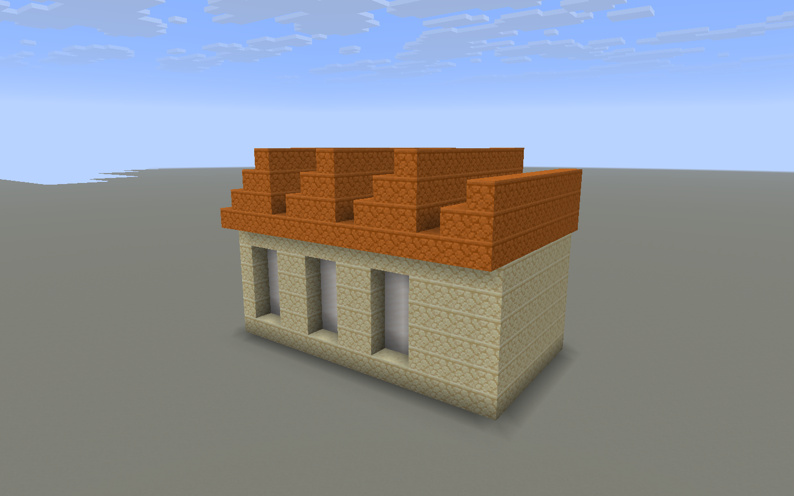
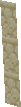

# How a screenshot becomes a Minecraft build

The [product intent](PRODUCT_INTENT.md) is visible-only reconstruction for both the current pipeline and proposed learned components. Only blocks supported by visible faces in the supplied input belong in the output. Unobserved backs, interiors and occluded regions stay unknown; geometry consistency must not become a hidden-area completion step.

## Pipeline terms in reading order

The [pipeline diagram in the README](README.md#from-source-image-to-placed-blocks) shows the ordinary Java 26.3 exterior command. The camera and surface paths share the same source image. The finder can outline a wall and the counter can measure its crop even when the camera cannot establish a 3D block scale. A count can also help validate a proposed recess before the full counting pass. The files below let you follow a single wall through the build.

| Stage | Terms and tasks | What you can inspect |
| --- | --- | --- |
| Input | The **source image** is the complete screenshot. A **pixel** is one image sample. A **block** is a Minecraft grid cell, and a **face** is one side of that block. A **surface** can span many block faces, such as the front wall of a building. A **plane** is the flat sheet in 3D on which we think those faces lie. | The original image. The build manifest records its fingerprint so stages can be traced to the same input. |
| Surface Finder | **Regions First** groups neighboring pixels. MoGe-2 estimates the **normal**, the direction a surface faces. Depth Anything V2 estimates **relative depth**, which helps tell nearer from farther. ScaleLSD supplies line junctions, M-LSD helps find thin undersides, MobileSAM proposes wall boundaries, and Pixel-wise Planarity tests flat regions and possible splits. | In `surfaces.json`, a **mask** says which pixels belong to each surface. Its **outline** follows the boundary and any holes. `surface-crops/` contains masked source pixels and separate crops with surrounding context. |
| Camera fit | The **viewpoint** and **block scale** describe how a unit Minecraft block projects at a given location. The fitter first uses visible pavement seams. If they are too weak, it tries aligning floor pixels with the Java texture **atlas**, a catalog of known game textures. | The placement section of `build-manifest.json` records the camera result. If block scale stays unresolved, the ordinary build exports an empty build function. |
| Refine outlines | Use edges, sky, texture continuity and contacts to refine which pixels belong together. A **recess** sits behind a surrounding **host wall**. Its **rim** is the boundary at the front, its **jamb** is a vertical side, and its **sill** is the lower ledge. Their visible shapes can establish the **setback**, the depth behind the host in blocks. The **facade** is the visible exterior face of the structure, including details like openings and pillars. An outline can also pass a count check while its depth stays unresolved. | `surfaces.json` shows the resulting masks. `build-manifest.json` records which checks accepted an opening. |
| Surface Straightener | A **surface crop** contains pixels from one part of the source image. **Rectification** warps a tilted surface into a face-on sampling view. Its four-corner **chart** describes how to sample it. The mask still excludes openings and neighboring faces. | Compare `surface-crops/` with the straightened crops in `samples/`. |
| Block Counter | Estimate the **grid pitch** (spacing between repetitions of a whole block texture) and **offset** (where the grid lines fall). Texture-guided straightening can retry an incomplete count. Width and height may resolve independently. A visible **span** measures the extent between observed cells. On an irregular surface, width × height can include gaps. | `counts.json` records count estimates and, on supported recesses, the measured visible grid span and number of supported cells. |
| Block Grouper and Material Matcher | Two or three adjoining faces can belong to one cube. Their textures can look different because they face different directions. The grouper uses shared convex edges to associate them. On a material run, the matcher uses an eligible face to compare its observed texture with atlas or rendered examples and proposes a **material ID**, such as `minecraft:tuff`. | `counts.json` records face groups and requested matches. The ordinary placement datapack uses smooth stone so you can inspect the geometry. |
| Placement and export | A **candidate** is a proposed position or surface pending a check. The placer tests possible plane depths, uses texture and contacts, and **reprojects** candidate cubes into the source image to check which face should appear first. It resolves conflicts and applies local edits inside measured recesses. At a framed opening, it compares the source pixels to the pavement grid outside. When they agree, it reprojects elevated cubes and removes those that visibly obstruct the opening. The outlines and measured floor tiles remain available because a real floor can share that grid. Hidden space stays **unknown**. A visible face can justify placing its whole cube. | `placements.json` lists accepted local **XYZ** block coordinates (X and Z along the ground, Y upward). `reconstruction.zip` places those blocks relative to the point where you run the build function. |

## One block on two surfaces

Look at the upper front corner of a square pillar. The front wall, side wall and top are three surfaces, each with its own direction and mask. At their shared corner, the front, side and top **unit faces** can all belong to one Minecraft block. Linking those faces would associate one XYZ coordinate with three observations. Each surface would keep its own outline.

**Current behavior.** The Block Grouper works after counting because it needs the projected corners of individual block faces. It checks whether their edges meet at an outward corner. Placement reads surface masks and grids and uses its own contact and visibility checks. It does not read the grouper’s face links. In seven saved ordinary builds at `9ce2f10`, the grouper emitted three single-face groups and zero groups with multiple faces. An earlier diagnostic supplied recorded face outlines and recovered all 198 known pairs with zero false links. That measures grouping with supplied corners. The ordinary path still needs to find those corners in the source image. [Seven verified build outputs](benchmark/reviews/facade-inset-round-01/ordinary-entry.json) · [Grouping diagnostic and illustrated examples](benchmark/reviews/blocker-picker-groups-01/README.md)

**Placement experiment.** We projected a cube beside a well-counted face and checked whether its thin side or top also fit the source image. This often confirmed an existing block. On the 104 fixed views, only two of 135 proposed new positions were correct. A candidate cube can fit both image regions at the wrong depth. [Projected corner examples and scores](benchmark/reviews/thin-face-placement-01/README.md)

**Outline experiment.** Four or more consecutive blocks agreeing on an edge provided a candidate boundary. We checked the atlas textures, the first cube hit when looking through each disputed pixel, and the effect on the block grid. Across 204 source images, the strictest rule assigned 80 pixels to the correct surface but moved another 13 between two incorrect surfaces. On Stepped Hall the real surface was a parallel wall one block closer. The ordinary pipeline keeps its existing outline and placement rules. [Outline comparisons](benchmark/reviews/edge-vote-outlines-01/README.md)

## Worked example of a rejected surface

The 1 × 3 example comes from **Sawtooth 2, earth palette, high-right view**. It is a different source image from the Facade with three recovered recesses. The left image below is the full 1440 × 900 input. The right image shows the 21 × 107 pixel mask of the proposed surface, before the check trims its uncertain edge.

| Full source image | Proposed surface crop |
| --- | --- |
|  |  |

The crop begins at source pixel **(511, 456)** measured from the upper left. After trimming two pixels around the edge, the **Block Counter** estimated **one block across by three high** from the remaining texture. Independently, mapping those pixels onto the candidate plane using the estimated camera gave **one across by four high**. Those are two estimates for the same pixels. Neither is a human label. Their disagreement caused the Surface Finder to reject the proposed split and keep the pixels on their original wall.

A **decision tree** is a learned set of if/then checks. The experimental inset tree rejected this candidate earlier. With that tree switched off, the ordinary grid check rejected it anyway. Both versions produced identical final masks and counts on 204 images. The separate placement stage still uses learned depth ranking where available. [Tree comparison](benchmark/reviews/inset-mask-chooser-01/final-tree-ablation.md) · [Positive example on the Facade](benchmark/reviews/facade-insets-01/returns-comparison.jpg)

## Evaluation terms

A **visible reference** is the set of block positions supported by faces visible in that source image. The benchmark derives it from the recorded world and capture camera. The ordinary build estimates its own camera from the source image. Scoring allows one integer XYZ translation of the whole prediction per image. A roof shifted relative to its pillars still counts as misplaced.

| Term | What counts |
| --- | --- |
| Correct, extra, missed | A **correct** position appears in both sets after alignment. An **extra** is a prediction outside the visible target set. A **miss** is a required visible position absent from the prediction. A single block at the wrong relative depth can create both a miss and an extra. |
| Precision, recall, F1 | **Precision** = correct / (correct + extras). **Recall** = correct / (correct + misses). **F1** = 2 × correct / (2 × correct + extras + misses). The fixed-suite score pools the block counts across images. |
| Strict and facade-priority F1 | **Strict** counts every visible reference block. **Facade-priority** makes a horizontal-only block optional when its visible top or underside lacks a solid 4 × 4 patch of source pixels at the fixed suite’s 1440 × 900 resolution. An optional block earns no credit and incurs no miss. All extras still count. |
| Surface overlap (IoU) | **Intersection over union** measures how well one predicted surface mask overlaps its reference in image pixels. Perfect overlap is 100%. A good outline can have unresolved depth, so its 3D placement can still be wrong. |
| Material accuracy | Compares the chosen block IDs with the labeled IDs. Two cubes can occupy the same correct position and have different materials. Geometry F1 checks the position. |

[Current placement score and block counts](README.md#current-placement-score) · [Visible reference and sliver examples](benchmark/reviews/strip-orientation-01/README.md)

## Find surfaces and count blocks

The ordinary exterior command on this PC takes one Java 26.3 screenshot. It runs the **Surface Finder**, **Surface Straightener** and **Block Counter** and saves their intermediate results. The selected Surface Finder matched **519 of 598** visible surface appearances across 56 frozen views. The counter got both block dimensions right for **121 of 598**. These scores measure different stages. [Surface comparison](benchmark/reviews/edge-detail-stable-01/cases.json) · [Crop review](benchmark/CROP_REVIEW.md)

```powershell
.\Invoke-WallRecovery.ps1 .\wall.png -Out .\runs\my-build
```

| Stage | What runs | Where to inspect it |
| --- | --- | --- |
| Surface Finder | **Regions First** groups connected pixels using MoGe-2 surface directions and Depth Anything V2 relative depth. ScaleLSD v2 supplies junctions, M-LSD Tiny helps identify thin undersides and MobileSAM proposes wall outlines. Pixel-wise Planarity checks for nearby missing surfaces and supported splits. | `surfaces.json` contains the masks, hole boundaries and optional sampling corners. `surface-crops/` shows the visible pixels and their surroundings. |
| Surface Straightener | A four-corner chart turns a surface face-on for sampling. Its pixel mask excludes gaps and neighboring surfaces. Regions without a usable chart still have outlines. | `samples/` holds rectified samples from the counting pass. |
| Block Counter | **Masked repetition** measures how often a texture repeats across and down the straightened surface. A supported width or height can be recorded independently. | `counts.json` records the estimated grid and dimensions for each surface. |
| Block Grouper | Join up to three visible faces along supported convex edges. Select the face with the greatest effective width in source pixels, breaking ties by area. A face must be at least five pixels wide to supply a material. | `counts.json` records the member faces and selected face for each block. |
| Blocker Picker (Material Matcher) | When requested, match the selected face once with the atlas, rendered exposure, texture, or texture with local shade. Other linked faces inherit its block ID. | Inspect `block_groups` and the material source on each face in `counts.json`. |

The Surface Finder’s build IDs are `mask-first` for grouping and `plane-recovery-crop-splits` for refinement. After the full-image pass, closer views can split a region while preserving its footprint. The counter’s ID is `texture-guided-repeat`. Each surface records which step supplied its count. A complete initial estimate uses `masked-repeat`; an incomplete estimate can use texture-guided straightening when a reserved strip confirms the spacing. Each run writes its actual stages, settings, input digest and checkpoint hashes to `build-manifest.json`. The winner is selected on the fixed suite. The previous methods are available through benchmark replays. [Single-image setup](benchmark/WALL_RECOVERY_BUILD.md) · [Stage guide](benchmark/SURFACE_FINDER.md) · [Method history](benchmark/RECONSTRUCTION_LINEAGE.md)

**Smooth wall edges.** A smooth wall can extend past the finder’s outline even when no block seam is visible. A connected patch can be supported by one mask or by adjoining masks facing the same way on an upright wall. The finder uses a connected patch of similar source pixels, compares the patch and an already detected neighbor against shaded atlas textures, then looks for the same appearance in the exterior margins at that height. It trims the uncertain edge before extending the visible mask. The original measured support is saved alongside the corrected outline so a crop correction cannot shift the existing grid. For placement, a second fit proposes individual cubes. The pipeline projects them together with the original build and keeps additions with enough visible samples on the new patch and the expected face direction. [Source images, outlines and placement effects](benchmark/reviews/shopfront-outline-review-01/README.md)

## Verify on the saved source images

```powershell
.\Invoke-SurfaceRound.ps1 -Round sky-gap
```

The replay applies the selected rules to saved numerical model outputs, runs the same counter and grades the resulting masks against the recorded geometry. The 56 views cover eight buildings captured in vanilla Java 26.3 at clear noon. Settings were chosen on Shopfront and Wing. The other six buildings measure performance on previously reviewed layouts. Run `build --through camera` with an image, version and output directory for the independent camera and projected-grid estimate. [Replay manifest](benchmark/reviews/sky-gap-01/manifest.json) · [Camera test](benchmark/CAMERA_ROUND.md)

## Export blocks and check placement

Assembly may place a full Minecraft cube for a block evidenced by a visible face. It must not add further cells to close a shell, fill an unseen continuation or manufacture concealed supports. An omitted unknown cell is not an instruction to place air in an existing world. The facade builder's legacy `--depth` shell generation is outside this product intent; its existence is not evidence that hidden reconstruction is a goal.

The ordinary exterior wrapper uses `build --through placement`. When the camera supports block scale, it exports the strict grid cells and adds cells with visible face evidence on estimated surface planes. The resulting smooth-stone datapack and coordinate list share the same local origin. [Placement results](benchmark/SUPPORTED_PLACEMENT.md)

The separate `build --through assembly` command uses the facade builder. It measures a projected block grid or accepts one saved for the same image. It ranks atlas textures for those cells, resolves conflicting placements and writes a Minecraft datapack. [Earlier count and placement experiment](benchmark/COUNT_ROUND.md)

```console
python reconstruct.py analyze wall.png --out runs/grid
python reconstruct.py build wall.png --geometry runs/grid/geometry.json --atlas runs/26.3/atlas --out runs/export
python reconstruct.py verify-build runs/export --version 26.3 --out runs/check
```

| Step | Input and result |
| --- | --- |
| Measure | `analyze` proposes wall outlines, estimates repeating block seams, and projects each occupied cell. `geometry.json` saves the source quad, facing and destination coordinate. `dimensions.json` records observed extents. A supplied `--scene` can provide planes, counts, origins, openings and landmarks. |
| Assemble | A plain `build` with `--atlas` measures its own grid. With `--geometry`, it checks the image fingerprint and reuses the saved quads and coordinates. Each face is compared with textures of the same facing. A calibrated `--library` supplies rendered exemplars. `matches.json`, `placements.json` and `reconstruction.zip` record the result. |
| Verify placement | `verify-build` opens a fresh Minecraft world, places the exported blocks, reads them back and captures a frame. A placement that matches the export can still differ from the source. The geometry and material benchmarks score that separately. |

For atlas creation and fresh in-game reference captures, see the calibration guide. For earlier tests of alternative geometry, lighting, opening detection and voxel occupancy, see the archived comparisons. [Calibration](calibration/README.md) · [Material results](benchmark/COLOR.md) · [Recess depths](benchmark/RECESSES.md) · [Voxel fits](benchmark/VOXEL_FIT.md)
