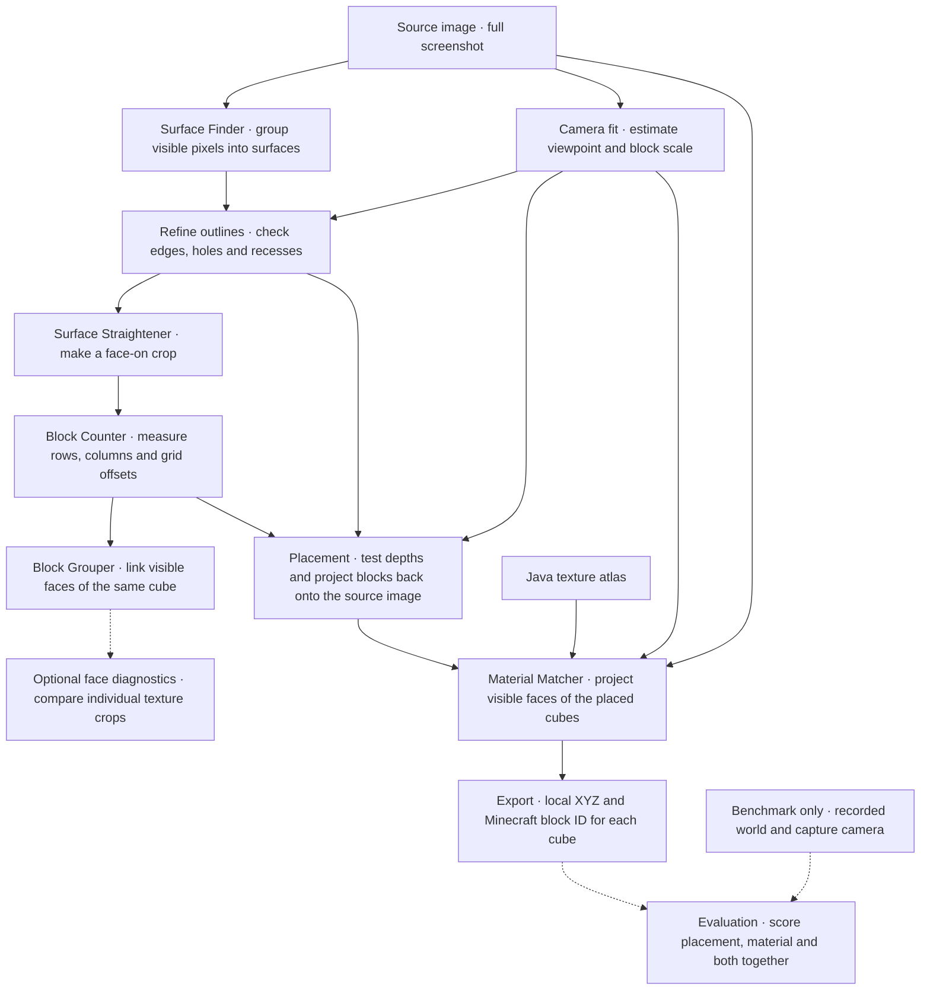

# Minecraft Image Reconstruction

## From source image to placed blocks

The **source image** is the full Minecraft screenshot supplied to the build command. A **surface crop** is a piece taken from that same image. Solid arrows show how the ordinary build uses the source. Dotted arrows show diagnostics and evaluation.



At the outer corner of a pillar, a front face and a side face can belong to one block. Today the Block Grouper records that link for material matching. Placement uses its own contact and visibility checks. [What happened when shared faces were tested for placement and outlines](ARCHITECTURE.md#one-block-on-two-surfaces)

The **[illustrated stage and term guide](ARCHITECTURE.md#pipeline-terms-in-reading-order)** walks through each box, the models it uses, and the files you can inspect. It includes the [actual 1 × 3 versus 1 × 4 example](ARCHITECTURE.md#worked-example-of-a-rejected-surface). To see the stages on buildings, open the [source images and stage overlays](benchmark/reviews/facade-placement-01/worst/README.md).

## Current placement score

The [round review guide](benchmark/ROUND_REVIEW.md) shows how to trace a missing block, compare scored releases, and see which steps use local scripts, vision models or Codex tokens.

The [pipeline consistency review](benchmark/reviews/pipeline-consistency-01/README.md) traces the ordinary build through scoring, tests three placement order changes, and compares optional material matchers and atlas fallbacks. In the interactive viewer’s **Block Counter**, switch between geometry-only and atlas-assisted grids to see where the atlas supplies a missing offset.

[Open the interactive weakest-structures viewer](benchmark/reviews/shared-face-round-01/viewer.html) to inspect the current source overlays and the layout and source-image scenarios for reaching 95% facade-priority F1.

[Where placement fails on the weakest source images](benchmark/reviews/shared-face-round-01/README.md) groups the misses at `a6e0195` by visible coverage, face direction and 3D position. The [stage map](benchmark/reviews/shared-face-round-01/stage-map.jpg) follows five buildings from source pixels through block counting and the exported geometry. The [required-miss overlay](benchmark/reviews/shared-face-round-01/wall-examples.jpg) shows which errors remain after optional roof slivers are excluded.

On the **104 fixed whole-structure source images**, the current default places **20,773** blocks at the correct relative coordinates, misses **2,929** visible positions and places **1,046** extras. Removing background that continued through the proposed Workshop canopy exposed 18 visible roof positions. Across the fixed suite the correction removed 18 extras and preserved every previously correct placement. In the viewer, choose **Face corner placement** to compare the detected surface edges, actual exported block corners and, where available, excluded background or the two counted corner fits. [Workshop foreground results](benchmark/reviews/workshop-foreground-01/README.md) · [Plank errors across four layouts](benchmark/reviews/workshop-horizon-01/plank-audit.md) · [Courtyard corner](benchmark/reviews/courtyard-corner-01/README.md)

| Measure | What it asks | Current |
| --- | --- | ---: |
| Precision | Of the positions we placed, what fraction were correct? | 95.21% |
| Recall | Of the visible positions in the reference, what fraction did we place correctly? | 87.64% |
| Strict visible-block F1 | How well did placement balance precision and recall across all visible blocks? | 91.27% |
| Facade-priority F1 | How well did we do when very thin top-only or underside-only targets are optional? | 93.42% |
| Exact material accuracy | Among the 20,773 correctly positioned blocks, how many have the right Minecraft ID? | 92.78% (19,274) |
| Overall strict F1 | How well did the exported packs recover both visible positions and IDs? | 84.68% |
| Overall facade-priority F1 | How well did they recover both under the facade scoring rule? | 88.51% |

The default Material Matcher assigned IDs to 21,809 of 21,819 exported blocks on the fixed suite. Ten used the smooth-stone fallback. The former all-smooth-stone exporter had 1.20% material accuracy and 1.10% overall strict F1 on exactly the same coordinates. On 28 additional independent views the matcher reached 97.35% material accuracy and 86.79% overall strict F1. Open **Placement + material** in the pipeline viewer, or select a structure in the material review and click a block to compare the source ID with the exported ID. [Interactive material and overall scores](benchmark/reviews/typed-structures-01/viewer.html) · [Decoded packs, cohorts and method comparisons](benchmark/reviews/typed-structures-01/README.md)

**F1** combines precision and recall using their harmonic mean. In block counts, **F1 = 2 × correct / (2 × correct + extras + misses)**. On these images, if you pick a placed block, roughly 95 in 100 are right. If you pick a visible reference block, roughly 87 in 100 were recovered. Both matter. The reference allows one whole-build shift per image so a different world origin gets full credit and misplaced parts still count as errors. [Scoring details and examples](ARCHITECTURE.md#evaluation-terms)

## Methods and evidence

A separate check on four previously unused decorative source images gave **75.49%** exact material accuracy and **45.56%** strict overall F1. One of the four had no recovered geometry. A directional texture-seam experiment gained 282 correct IDs on the known fixed suite but tied the default on these new buildings. The default remains the matcher validated above. [New building families and seam comparison](benchmark/reviews/material-seam-confirmation-01/README.md)

[Reconstruction adjustments and lessons for training](MODEL_CHANGELOG.md) records what shipped, which experiments fell short, and what to look for in later training runs.

The Java 26.3 camera measures pavement seams first. If those give insufficient evidence, it registers visible floor texels against the vanilla texture atlas. This recovered 4,017 visible block coordinates across the 24 Cloister and Twin Spires screenshots that previously exported empty packs. See the [current camera and placement evaluation](benchmark/TEXTURE_CAMERA.md) and the [earlier 92-pack material evaluation](benchmark/COMBINED_DEFAULT_EVALUATION.md).

Download [Visible Builds v2](training/DATASET.md) for 144 whole-structure screenshots with camera calibration, visible block coordinates and material states. All four splits require a clear border around the complete build.

A build can be placed anywhere in the world. We score its visible blocks after shifting the whole build together. This gives full credit for a translated copy while preserving the roof height, pillar spacing and offsets between parts. [Relative geometry results and one-block control](benchmark/reviews/relative-build-01/README.md)

After fitting the camera, the placer verifies visible wall faces against the atlas and measures overlapping pillars from their exposed texture rows. When a visible side and sill meet inside a wall, the Surface Finder checks their projected shape against the block grid and splits out the back wall visible in the source image. A second outline check compares the count measured from the surface crop with the projected grid. It can identify a back wall whose depth is still unresolved. The placer uses a measured setback and edits only supported cells inside the opening. Twenty alternate views score 90.02%. Four shelter and gate views score 83.47%. [Recess examples, decision models and scores](benchmark/reviews/facade-inset-round-01/README.md) · [Sliver scoring and face-direction examples](benchmark/reviews/strip-orientation-01/README.md) · [Interactive comparison of six earlier issues](benchmark/reviews/visible-error-budget-01/shipped-regions/viewer.html) · [Previous stage map for the ten weakest layouts](benchmark/reviews/facade-placement-01/worst/README.md)

Reconstruct only the parts of a build visible in the supplied image or images. Hidden backs, interiors and occluded regions remain unknown and are omitted from the reconstruction. This scope applies to the current pipeline and the [planned learned approach](training/README.md). [Product intent](PRODUCT_INTENT.md)

Surface Finder also scores how well each surface mask covers its visible area in the source image. Its default now removes a false diagonal cut on the Facade, recovering 98.35% of that wall and its correct 27 × 11 span. An upward-looking skyline check restores 225 visible wall pixels on a Watchpost. Across 204 checked images, the two surface corrections preserved the exported builds. [Before and after on both source images](benchmark/reviews/strip-orientation-01/README.md#surface-finder-changes-in-ordinary-builds)

Use `main` to recover visible surfaces from one Minecraft Java 26.3 screenshot. The ordinary **Surface Finder** uses Regions First, Wall Recovery and Pixel-wise Planarity with split-only zoom. After sky removal, it trims a narrow extension when a second detected surface runs alongside it and matches its colors. It then moves outlines to nearby edges in the source image when the Block Counter preserves its complete estimates. It matched **519 of 598** visible surface appearances across 56 saved views of eight buildings. The **Block Counter** keeps complete texture counts and automatically tries straightening the crop using repeated texture when a count is incomplete. It recovered both dimensions for **121 surfaces** on these views and **73** on the 24 Cloister and Twin Spires views. [Counter results and tradeoffs](benchmark/COUNT_TRANSFER.md) [Surface scores by screenshot](benchmark/reviews/edge-detail-stable-01/cases.json) · [Cleanup examples](benchmark/reviews/edge-detail-stable-01/comparison.jpg) · [Counting repeating textures](benchmark/TEXTURE_REPEATS.md) · [Crop and straightening review](benchmark/CROP_REVIEW.md)

## Build from a screenshot

```powershell
.\Invoke-WallRecovery.ps1 .\screenshot.png -Out .\runs\my-build
```

Open `reconstruction.zip` for the visible build datapack and `placements.json` for the block at each local coordinate. Once placement finishes, the Material Matcher uses the estimated camera to project those cubes into the source image. It compares the visible pixels with the Java atlas and writes the chosen block IDs into the pack. A cube without usable material evidence gets a recorded smooth-stone fallback. Use `-GeometryOnly` for the smooth-stone control. When the camera cannot establish block scale, the pack contains an empty build function and the manifest explains the decision. Load a supported pack as a Java 26.3 datapack and run `/function reconstruction:build` at the desired origin.

Read `surfaces.json` for visible masks and openings, and `counts.json` for the **Block Counter**’s estimates and any requested material matches. Use `-Through counts` to stop after counting. [Setup and single-image verification](benchmark/WALL_RECOVERY_BUILD.md) · [Placement results](benchmark/SUPPORTED_PLACEMENT.md)

To inspect the separate per-face Texture matcher at the counting stage, run:

```powershell
.\Invoke-WallRecovery.ps1 .\screenshot.png -Through counts -MaterialMatch shape -Out .\runs\my-materials
```

The command finds the atlas in `runs/26.3/atlas`, `runs/atlas`, or this workspace’s calibration directory. Use `-Atlas PATH` to select a directory explicitly. When both block spacings are measured, material runs automatically use visible texture to locate missing grid offsets. Only complete faces inside the observed mask reach material matching. If the atlas is missing or damaged, the build writes the ordinary measurements and leaves material IDs unresolved. If registration fails on one surface, its original grid still goes to the matcher. The `atlas_phase` entry in `build-manifest.json` records recovered offsets or the fallback reason. [Paired results on 56 screenshots](benchmark/reviews/default-atlas-phase-01.json)

## Reproduce the surface score

```powershell
.\Invoke-SurfaceRound.ps1 -Round boundary-detail -Out runs/my-boundary-review
```

Use a fresh output directory. This compares the new default with the previous finder and a less restrictive edge adjustment on the same 56 clear-noon screenshots. [Comparison and zoomable sheet](benchmark/reviews/edge-detail-stable-01/comparison.jpg) · [Offline testing guide](benchmark/OFFLINE_GEOMETRY.md)

Use the benchmark runners to replay older experiments. The stage scores, fixtures and prototype command snapshots are listed in the project history. [Branch and experiment history](benchmark/RECONSTRUCTION_LINEAGE.md) · [Architecture and call paths](ARCHITECTURE.md)

The protected-edge test found 524 surfaces and kept the Workshop ledge, but lost a Crossing wall. Closer views found 516 and covered more open space. Both tests can be replayed from saved model outputs with `.\Invoke-SurfaceRound.ps1 -Round guard-zoom`. [Results and comparison sheet](benchmark/GUARD_ZOOM.md)

The one-wall split test found and counted a 1 × 5 Portico face, kept the Crossing wall, and added six extra guesses. Split-only zoom was selected for ordinary builds. Run `.\Invoke-SurfaceRound.ps1 -Round contained` to replay the test. [Comparison sheet and decision](benchmark/CONTAINED.md)

## Create a calibration world for a new version

The saved benchmarks above run with Python and their listed dependencies. Use the following live procedure when building new reference displays for a game version. It needs an installed vanilla client and compatible JDK. Live verification has run on Windows with JDK 25 and Minecraft Java 26.1, 26.2 and 26.3.

```console
python -m pip install -r requirements.txt
python reconstruct.py calibrate --version 26.3 --out runs/26.3
```

The command reads the game's block registry and texture/model assets. It creates a flat calibration world, builds three shuffled displays of the registry plus walls of touching blocks, and takes labeled screenshots at clear noon from different angles. It chooses the matching method on validation images, scores held-out placements and grid boundaries, then reconstructs a separate example wall. A second game session places the exported structures and reads back the resulting blocks. Compare `evaluation.json` and `independent-check.json` when evaluating releases or algorithm changes. Use a fresh output directory for each run.

For a new release, substitute its Java Edition version ID. If the client is missing, add `--install-dir runs/minecraft-cache` to download the matching official assets and libraries. A release that changes the game's driver API or save format can require an adapter. The compile and live-placement checks expose those incompatibilities. [Runtime and installer](runtime/README.md) · [Calibration and metrics](calibration/README.md)

For an offline atlas and a first reconstruction without launching Minecraft, run `python reconstruct.py atlas --version 26.3 --out runs/26.3/atlas` and omit `--library` below. Use `--jar PATH` for a client outside the usual installation or Gradle cache. The generated atlas PNG, texture metadata, and direction-specific placement index stay on your machine.

## Export blocks from a measured facade

```console
python reconstruct.py analyze examples/repair-wall/wall-only.png --out runs/wall-grid
python reconstruct.py build examples/repair-wall/wall-only.png --geometry runs/wall-grid/geometry.json --atlas runs/26.3/atlas --library runs/26.3/face_textures/softened-library.npz --out runs/wall
```

Replace the example PNG with a JPEG, PNG, or another Pillow-readable image. To run both image stages in one command, omit `--geometry`. Review `grid.png` for the detected outline and spacing. `geometry.json` records the image fingerprint, camera-plane transforms, source pixels and destination coordinates. You can reuse this file with another version's atlas and library. `dimensions.json` reports block measurements. `matches.json` records the closest texture candidates, distances and margins. Each visible cell receives its best eligible block when building. A small margin means the decision is ambiguous. Reviewer labels belong in test cases.

The result is a Java datapack, `reconstruction.zip`, containing tiled structure templates. File export runs with Minecraft closed. When the task calls for actual placement and an in-game screenshot, run `python reconstruct.py verify-build runs/wall --version 26.3 --out runs/wall-world`. Its save is under `client/saves/Palette Lab` and the screenshot is under `captures`. To place it in an existing world, put the ZIP in that world's `datapacks` folder, run `/reload`, stand at the desired origin and run `/function reconstruction:build`.

## Angled views and visible geometry

The automatic pass proposes a main wall or a front and return from image structure and looks for periodic seams. Busy backgrounds, stepped roofs and repeated window bays can produce the wrong outline or block pitch. For those images, edit the generated `proposed-scene.json` and rebuild using `--scene PATH`. Geometry hints are independent of block identities. This example defines a six-by-six wall by its four pixel corners and world-relative location.

```json
{"planes":[{"name":"front","quad":[[80,40],[250,55],[247,211],[82,216]],"columns":6,"rows":6,"origin":[0,0,0],"facing":"south"}]}
```

Order corners clockwise from top left. The origin is the block at the bottom left of that plane. Supply a plane per visible surface with shared coordinates at adjoining edges. Directions include north, south, east, west, up and down. A south wall runs toward positive X on the right. On an upward-facing roof, the image top runs toward negative Z. Omit both counts to estimate the lattice from seams. Use `holes` containing lists of image polygons to exclude openings or occlusions. Alpha transparency also excludes cells. For detailed parallel façades, the geometry engine also supports shared vanishing directions, approximate block scales and per-plane anchors; the `dimensions` section can join measured adjoining bands across setbacks.

The reconstruction target contains only blocks supported by visible face evidence in the supplied input. Unseen cells are unknown, not confirmed air; omission must not become a claim about their contents or permission to clear them in an existing world. Reconstruction currently places full cubes, so a visibly supported block has its normal Minecraft volume. Do not add further cells to complete a wall, roof, shell, interior or concealed support. Ambiguous visible dimensions, materials and states should remain explicit uncertainties.

The legacy facade builder still accepts `--depth` to generate an assumed shell. That historical option is outside the reconstruction scope and is not a recommended reconstruction step. This intent update does not remove the option or establish runtime enforcement. The catalog measures exact-ID recognition for irregular blocks as a separate research metric. Use `--white-balance` for conservative neutral-patch correction on a shader image.

## Verification

Minecraft can drop sand, gravel and concrete powder when a reconstructed face has a gap below it. For known vanilla gravity blocks, the exporter checks support within the reconstructed shape. Where support is missing it takes the highest-ranked self-supporting alternative and records the coordinate, original material and replacement in `placements.json` under `substitutions`. The original texture rankings remain in `matches.json`. This check assumes full-block supports and does not model later player edits or redstone changes.

The visible-only intent does not permit inventing hidden support blocks. Record material substitutions and unresolved placement constraints separately from evidence about the source build.

| Java release | Registry IDs tested | Held-out labeled faces correct | Touching-wall material IDs correct | Auto-detected independent wall |
| --- | ---: | ---: | ---: | ---: |
| 26.1 | 1,168 | 393/400 | 233/240 | 6 × 6, 33/36 IDs |
| 26.2 | 1,196 | 401/409 | 229/240 | 6 × 6, 29/36 IDs |
| 26.3 | 1,286 | 413/417 | 234/240 | 6 × 6, 31/36 IDs |

The contiguous-wall benchmark supplies a coarse wall outline and grid seed, then tests the fit against independent camera-projected seams. All 448 tested seams per version were within one tenth of a block. The independent automatic case is a cropped in-game wall with nine masonry materials. The versioned packs also passed live readback on a 36-block reconstruction from an oblique view. Whole-building accuracy on arbitrary scenes remains unmeasured. [Detailed client results](tests/results/client-validation.json)

Run `python -m unittest discover -s tests` for the release-format and geometry checks. [Four-family building benchmark](benchmark/README.md) · [Material tests and in-game comparisons](benchmark/COLOR.md)

For a wall where shader lighting changes the apparent color of masonry, add `--match-appearance context` to a build with a calibrated `--library`. This matcher checks neighboring faces for repeating mortar courses and staggered joints. Reuse `--geometry` to compare material choices at identical block positions. Each accepted override records its evidence in `matches.json`. [Context matching and limitations](benchmark/COLOR.md#matching-mortar-across-block-faces)
