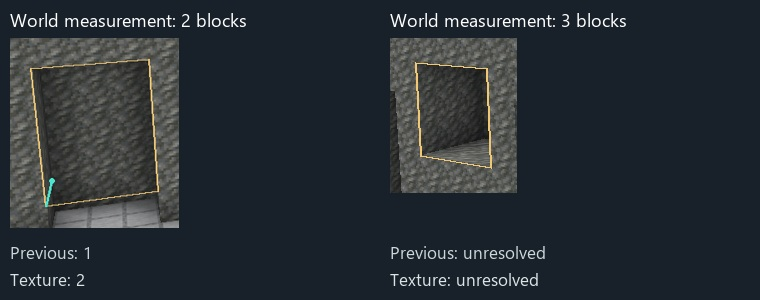

# Finding the back corner in an angled opening

These experiments take one image. The oblique pavement solver estimates a camera and rectifies the wall. All five methods receive the same proposed entrance rims and share a final check against the texture spacing of flat inlays. Ground-truth positions enter the scorer after inference. This comparison tests a change to depth measurement; it also counts actual recesses missed by the entrance finder.

| Method | How it estimates depth |
| --- | --- |
| Previous oblique solver | Project alternative back rims toward the depth vanishing point and check the edge evidence. Calibrate the wall texture around the opening to reject flush inlays. |
| Snapped edges | Jointly snap opposite entrance edges, allowing for the local block spacing. Clip each projected back edge to its visible portion inside the opening. Reward a connecting diagonal that terminates at the back corner. |
| Texture spacing | Try a flush surface and integer setbacks of up to eight blocks. Measure repetition at the predicted back-wall spacing and compare shifted texture patterns against nearby wall samples. Interior repetition can support a different back material. A weak or ambiguous score leaves depth unresolved. |
| Agreement | Require the edge and texture methods to return the same positive depth. |
| Two votes | Require agreement from at least two of the previous solver, snapped edges, and texture. |

## Held-out viewpoints

On development views, the four new rules tied at ten exact depths out of twelve. The predeclared ordering selected snapped edges. Eight new in-game frames at −21° and +31° then compared the frozen methods on the same original and rearranged structures, plus flat and shaded controls. The following counts cover 22 observations of genuine recesses across the two positive walls. All methods returned zero false recesses on the controls.

| Method | Exact | Wrong depth | Unresolved or missed |
| --- | ---: | ---: | ---: |
| Previous oblique solver | 10 | 3 | 9 |
| Snapped edges | 9 | 0 | 13 |
| Texture spacing | 15 | 0 | 7 |
| Agreement | 9 | 0 | 13 |
| Two votes | 12 | 0 | 10 |

The entrance finder proposed 17 of the 22 genuine recess observations. Of the seven unresolved by the texture method, five were missing before any back-corner estimator ran. Texture spacing led this comparison after the results were examined. The development tie breaker selected edges. [Development scores](../tests/results/back-corners-dev-26.3.json) · [Fresh angles](../tests/results/back-corners-fresh-26.3.json) · [Previously seen ±26° views](../tests/results/back-corners-previous-26.3.json) · [Fresh camera audit](../tests/results/back-corner-cameras-26.3.json)



Gold marks the proposed entrance. Teal shows the corner displacement implied by the texture estimate. The example on the left is a two-block recess. The right opening is three blocks deep and remained unresolved.

### New wall with different back materials

After the viewpoint comparison, the frozen methods were applied to a new tuff wall with smooth stone, cobblestone, diorite, cobbled deepslate and andesite at the backs of its openings. A sixth location was a flush polished-deepslate inlay. On the two ±28° captures, texture spacing recovered five of ten genuine recess observations, snapped edges recovered four, and the previous solver recovered three. All three abstained on the remainder and assigned no depth to the flush inlay. This is one new wall seen twice. [Per-opening results](../tests/results/back-corners-mixed-26.3.json)

## Run on one screenshot

```console
python -m benchmark.back_corners --image INPUT.png --out result.json
```

Each candidate contains the method-specific results, the texture score profile and the snapped-edge evidence. A zero-depth texture hypothesis indicates support for a flush surface. The positive-depth comparison counts a flush decision or abstention as no recess prediction. If the camera solver cannot calibrate a wall, the report gives its reason and no candidates. This happened on the original shader workshop image.

To reproduce the comparison, use `benchmark.corner_cases` to prepare separate development and evaluation caches. Supply the fixture root and output cache directory, and add `--controls` when appending flat fixtures. The camera manifest identifies the split and views. Image arrays and candidate geometry are stored separately from evaluation labels.

```console
python -m benchmark.back_corners --cache DEV_CACHE --out dev.json
python -m benchmark.back_corners --cache FRESH_CACHE --selection dev.json --out fresh.json
```

These are measurement experiments. The public build's frontal recess exporter uses a different call path. [Architecture and enabled modes](../ARCHITECTURE.md)
