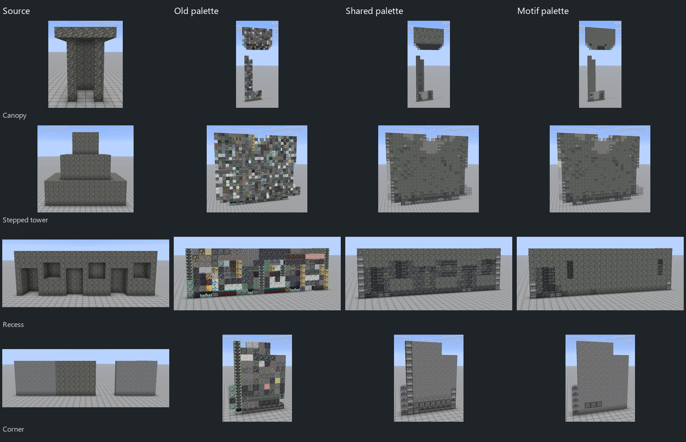
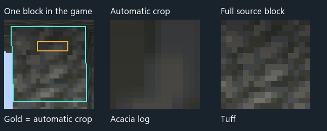

# Diagnosing the gallery palette

The four front views use the same predicted coordinates before and after material matching. Each gallery column was built and photographed in a fresh Java 26.3 world. A verification pass read back all 1,182 placements in each revised column.



## Why the older export looked multicolored

The canopy, tower and recessed wall use tuff throughout. The paired corner adds andesite. The old matcher treated every proposed quadrilateral as a whole texture. In the canopy, a typical proposal centered on a visible front face measured only 38% of its actual width and 13% of its height. Resampling that fragment to 16 × 16 exaggerated individual markings. A per-candidate exposure adjustment also allowed unlikely colors to compete. At accurate projected face corners the same matcher recovered 528 out of 528 visible south faces. The largest error occurred before material identification.



## Material options

The public build command accepts `--match-appearance local|shared|motif|adaptive|context` with a version-matched rendered library.

- **Local** compares luminance and red–green and blue–green color distributions to calibrated rendered faces. Dark flecks in a gray stone remain distinguishable from blue or orange flecks with the same average brightness.
- **Shared** lets cells on a plane reuse materials. An additional material must explain enough color variation to justify adding it. This gave the closest rendered colors on the four gallery frames.
- **Motif** also searches for distinctive 7 × 7 texel patterns at 19 scales and different offsets within a native 16 × 16 sprite. Agreement at several sample positions provides evidence for the same material nearby. Weak evidence falls back to the shared palette. This recovered the most correct block IDs among the three in-game gallery comparisons.
- **Adaptive** checks spatial agreement with the winning whole-face rendered exemplar. It uses the exposure matcher where the grid appears aligned, and the motif matcher elsewhere. Each exported match records which method was used.
- **Context** checks for masonry across several faces and preserves a whole-face texture match when it explains the pattern. It uses the shared palette and exposure-adjusted rendered faces where neighborhood evidence is weak.

| Method on the four front views | Correct block IDs / 1,479 | Mean in-game RGB channel error, 0–255 |
| --- | ---: | ---: |
| Previous whole-face matcher with exposure | 36 | 25.79 |
| Shared palette | 876 | 5.35 |
| Repeated atlas motifs and shared palette | 1,147 | 7.91 |

These are diagnostic scores on previously seen views. Each observation is a proposed crop with at least 20 of 25 camera rays hitting the same known material. Coordinates can overlap. The color comparison samples corresponding source and exported faces. Geometric openings, missing depth and cast shadows still affect the result. [Crop scores](../tests/results/gallery-color-26.3.json) · [Deduplicated placement color measurements](../tests/results/live-palette-color-26.3.json)

On four additional oblique development views of other buildings, ID recovery was 97/1,479 for exposure, 745/1,479 for shared palette and 847/1,479 for motifs. The oblique canopy regressed from four correct IDs to one out of 122. The automatic grid and material results remain sensitive to viewpoint. [Oblique view scores](../tests/results/oblique-materials-26.3.json)

Adaptive routing recovered 1,144/1,479 IDs on the four gallery views and 851/1,479 on the four oblique views. On the independent cropped repair wall it used the whole-face matcher on all 36 cells and recovered 34 IDs. The separate routing control with a shared-color fallback preserved all 411 correct IDs on the 417-face registry test. Small aligned panels still slipped from 351 to 347 correct out of 886 in that control. [Adaptive front-view results](../tests/results/front-materials-26.3.json) · [Routing controls](../tests/results/appearance-controls-26.3.json)

## Reproduce

### Matching mortar across block faces

```console
python reconstruct.py build IMAGE --geometry GRID --atlas CALIBRATION/atlas --library CALIBRATION/face_textures/softened-library.npz --match-appearance context --out OUTPUT
```

The detector straightens each wall plane and finds local rectangles of occupied cells with similar color and texture. At least four repeating courses and staggered vertical joints must support a brick proposal. It compares the patch against eligible opaque atlas faces at several scales and offsets. The color comparison allows bounded exposure and tint changes. A supported neutral-patch estimate corrects the masonry comparison. A strong shifted whole-face match to a competing texture can still overrule the masonry proposal.

The result records `material_method` per observed face. A `masonry` match includes its supporting rectangle in plane-grid units, course height, estimated brick width and correlation with the atlas. A `shifted face` match includes its atlas correlation. A reported margin measures separation between candidates within that route. Rows of timber planks can resemble masonry, especially when the block grid is offset. The tower that motivated this mode was used during development.

On a separate 240-face Java 26.3 wall with known placements and aligned crops, context and the exposure matcher each recovered 234 exact IDs. Shared appearance recovered 187. Context used its face-level fallback throughout that wall. A second check used an oblique, JPEG-compressed composite of captured materials with aligned and offset crops. Context identified 173 of 221 brick-family observations and mislabeled 61 of 419 non-brick observations as brick. All 61 were planks. Exposure identified 149 of 221 brick observations and mislabeled eight non-bricks. These results support selecting context for mortar recognition in difficult crops while keeping exposure available for accurate face grids.

### Gallery comparisons

After creating the geometry fixtures and versioned calibration library, reuse one geometry JSON for all material comparisons. Set IMAGE, GRID, CALIBRATION and OUTPUT for the desired view.

```console
python reconstruct.py build IMAGE --geometry GRID --atlas CALIBRATION/atlas --library CALIBRATION/face_textures/softened-library.npz --match-appearance motif --out OUTPUT
python reconstruct.py verify-build OUTPUT --version 26.3 --out VERIFY
python -m benchmark.oblique_materials --fixture MAIN --calibration CALIBRATION --out OBLIQUE
```

The gallery scoring and live rendering comparisons accept paths to each variant. See `python -m benchmark.color_gallery --help`, `python -m benchmark.live_color_gallery --help` and `python -m benchmark.appearance_controls --help`.
