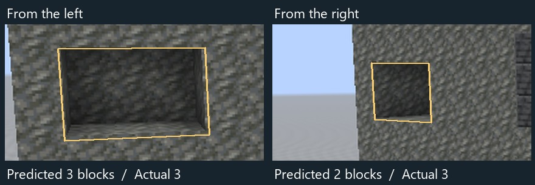

# How experimental opening measurements are chosen

Run `python reconstruct.py inspect-openings image.jpg --out review` to get `review.png` and `openings.json`. Each run loads the same [entrance policy](entrance-policy.json). A plain build uses baseline geometry. The opt-in `remap` build can place near-frontal recesses. This oblique inspector only produces measurements and outlines for review.

## How we know on a test wall

We build a wall with specified opening positions and depths, capture it in Minecraft, and verify the placed blocks. Each test also includes a flat dark inlay and a physically shaded flat wall captured at the same angles. The finder receives only the image. The scorer projects the known opening corners with the recorded camera pose, pairs proposals to truth one-to-one by descending overlap, and requires intersection over union of at least 0.50. It counts the rim and the depth separately. A positive depth assigned to a flat or unmatched location counts as a false recess.

The first comparison used previously inspected scenes as development data, including older benchmark images originally named “test.” We ranked settings by exact depths minus wrong depths minus twice the false recesses, breaking ties by localized rims and then fewer other proposals. Local-contrast regions won on those images. We then evaluated that choice on an irregular new wall with seven recesses, stacked openings, varied back materials and a flush inlay. The development winner lost ground and produced false recesses.

That first evaluation informed one follow-up. Preserve every original rim and its measured depth. Consider an extra outline only if the local-contrast finder and the hard-edge finder agree (overlap ≥0.55) and it overlaps each incumbent rim by less than 0.35. We froze this rule and tested a second new wall with different geometry, back materials and viewpoints. Promotion required extra exact depths on at least one new layout, no loss of exact depths on either, and no increase in wrong depths or false recesses on either. The challenger tied the incumbent on both. Extra outlines with this agreement can appear in pink for review. They carry no depth.

| Rim finder | Development, exact / 34 | First new wall, exact / 14 | Second new wall, exact / 14 | False recesses, first / second |
| --- | ---: | ---: | ---: | ---: |
| Original dark regions | 25 | 9 | 10 | 0 / 0 |
| Local contrast and lintels | 30 | 8 | 10 | 2 / 1 |
| Hard edges and jambs | 26 | 8 | 7 | 0 / 0 |
| Union, local regions first | 30 | 8 | 10 | 2 / 1 |
| Original plus corroborated additions | 28 | 9 | 10 | 0 / 0 |

Each new layout contributes seven real openings viewed twice. Together the original finder localized 26 of 28 observations, returned 19 exact positive depths and three wrong depths, and supplied no positive depth for six. These are two layouts from vanilla 26.3 at clear noon. The study does not establish a success rate on arbitrary shader images. [Development](../tests/results/entrances-dev-26.3.json) · [First evaluation](../tests/results/entrances-holdout-26.3.json) · [Confirmation](../tests/results/entrances-confirm-26.3.json) · [First world checks](../tests/results/entrance-world-holdout-26.3.json) · [Confirmation world checks](../tests/results/entrance-world-confirm-26.3.json)

## How a decision works on your screenshot

1. **Measure perspective.** Use two families of repeating pavement lines to estimate camera directions and scale. Project the facade to a rectangle. If the ground grid or wall cannot be established, return the reason and leave depth unknown. The original waterfront screenshot returned `no stable pavement calibration`.
2. **Find a rim.** The incumbent groups neighboring grid cells darker than their row and proposes sufficiently filled rectangles. A separate local-contrast method looks for transitions below lintels. A hard-edge method traces long top edges and their two sides. These last two methods can propose extra review outlines.
3. **Compare possible backs.** Measure one-block texture repetition horizontally and vertically just outside the opening. If both measurements succeed, project depths from zero through eight blocks, stopping when too little of the back remains visible. At each scale compare repeating interior detail with itself and with texture patches from the surrounding wall. Zero means flush.
4. **Report what the image supports.** Require a correlation score above 0.63 and a lead above 0.055 over the next depth. Reject a proposed recess when interior texture repeats more strongly at the facade scale under the independent front-plane check. The JSON includes the available spacing measurements, score, margin, decision and reason. A correlation score measures pattern agreement. Converting it into a probability of correctness would require additional calibration.

In the example below both views passed. The opening is three blocks deep. The left view measured three (score 0.942, margin 0.348). The right view measured two (score 0.703, margin 0.357). Even a substantial lead over the alternatives can accompany a wrong depth.



## Reproduce the decision

Generate each positive fixture with `python -m benchmark.entrance_fixture --variant holdout --jar CLIENT_JAR --out FIRST_POS` or `--variant confirmation`. For the flat dark-inlay and physical-shade scenes from the [control fixture](RECESSES.md), stage the same camera angles using `python -m benchmark.rim_viewpoints --source CONTROLS --buildings dark-inlay physical-shade --angles -31 29 --out FIRST_CONTROLS`. Use `-24 33` for the confirmation. Run `python -m runtime.capture capture --version 26.3 --run DIRECTORY` on each staged directory, then `python -m benchmark.recess_control --out DIRECTORY --audit`.

```console
python -m benchmark.entrance_trials MAIN CONTROLS --extra-dev PREVIOUS_ORIGINAL PREVIOUS_POSITIVE PREVIOUS_CONTROLS --split dev --policy dev-policy.json --out dev.json
python -m benchmark.entrance_trials FIRST_POS FIRST_CONTROLS --split test --policy dev-policy.json --out first.json
python -m benchmark.entrance_trials SECOND_POS SECOND_CONTROLS --split test --policy tests/results/entrances-confirm-candidate.json --out second.json
python -m benchmark.entrance_decision --candidate tests/results/entrances-confirm-candidate.json --validation first.json --confirmation second.json --out decision.json
```

Each trial records all candidates for every method. The report's `selected` field records the nominee for that evaluation. The last command compares the frozen challenger with the incumbent and writes the resulting operational policy. It can also be run directly against the two checked-in evaluation reports.
