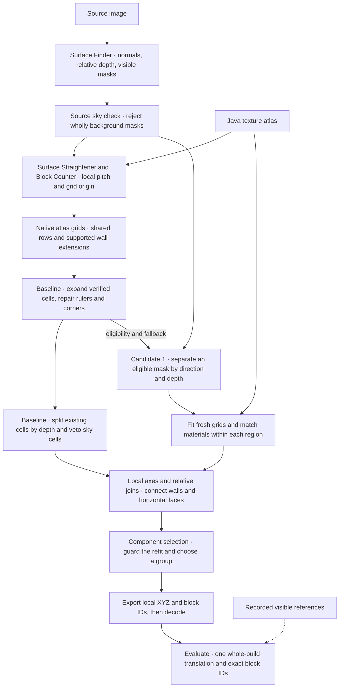

# Floating reconstruction pipeline

Expanded Split-Border uses the geometry visible in a source image to build local block grids. It joins surfaces using their visible contacts and exports the selected group at one arbitrary origin. The recorded camera and world supply scoring and diagnostics. Unseen geometry stays unknown.

## Current Expanded Split-Border path

The [single-image build](../README.md#run-floating) and [Front 100 replay](FLOATING_SHARED_DATASETS.md#replay-front-100) share the Baseline path in the diagram below. The method preserves the archived rules and thresholds. It uses the source image for every mask, grid, texture match and relative placement decision. Inspect `source-handoff`, `charts.json`, `oriented-charts.json`, `decisions.json`, `assembly.json` and the exported Java pack together. [Architecture](../ARCHITECTURE.md)

1. Start with the native source masks and the initial surface counts. Trace a seed through native atlas measurements and texture witnesses, the shared-row junctions that help register its grid, and its connected-wall extensions.
2. Check the recovered face extent and material ranking where expansion resamples full unit faces. The large-chart contraction guard requires at least 256 expanded cells and a supported alternative with at most one quarter as many. The edge-aligned replacement ruler needs peer-scale and repeat evidence. Corner-pair repair rechecks the shared transform against the counted junction.
3. For eligible charts, the depth pass groups existing cells by the native depth region at each projected center and preserves their ruler. The border-sky pass samples a 9 × 9 lattice in each projected footprint and vetoes export when more than 40 of the 81 samples land in border-connected sky. The complete measured charts still participate in joins and group ranking.
4. Inspect orientation and relative joins before judging the size of the export. The wall solver compares projected edges and coplanar grids. An observed horizontal chart enters assembly if two perpendicular wall rims support its grid and the resampled cells join adjoining walls. The assembly selects one connected group and serializes its permitted cells and IDs. At scoring time, unresolved nonempty exports are charged as misses and extras. Empty exports count as misses.

## Archived original V1 comparison

The chart includes the [archived original V1 comparison](https://github.com/jeremyepling/minecraft-image-reconstruction/blob/01d51c0/benchmark/reviews/floating-visible-builds-v1-01/README.md). Its **Baseline** is Expanded Split-Border. **Candidate 1** is the guarded depth-first refit. It tests fresh per-region grids and keeps the Baseline export if source evidence cannot support the joins.

See the [baseline and historical comparisons](FLOATING_BRANCH.md) for each method's measured scope. The former pavement-based build is documented in the [floor-and-camera archive](https://github.com/jeremyepling/minecraft-image-reconstruction/blob/e3bd220188f224a0a6cf2841c8f495fd0ac9d090/ARCHITECTURE.md).



Candidate 1 reuses a source quadrilateral or fits its own line tangents. Fresh atlas fits start without the parent grid cells or homography. The original count pass still runs for eligibility and inherited cells. The branch does not yet replace that entire pass. A separated mask can establish depth ordering while still lacking a measured offset in blocks. A chart with a verified local grid can therefore remain outside the selected group.

| Stage | What it does | What a saved report can measure |
| --- | --- | --- |
| Surface Finder and source sky check | MoGe-2 estimates facing. Depth Anything V2 estimates relative depth. The Finder saves outlines and masked crops. A border-connected sky test rejects wholly background masks before counting. | Kept / proposed masks from `build-manifest.json`. Native mask accuracy needs a separate visible-reference measurement. |
| Surface Straightener and Block Counter | Form a face-on sample, look for repetitions and atlas agreement, and estimate block dimensions and grid origin. Shared rows and native atlas matches can extend supported grids. | Surfaces with both dimensions / surfaces sent to counting from `counts.json`. A returned dimension still needs an accuracy check. |
| Candidate depth-first refit | Split eligible walls into source-supported pieces, test independent rulers, and assign materials to supported cells. Keep inherited grid cells where the fresh fit does not qualify. | Parts with a supported fit offered / parts tried. Local fit witnesses live in the saved depth audit. |
| Local axes, joins and placement | Infer signed grid axes from estimated directions. Connect shared corners and compatible coplanar grids. Horizontal charts can enter during assembly. The refit keeps sibling depth regions from rejoining just because their textures agree. | Views with oriented charts and selected / oriented charts. `score.json` records joins, vetoes, conflicts and selected origins. |
| Component selection | Select a connected group. The guarded refit can retain the previous export when a fresh grid fails the join or component check. | Export size / cell count summed across available components. A discarded component can overlap other components in local space. |
| Materials and decoded export | Atlas matches and fallbacks supply block IDs before writing the Java pack. A later placement can still drop a correctly identified local face. | Exact IDs among correct positions, both placement F1s, both position-plus-ID F1s and correct, missed and extra blocks. Report unresolved compass orientation and empty exports separately. |

## Generate the loss report

Read saved score receipts, source handoffs and depth audit rows with `benchmark.floating_stage_report`. It generates a Markdown report and a machine-readable stage receipt. It flags changed packs, dropped source charts, disjoint selected groups and the largest placement regressions. It uses no model inference, world capture or pack rebuild. Saved end scores remain available when optional source-stage receipts are missing.

For the original 144-view V1 replay on this PC:

```powershell
python -m benchmark.floating_stage_report ../floating-visible-builds-v1/benchmark/reviews/floating-visible-builds-v1-01/conditions.json.gz --run-root ../floating-visible-builds-v1/runs/floating-v1 --cohort-label "Original Visible Builds V1 replay" --visible-available 144 --baseline-name "Expanded split-border" --candidate-name "Guarded depth-first refit" --out runs/v1-stage-report
```

The [generated V1 example](reviews/floating-stage-report-01/report.md) is a replay of saved results. For a pre-grid comparison, pass its `conditions.json.gz` and the saved arm keys using `--baseline` and repeatable `--candidate` flags. The pre-grid archive needs the original `score.json` receipts for orientation and assembly. Set `--visible-available` to the size of the named cohort. Decorative is reported in its own table when included in the input. The stage figures describe the saved opportunities at each handoff. A comparison can count more correctly placed blocks while losing an entire previously selected group, as [Arcade 1](reviews/floating-stage-report-01/report.md#component-changes) shows.

## Perfect from this stage

The [Perfect Stage viewer](reviews/floating-perfect-stage-01/perfect-stage.html) pairs the source-only score with the final score when a visible reference answer enters at one handoff. Pick strict or facade placement or position + material F1. Expand a row for individual views. Use the held-out split to compare interventions on the same views. The companion [report and replay instructions](reviews/floating-perfect-stage-01/README.md) record the tested views, the exact input supplied, and which downstream stages still estimate their inputs.

Pass `--perfect` and optionally `--perfect-inputs` to the stage report to add the table, per-view data and viewer from saved diagnostics. The report verifies the comparison, anchor arm, source pixels, reference labels, pack and matched scores. A report-only or layout change can reuse the data. A different intervention, input or downstream behavior requires refreshing the affected replay. The heading chooser, material substitution and writer check answer different questions and their gains overlap.

## Generate the visual review queue

Run `benchmark.floating_visual_review` after scoring. It selects large gains, gross losses and dropped components from the saved comparison. It verifies the source and decoded exports, then traces changes to native visible face pixels. The [V1 example](reviews/floating-auto-review-queue-01/queue.md) includes zoomable overlays and paired placement and material counts. Extra coordinates are charged in the counts. An unresolved orientation stays visible as a failure even when a registered overlay is unavailable.

```powershell
$release = '../floating-visible-builds-v1/benchmark/reviews/floating-visible-builds-v1-01'
$frames = 'runs/v1-release/data'
python -m benchmark.floating_visual_review runs/perfect-stage-report/report.json "$release/conditions.json.gz" --run-root ../floating-visible-builds-v1/runs/floating-v1 --frame-root $frames --out runs/visual-review
```

Use `--shard` with an archived frame ZIP instead of the extracted frame root. Decorative review is opt-in with `--decorative` and also needs its own scored inputs.

## Resume the archived V1 benchmark

Use the optional [verified checkpoint replay](reviews/floating-selective-replay-01/README.md) to rerun the original V1 comparison. The runner reuses verified upstream results and reruns the first affected stage and its consumers. For a reporting-only edit, regenerate the report directly from saved receipts. The checkpoint adapter currently targets the original 144-view V1 replay. Floating Combined V1 continues to use its existing evaluation entry point.

For a replay-only worktree, the [sparse checkout and shared fixtures pilot](FLOATING_WORKTREE_PILOT.md) gives the tested Git patterns, input layout and launcher. A review can keep its own archived artifacts and use the same source captures through its explicit input paths.
