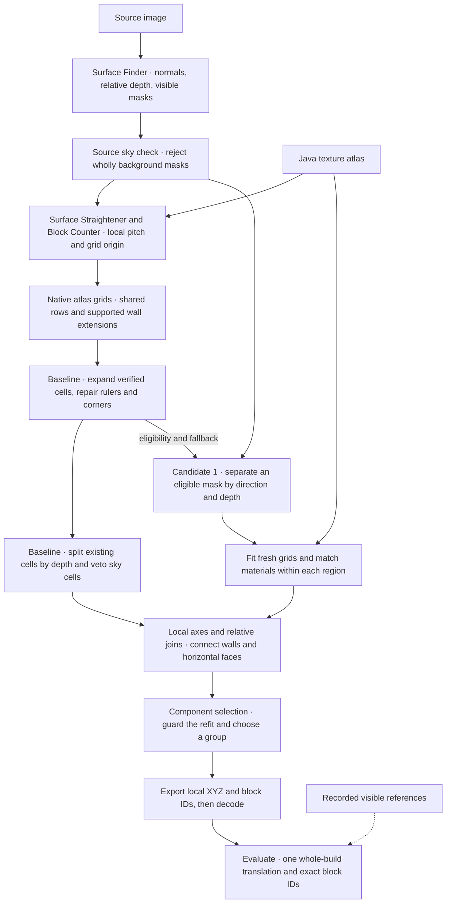

# Floating reconstruction pipeline

Floating uses the geometry visible in a source image to build a local block grid. It joins surfaces using their visible contacts and places the complete build at one arbitrary origin. The recorded camera and world supply scoring and diagnostics. Unseen geometry stays unknown.

**Baseline** is the frozen expanded split-border method. Its pink depth check separates existing chart cells while keeping their ruler. **Candidate 1** is the guarded depth-first refit used in the [V1 comparison](https://github.com/jeremyepling/minecraft-image-reconstruction/blob/01d51c0/benchmark/reviews/floating-visible-builds-v1-01/README.md). It tests fresh per-region grids and keeps the Baseline export if the source evidence cannot support the joins. The sparse connected-atlas runtime is an available historical control. The ordinary exterior command has its own [pavement-based architecture](../ARCHITECTURE.md).



Candidate 1 reuses a source quadrilateral or fits its own line tangents. Fresh atlas fits start without the parent grid cells or homography. The original count pass still runs for eligibility and inherited cells. The branch does not yet replace that entire pass. A separated mask can establish depth ordering while still lacking a measured offset in blocks. A chart with a verified local grid can therefore remain outside the selected group.

| Stage | What it does | What a saved report can measure |
| --- | --- | --- |
| Surface Finder and source sky check | MoGe-2 estimates facing. Depth Anything V2 estimates relative depth. The Finder saves outlines and masked crops. A border-connected sky test rejects wholly background masks before counting. | Kept / proposed masks from `build-manifest.json`. Native mask accuracy needs a separate visible-reference measurement. |
| Surface Straightener and Block Counter | Form a face-on sample, look for repetitions and atlas agreement, and estimate block dimensions and grid origin. Shared rows and native atlas matches can extend supported grids. | Surfaces with both dimensions / surfaces sent to counting from `counts.json`. A returned dimension still needs an accuracy check. |
| Candidate depth-first refit | Split eligible walls into source-supported pieces, test independent rulers, and assign materials to supported cells. Keep inherited grid cells where the fresh fit does not qualify. | Parts with a supported fit offered / parts tried. Local fit witnesses live in the saved depth audit. |
| Local axes, joins and placement | Infer signed grid axes from estimated directions. Connect shared corners and compatible coplanar grids. Horizontal charts can enter during assembly. The refit keeps sibling depth regions from rejoining just because their textures agree. | Views with oriented charts and selected / oriented charts. `score.json` records joins, vetoes, conflicts and selected origins. |
| Component selection | Select a connected group. The guarded refit can retain the previous export when a fresh grid fails the join or component check. | Export size / cell count summed across available components. A discarded component can overlap other components in local space. |
| Materials and decoded export | Atlas matches and fallbacks supply block IDs before writing the Java pack. A later placement can still drop a correctly identified local face. | Exact IDs among correct positions, both placement F1s, both position-plus-ID F1s and correct, missed and extra blocks. Report unresolved compass orientation and empty exports separately. |

## Generate the loss report

Read saved score receipts, source handoffs and depth audit rows with `benchmark.floating_stage_report`. It generates a Markdown report and a machine-readable stage receipt. It flags changed packs, dropped source charts, disjoint selected groups and the largest placement regressions. It uses no model inference, world capture or pack rebuild. Saved end scores remain available when optional source-stage receipts are missing.

For the original 144-view V1 replay on this PC:

```powershell
python -m benchmark.floating_stage_report ../floating-visible-builds-v1/benchmark/reviews/floating-visible-builds-v1-01/conditions.json.gz --run-root ../floating-visible-builds-v1/runs/floating-v1 --cohort-label "Original Visible Builds V1 replay" --visible-available 144 --baseline-name "Expanded split-border" --candidate-name "Guarded depth-first refit" --out runs/v1-stage-report
```

The [generated V1 example](reviews/floating-stage-report-01/report.md) is a replay of saved results. For a pre-grid comparison, pass its `conditions.json.gz` and the saved arm keys using `--baseline` and repeatable `--candidate` flags. The pre-grid archive needs the original `score.json` receipts for orientation and assembly. Set `--visible-available` to the size of the named cohort. Decorative is reported in its own table when included in the input. The stage figures describe the saved opportunities at each handoff. A comparison can count more correctly placed blocks while losing an entire previously selected group, as [Arcade 1](reviews/floating-stage-report-01/report.md#component-changes) shows.
