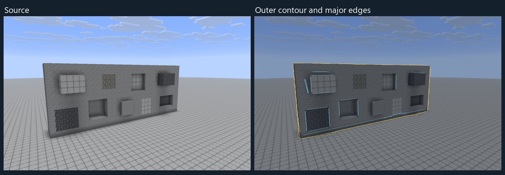

# Tracing the visible form before estimating relief

The command below documents the line-form prototype at its archived revision. The `benchmark.line_form_trials` commands at the end replay the experiment. [CLI snapshot at ca0a60c](https://github.com/jeremyepling/minecraft-image-reconstruction/tree/ca0a60c)

```console
python reconstruct.py inspect-form IMAGE --out REVIEW
```

`outline.png` draws the estimated visible contour in gold and major interior lines in blue. `mask.png` gives the filled silhouette. `relief.png` draws candidate faces on the source and marks accepted diagonal connectors in white. `form.json` records segment endpoints, scale, strength and role, face corners, competing directions and the evidence for a label. All coordinates are source-image pixels after EXIF orientation. The command runs independently of the material atlas, ground grid, metric depth solver and exporter.



## Call order

1. **Find whole-frame lines.** At two resolutions, form an RGB gradient structure tensor and find local edge ridges. A direction-restricted Hough vote groups pixels onto straight lines. Split disjoint spans and refit each segment to its supporting pixels. Long segments get priority. Duplicate suppression and a 720-segment limit bound work on highly textured scenes.
2. **Outline the structure.** Label foreground and background using scanline margin colors and local detail. At preview scale, exchange votes between neighboring pixels. A strong vertical line reduces the cost of putting different labels on its left and right. A horizontal line does the same above and below. Keep substantial connected regions, preserving gaps. A segment separating foreground and background belongs to the outline. The mask is a visible footprint, not a recovered 3D solid.
3. **Find smaller shapes.** Seek two horizontal-world vanishing directions in the global line set. Refine segments within the estimated silhouette, and assemble quadrilaterals from supported line intersections. Two terminating arms can start an incomplete quadrilateral if the image supports the opposite sides.
4. **Read the corners.** Trace possible diagonal segments from each corner. Take parallel samples on both sides of a segment and subtract the gradual luminance change measured farther out. Look for a consistent contrast step along the diagonal, two edges at its far end and weakening along its continuation. Compare rays running inside the face with rays leaving it. An outward decision needs support at another corner. If both explanations are weak, matching interior and exterior repetition along two axes can support a flat surface. Other cases stay unknown. The method assumes roughly upright rectangular architecture and reports no block count.

## Evaluation on Minecraft Java 26.3

The outline test used left and right views of six structures in each split. For each existing family we took the first building in manifest order, then added one new signed-relief wall. Both new walls have nine panels, three of each kind. The evaluation wall has a different arrangement, material and camera headings. Live readbacks and saved-world checks establish the reference. The detector receives pixels. The scorer projects the actual exposed faces afterward.

| Method | Development silhouette IoU | Evaluation silhouette IoU | Evaluation boundary F1 |
| --- | ---: | ---: | ---: |
| Previous foreground extractor | .9355 | .9369 | .8440 |
| New grouping with the line cues disabled | .9356 | .9409 | .8471 |
| Full line-first outline | .9432 | .9461 | .8540 |

IoU measures the overlap of filled silhouettes. Boundary F1 measures contour precision and recall within two evaluation pixels at quarter resolution. The evaluation result is an equal-weight average over 12 views. The new method helped most on the recess, canopy and new signed-relief walls. Both stepped-tower views and the left adjacency-wall view scored lower than the previous extractor. The uploaded waterfront image has no reference geometry. Visual inspection shows the tower and deck edges, along with some cloud included above the roof and gaps in the light facade.

For local relief, matching requires at least 0.50 projected overlap with the actual opening or flush patch, or the visible cap of a protrusion. Each proposal and panel can match once. Each class occurs six times on the evaluation wall (three panels, two views).

| Actual panel | Correct line-first labels | Wrong labels | Unknown or missed | Correct previous inspector labels |
| --- | ---: | ---: | ---: | ---: |
| Recess | 5 | 1 | 0 | 1 |
| Flat | 2 | 2 | 2 | 2 |
| Protrusion | 3 | 0 | 3 | 0 |

The new path localized 17/18 panel observations. It also assigned inward or outward relief to **15 extra unmatched proposals**, with another 25 extra outlines left unknown. The previous opening inspector localized 8/18, made three correct categorical calls and proposed one extra flat patch. It has no protrusion output. The signed pass is useful for visual review but too prone to false relief for automatic placement.

On two further views of the entirely flat dark-inlay wall, the new method made **14 false relief calls** wholly inside the facade. On the physically shaded flat control it returned no eligible panels in the evaluated wall area. That scoring region excludes proposals overlapping the projected bounding box of the canopy. The shade control therefore provides no evidence of correct flat classifications there. [Development decisions](../tests/results/line-form-dev-26.3.json) · [Evaluation and controls](../tests/results/line-form-test-26.3.json) · [Development capture audit](../tests/results/line-form-world-dev-26.3.json) · [Evaluation capture audit](../tests/results/line-form-world-test-26.3.json)

## Reproduce

Generate `DEV` and `TEST` separately using `python -m benchmark.relief_fixture --split dev --out DEV` or `--split test --out TEST`. Capture each with `python -m runtime.capture capture --version 26.3 --run DIRECTORY`. Use the [building benchmark](README.md) for `MAIN` and the [angle-matched flat controls](ENTRANCES.md) for `FLAT_CONTROLS`.

```console
python -m benchmark.line_form_trials MAIN DEV --split dev --out dev.json
python -m benchmark.line_form_trials MAIN TEST --split test --flat-controls FLAT_CONTROLS --out test.json
```
