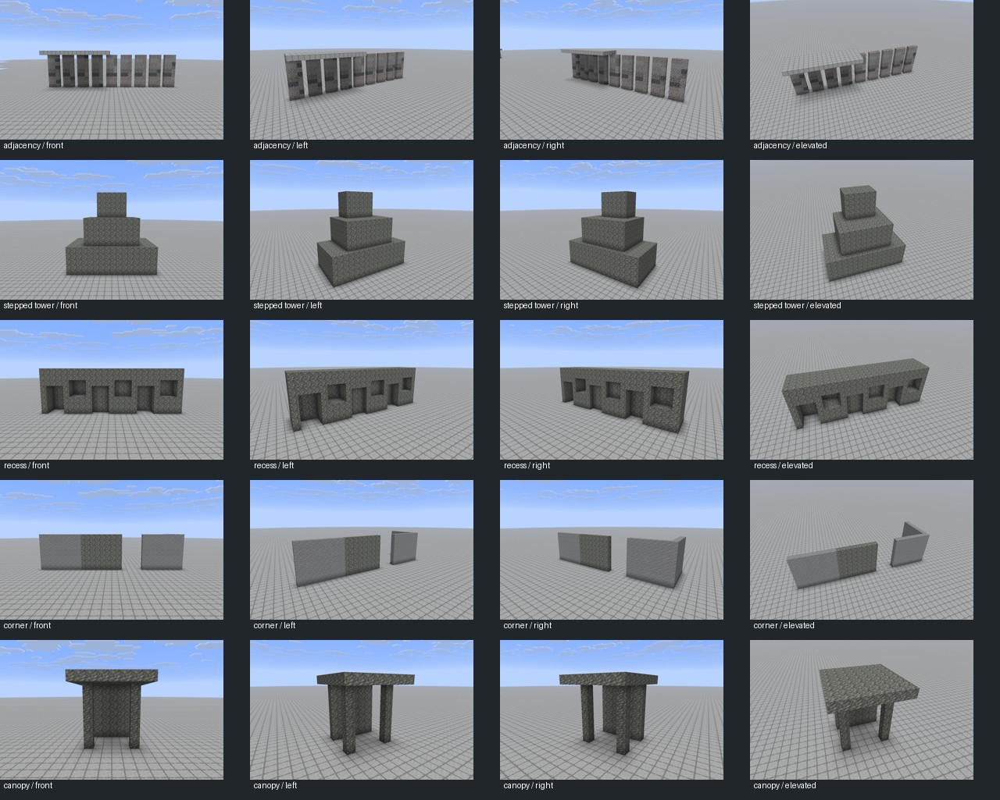
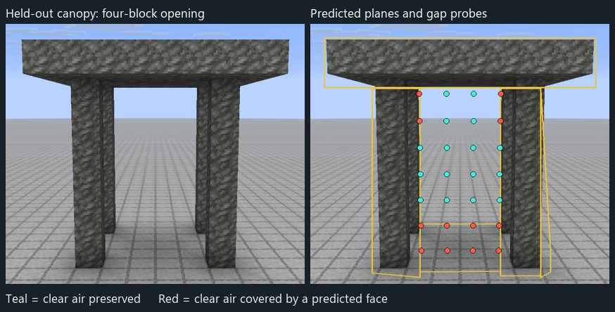

# Measuring a build from screenshots

This Java 26.3 benchmark uses 48 built fixtures and 216 Minecraft screenshots. Each building belongs to one split. Four camera views of that building stay together, and the predictor sees one frame at a time. Physical block coordinates and actual camera poses supply ground truth for scoring.



| Fixture family | What varies | What the held-out images show |
| --- | --- | --- |
| Canopy on pillars | Pillar gaps of 2, 4 or 6 blocks, canopy projections of 1, 2 or 4, with and without a rear wall | The experimental finder falsely covered 388 of 710 known clear sightlines, down from 607. In the front view of the open four-block gap it still covered 12 of 28 and returned no gap width. |
| Stepped tower | Setback and viewing direction, with a known 15-block overall height | The representative automatic export reached 22 blocks. A good outline still requires an accurate grid and a way to connect different elevations. |
| Recessed doors and windows | Recesses of 1, 2 or 3 blocks | Given visible endpoint locations, mean door and window width errors were 0.14 and 0.07 blocks across 12 measurements each. Window depth remained unresolved. |
| Flat seam and real corner | A material change on one plane beside an actual turn using one material | The experimental finder kept the flat seam coplanar in four views and found the turn in the one view exposing both faces. The other three views concealed it. |



## Geometry results

Development scoring gave each family equal weight and selected the method before the test run. The experimental method estimates foreground against the background, proposes planes and estimates block spacing from repeating texture-pixel transitions. Each automatic method also has a diagnostic run supplied with the true plane outline. This isolates grid error from errors in finding the surface.

| Held-out metric, 15 buildings and 60 images | Default | Experimental |
| --- | ---: | ---: |
| Mean silhouette intersection over union | 0.195 | 0.829 |
| Mean absolute width error, blocks | 42.69 | 19.40 |
| Mean absolute height error, blocks | 27.79 | 17.20 |
| Images with size estimates | 60/60 | 58/60 |

Size errors use the views with estimates. Providing true outlines lowered the experimental height error to 2.98 blocks. In a separate test supplying two image points, the method detected zero of 12 genuinely visible depth returns and produced one spurious return. The image-only export represents a front elevation. The evidence does not support assigning overhang or recess depth automatically. [Geometry scores](../tests/results/geometry-heldout-26.3.json) · [Depth visibility](../tests/results/depth-visibility.json)

## Material results

Allowing a bounded change in exposure improved identification on aligned faces from 1,628 to 1,999 out of 2,658. On the complete adjacency screenshots the default geometry plus exposure recovered 31 correct faces, while the experimental geometry plus exposure recovered six. Alignment is the limiting step on these walls. Both options remain available individually through `--geometry-method texel` and `--match-exposure`. [Texture results, conditions and reproduction commands](TEXTURES.md)

## Reproduce the geometry comparison

Run from the repository root with Python and the matching Java client JAR. Replace MAIN and OPEN with separate fresh run directories and SCORES with the output directory.

```console
python -m benchmark.fixtures --jar CLIENT_JAR --out MAIN
python -m benchmark.fixtures --jar CLIENT_JAR --out OPEN --open-only
python -m runtime.capture capture --version 26.3 --run MAIN
python -m runtime.capture capture --version 26.3 --run OPEN
python -m benchmark.planes MAIN --splits dev
python -m benchmark.planes OPEN --splits dev
python -m benchmark.geometry_benchmark MAIN OPEN --split dev --out SCORES
python -m benchmark.planes MAIN --splits test
python -m benchmark.planes OPEN --splits test
python -m benchmark.geometry_benchmark MAIN OPEN --split test --selection SCORES/selection.json --out SCORES
python -m benchmark.depth_visibility --roots MAIN OPEN --selection SCORES/selection.json --out SCORES/depth-visibility.json
```

The fixture generator records dimensions, placements, openings and viewpoints. The capture driver reads the placed blocks back from the game. Predictions and per-view scores are written alongside the runs. The additional small-frame and warm-shader captures use the adjacency panels in MAIN. [Capture setup](../runtime/README.md)

## Export verification

One held-out front view from each family went through the public build command into a fresh Java 26.3 world. All 1,182 exported blocks matched server readbacks. One unsupported falling block used its next-ranked stable material. All four exports recorded unresolved depth. [Source and reconstructed elevations](source-and-reconstructions.jpg) · [Expected sizes, export sizes and block counts](../tests/results/shape-public-builds-26.3.json)
