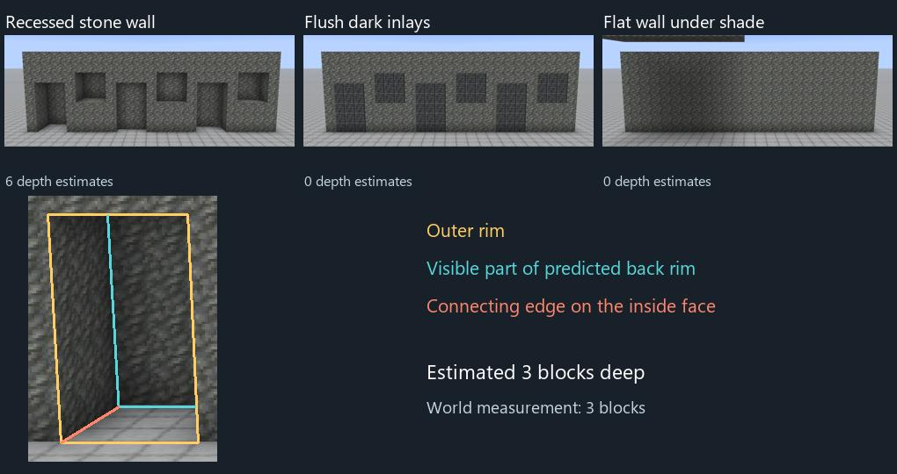
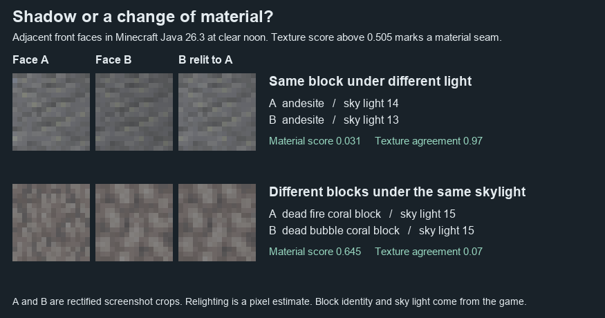
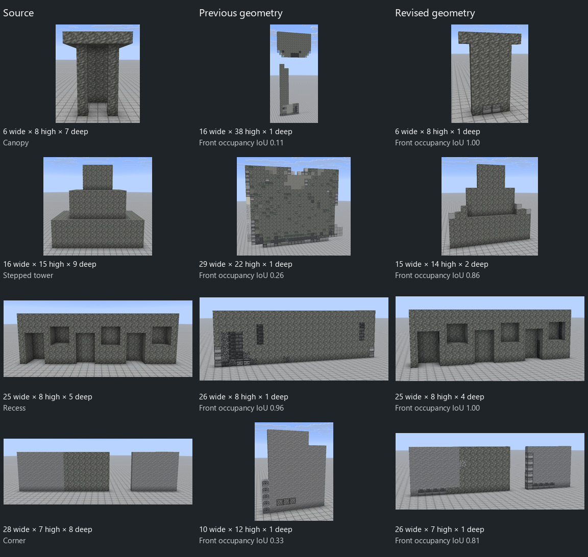

# Measuring a recess from one image



The geometry pass starts by estimating a common block lattice. It compares local repetitions of whole textures with the spacing of texture pixels and fits the lattice phase against silhouette boundaries. A near-frontal shot with repeating pavement in both margins can also supply a horizon, camera scale and perspective correction. The detector uses image pixels at inference. The scorer receives block locations and camera readbacks afterward.

## Testing whether a dark patch goes inward

A dark region on a rectified wall seeds an opening hypothesis. For each proposed integer depth from one to eight blocks, the solver projects a possible back rim toward the depth vanishing point. It measures image edges along the parts of two back-rim edges visible inside the opening and along the short angled edge joining outer and inner corners. Repeated texture on the wall supplies an independent scale and alignment check. A hypothesis needs support along the projected edges and a margin over competing depths. The solver can leave the depth unresolved.

The original test facade contains three doors and three windows. The frontal solver measured all six correctly. Since the development and test facades happened to share a depth ordering, a fresh world used the sequence **2, 0, 3, 1, 2, 1** across the wall. With the solver frozen, it measured each of the five real recesses correctly and proposed no opening at the flush position. Two separate zero-depth controls used six dark inlays and a physical canopy casting shade on a flat wall. Neither produced a positive frontal depth. The control materials, positions and skylight levels were checked in Minecraft Java 26.3. [Per-opening predictions](../tests/results/recess-geometry-26.3.json)

The public solver requires a reliable front view for this depth measurement. It abstained on the left, right and elevated captures. The original shader workshop screenshot lacks the visible pavement reference, and automatic foreground extraction reaches the frame edges. Its whole-building height and window depths remain unresolved with this method.

An experimental oblique solver estimates two ground-plane vanishing points, rectifies the wall, and repeats the projected-rim test. Across the left and right test views, six of twelve opening observations produced a depth and all six were correct. It also gave one flush dark inlay a depth of one block. Comparing repeated details inside that inlay did not remove the false positive. On that inlay the inferred block scale was off by about 5%, enough to make the flat texture repeat at the scale predicted for a one-block setback. The experiment is available for comparison and remains outside the build command. [Oblique experiment results](../tests/results/oblique-recess-26.3.json)

## Isolating lighting changes

A separate comparison takes two rectified face patches. It fits uniform brightness change, a smooth gradient, and a sharp step in log luminance. It compares hue and fine texture after accounting for lighting. Geometry output records ambiguous pairs, likely material changes and transitions consistent with lighting. Lighting evidence alone never sets a block depth. The fitted gain map is available for inspection.



On 4,104 labeled adjacent observations, balanced accuracy for detecting material boundaries rose from **77.5%** with luminance alone to **94.8%**. Among pairs with a skylight change, 169 of 189 same-material pairs stayed together and 170 of 171 real material changes remained distinct. This measures the lighting comparison with known face corners. The in-game data establishes block identity and light levels. The sharp-step model also has a synthetic test. [Lighting results](../tests/results/shadow-edges-26.3.json)

## Geometry results

Four scale/grid variants were compared by building family on the development split. The selected method used the shared lattice and pavement calibration where available. On the established 60-view test set, mean width error fell from **19.40 to 3.72 blocks**, and height error from **17.20 to 1.69 blocks**. The previous method returned 58 sizes, the new method 60. These are projected size estimates before recess and setback export. Silhouette overlap slipped from 0.829 to 0.806. Wrongly filled clear sightlines rose from 388 to 453 of 710. Requiring stronger foreground coverage in a cell also removed narrow pillars, so the export uses majority coverage. [Method selection](../tests/results/remap-selection-26.3.json) · [Geometry scores](../tests/results/remap-heldout-26.3.json) · [Occupancy thresholds](../tests/results/remap-occupancy-dev-26.3.json)



The live comparison uses the same four source screenshots and motif matcher as the previous gallery. The original and generated voxels are translated to common left, ground and front coordinates. All 612 placements matched their final in-game readbacks. The recessed facade reproduces the source width of 25 blocks and height of eight. Its 269 modeled voxels all occupy real source positions; hidden bulk is omitted. Mean front occupancy overlap over the four exports rose from 0.416 to 0.916, and full 3D overlap rose from 0.114 to 0.275. Full building thickness remains unknown for several examples, including the covered canopy and the corner. [In-game dimensions and occupancy](../tests/results/remap-live-26.3.json)

## Reproduce

Use the project root, the matching client JAR, and the main geometry fixture run from the [building benchmark](README.md).

```console
python reconstruct.py analyze IMAGE --geometry-method remap --out GRID
python reconstruct.py build IMAGE --geometry GRID/geometry.json --atlas CALIBRATION/atlas --library CALIBRATION/face_textures/softened-library.npz --match-appearance motif --out BUILD
python -m benchmark.recess_control --source MAIN --jar CLIENT_JAR --out CONTROLS
python -m benchmark.recess_control --source MAIN --jar CLIENT_JAR --out POSITIVE --positive-depths 2 0 3 1 2 1
python -m runtime.capture capture --version 26.3 --run CONTROLS
python -m runtime.capture capture --version 26.3 --run POSITIVE
python -m benchmark.recess_control --out CONTROLS --audit
python -m benchmark.recess_control --out POSITIVE --audit
python -m benchmark.recess_review --source MAIN --controls CONTROLS --positive POSITIVE --out RESULTS.json --image EVIDENCE.jpg
python -m benchmark.shadow_edges --help
```

In the generated geometry JSON, the first plane's `depth_evidence` contains candidate rims, visible connecting edges, depth decisions and calibration evidence. `appearance_boundaries` holds the independent lighting observations. `--geometry` reuses the measured surfaces and apertures for material matching.
