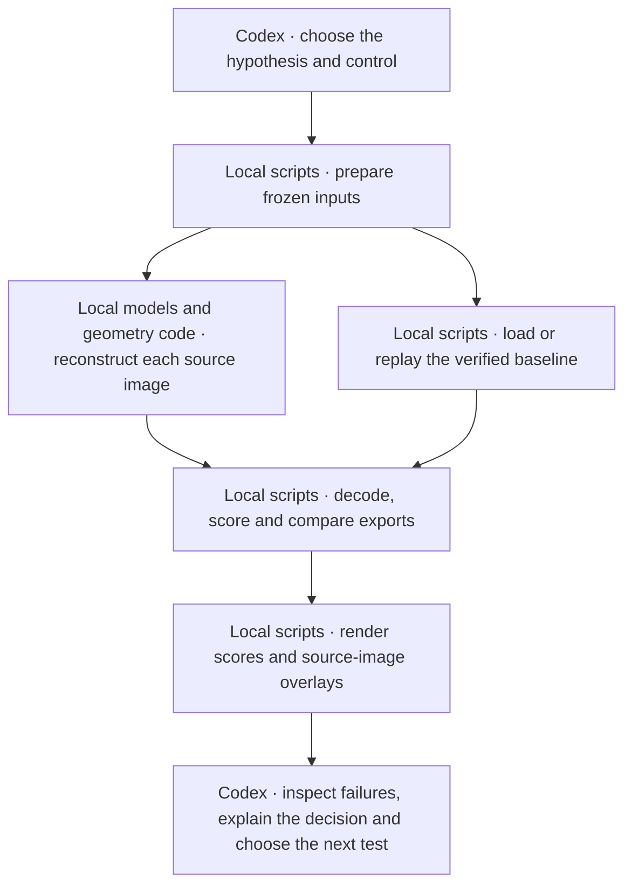

# Reviewing a reconstruction round

Start with the question Jeremy asked about the build. A score update can come straight from a scored release. A question about two missing blocks calls for tracing those two positions through the ordinary build.

## When a perfect-answer test earns its cost

Label each score with its dataset version, split and tested frame count. Lead with the fixed 104 trend and show Visible Builds v3 (144 new views) and Decorative Builds v1 (40 views) alongside it in every results summary. For each cohort give coverage, strict and facade placement F1, and strict and facade position-plus-ID F1. Identify development and held-out results separately. Mark an unmeasured cohort explicitly and date or identify the revision of any carried-forward score. Compare candidates on identical images within each cohort. Report paired lighting changes separately when measured. Report camera failures as their own outcome alongside overall placement. Give failed views and the visible misses on them, placement F1 on camera-supported views, and supported views that exported zero blocks. Preserve the per-image camera reason and atlas fallback reason. Keep every camera failure in the overall denominator.

For an expensive model, a low-scoring handoff, or a feedback rule, run a small paired diagnostic first. Choose the test that answers the decision Jeremy needs to make.

| Question | Test |
| --- | --- |
| Does the correct option exist among the proposals? | Keep the existing output as one option. Let a reference-only chooser select the best available alternative by the final placement or position-and-ID score. Report the gain, the remaining misses and the options considered. This is a ceiling only within that choice set. |
| Would correcting an earlier measurement actually help? | Replace just that stage's output with its visible reference answer. Rerun the ordinary downstream consumers and decode the build. Record both the change at the handoff and the change in final geometry, material, and overall F1. The output may improve, tie, or regress. |
| Is there an interaction? | If a correct answer is ignored or hurts, compare the adjacent handoffs alone and together. For example, give the counter a true chart with measured counts, then supply true counts on that same chart. Check which fields the placer actually reads. |
| Can the source image deliver the gain? | Fit the source-only challenger using development views; freeze it, then compare it on other buildings. Only this last step supports changing the production default. |

Before calling an input perfect, verify its handoff: compare decoded mask ownership at each native pixel center, reproject integer world corners with the recorded camera and state the tolerance, or decode the pack and compare integer cell sets. Report the actual scope. A correct camera used only for reading textures leaves placement untouched. For a removal decision, bypass a single active sub-stage, check it actually changed the intermediate output, and run the remaining stages through export.

Use frame-identical controls and the same visible-only scoring and alignment. State the number of views, exact interventions, and any gap between the replay baseline and published packs. A ground-truth mask carries pixel grouping and coverage together; do not attribute a bundled result to a single cue. One-plane-at-a-time gains do not add up to a whole-build ceiling. For a small deterministic bug with a direct reproduction, the focused regression test is usually quicker. [Measured stage handoffs and source-only follow-ups](reviews/pipeline-impact-01/README.md)

## Floating branch scorecard

Use Floating reconstruction scores in Floating reports and chat results. Compare the frozen Floating benchmark and candidate on the same images. Give strict and facade placement F1, strict and facade position-plus-ID F1, and correct, missed and extra blocks. State which gains landed and label carried-forward results with their measured revision. When false positives drive a decision, show how many extras were removed for each correct position lost and identify any single view that dominates the tradeoff. Include production trend scores only when Jeremy requests them.

## From a reported error to a test

| Question | Evidence to bring back |
| --- | --- |
| Where did this block go? | Identify the source image, surface and concrete position. Follow the visible mask, axis, count and grid origin into the depth proposal, first visible face, final edits and decoded export. Name the first stage that lost the evidence. A detected wall can still lose a cell to an erroneous block in front of it. |
| Do those plank, concrete or roof errors have the same cause? | Trace which surface supplied each misplaced coordinate. Compare texture changes, repeats, adjoining faces and the visible rim. A cube projected over planks can originate on a different surface. Protect real platforms, detached pieces and openings when testing a foreground rule. |
| Is the block misplaced or made of the wrong material? | In the pipeline viewer select **Placement + material**. Amber locates the right cube with a wrong ID. Open **Inspect exported IDs and substitutions** to see the named blocks, source-to-export substitutions and scores for that structure. Report pooled exact-ID accuracy on correctly placed blocks and overall F1 on the decoded build. Compare the 104 fixed views and the separate 28 independent controls. |
| Would a decision model help? | First let a **perfect chooser** use reference answers to pick the best of the proposed options. Count distinct required positions it could recover, extras it could remove, and already-correct blocks the options might disturb. If there is headroom, test a simple source-image rule and a local learned chooser on held-out buildings. If the correct option is missing, improve proposal generation first. |
| Does an intermediate gain improve the build? | Join the new face or grid matches to the actual exported coordinates under the same whole-build translation. In the atlas audit, 303 of 304 additional face matches already belonged to correctly placed blocks. They may still constrain a neighbor’s depth. For an outline-only win, measure correct pixels, spill onto neighbors and openings, count changes and placement regressions. |
| What should get us closer to 95%? | Group **required** misses and extras by failure stage and layout. Name the largest actionable group and a counterexample that could disprove the fix. The viewer shows how much of the gap could close if selected images or entire layouts were perfect. Label that ceiling separately from any measured improvement. |

[Examples and per-view evidence from the pipeline review](reviews/pipeline-consistency-01/README.md)

## First pass before asking for annotations

For each candidate, put the source crop, both projected grids, and visible reference boundaries in the same pixel coordinates. Check the projection against native image ownership or reprojected visible corners. Compare coverage, alignment, scale and suspicious warp independently. When the measurements agree, record the preferred stage output and the evidence yourself. Keep a relative preference distinct from a complete or correct grid.

If the preferred grid yields a worse build, trace the affected coordinates into the exported pack. Check whether different charts were selected, a shared edge broke, the grid changed its depth, or the whole-build alignment moved. Report gained and lost positions as well as the net difference. Replaying the changed grid with its measured neighbor can isolate a corner compatibility problem. Use a reference-only replay at the exact handoff when that answers what improvement is possible. Use source-only tests for behavior changes.

Use an existing focused regression or add a small deterministic case when the check catches a specific failure. Run the ordinary export on the affected view and a relevant control. Use existing CI for portable checks. If a fixture exists only in the saved local archives, keep its paired checksum and replay receipt alongside the portable test and report CI separately.

For questions that remain, put the smallest useful prompt beside your own assessment in the viewer and phone PNG. Ask about ambiguous visible evidence or a preference that would change the result. Keep pending and resolved IDs in the report, check them before each new review, and close items answered by replay or by Jeremy.

## Produce the result

When launching or reassigning a worker, tell Jeremy its task, model and reasoning effort in chat.

1. **Freeze the comparison.** Use identical frame IDs, source hashes, visible targets and scoring rules. Report the fixed 104 whole-structure views and the other 100 controls separately. Use the historical 112 only for comparison with older work. Training uses the documented Visible Builds v2 split and its full-structure framing checks. Keep the visible-only scope and a single whole-build translation throughout.
2. **Parallelize independent work.** Fan out the baseline, independent hypotheses, per-image replays and regression checks as their inputs become available. Reuse a verified baseline and immutable model fields when their inputs, settings and code match. Give each writer its own outputs. When geometry or counting changes, rerun that stage and its consumers. Run the ordinary single-image command on affected cases and a relevant control. For an ordering or sharing change, compare the affected exits, matcher modes or fallbacks. Read the current manifest for artifact paths.
3. **Lead with the measured placement result.** Give previous and candidate strict and facade-priority F1, percentage-point change, and correct / missed / extra blocks. Name the cohort, branch and revision, and say what was newly built, replayed or carried forward. Report gains and losses on individual coordinates when available. Net totals alone can hide a swap. Distinguish an optional-mode repair from a change to the geometry default.
4. **Show where the difference is.** For a reported source image, link directly to its affected stage. For a weakest-structures review, show the ten lowest layouts by their weakest fixed view, preserve the full source image, and let the reader follow outlines, counted grids, face corners, projected export and required misses. Label the camera and grid mode. Update the viewer’s release chain and revision when the displayed default changes. Document what improved, what regressed or tied, and which method actually landed.

Generate a score report from a release containing paired `cases.json` and `summary.json` files. The example below compares the Workshop release with its embedded baseline. For two compatible releases, pass the earlier directory with `--baseline`.

```powershell
python -m benchmark.round_report benchmark/reviews/workshop-foreground-01
```

Use `python -m benchmark.current_placement_viewer` to regenerate the published review from its configured scored releases. To inspect a compatible placement challenger against the same upstream evidence before promotion, render a private page in a new directory. Repeat `--release` in order for a chain of changes. The fixed-view regrade uses parallel workers. Use `--workers N` to adjust concurrency for the machine.

```powershell
python -m benchmark.current_placement_viewer --out runs/my-preview --release PATH_TO_SCORED_RELEASE --revision CANDIDATE_REVISION
```

Refresh the published viewer when a displayed result or stage changes. An explanation of a previously scored run can link the existing view. Use the [stage-specific runners](OFFLINE_GEOMETRY.md#stage-specific-comparisons-and-review-sheets) when the question concerns a surface, texture, camera or count.

After grading a material release, run `python -m benchmark.material_review --workers 6` to regenerate the material overlays, clickable block IDs and per-structure scores. The ordinary viewer loads them on its **Placement + material** stage and checks the geometry pack hash for the selected image. Candidate geometry previews have their own scores and stage assets. [Material scoring and replay](reviews/typed-structures-01/README.md)

## What uses tokens



The ordinary reconstruction, scoring and rendering commands make zero language-model calls. Local vision inference consumes compute on this PC. Codex uses tokens for its own instructions, reasoning, tool inputs and outputs, and any images it inspects. Keep full results on disk and bring the relevant rows and overlays into the conversation. Measure wall time in a dedicated timing run when requested.

### Floating feedback rounds

Publish an annotatable comparison with each experiment report. Keep the full source image above matched crops, mark the changed wall, show both grids and let the reviewer choose either, neither, or only part. Save a comment per case and experiment and export the annotations as JSON. Include both a successful case and a transfer failure when available. Label any reference-assisted view and give the corresponding whole-export scores. Report the most promising next experiment alongside a table of measured reference controls, with the cohort, baseline and exact handoff for each. Distinguish a perfect chooser among existing options from an exact reference input and from a deployable source-only gain.

For grid reviews, keep the user's A/B preference distinct from absolute quality. Present cyan candidate lines and gold visible reference lines on registered crops. Include a gold-only view and a reasoned first-pass proposal. Collect independent coverage, alignment, and block-size ratings and notes for each candidate, plus a separate approve, adjust, or reject response to the proposed change. Leave missing ratings unknown, including when importing older comparative votes.

After the user submits a grid review and authorizes iteration, implement the supported first-pass hypotheses and run matched experiments before asking for another decision. Bring the reviewer a second-round comparison of the actual changed grids, a gold-only visible reference, and decoded whole-build outcomes. A blank dropdown stays unknown. A comment or general authorization to experiment can guide a test without becoming a recorded vote for a candidate.
