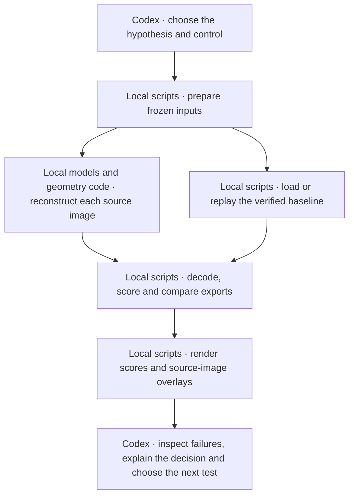

# Reviewing a reconstruction round

Start with the question Jeremy asked about the build. A score update can come straight from a scored release. A question about two missing blocks calls for tracing those two positions through the ordinary build.

## From a reported error to a test

| Question | Evidence to bring back |
| --- | --- |
| Where did this block go? | Identify the source image, surface and concrete position. Follow the visible mask, axis, count and grid origin into the depth proposal, first visible face, final edits and decoded export. Name the first stage that lost the evidence. A detected wall can still lose a cell to an erroneous block in front of it. |
| Do those plank, concrete or roof errors have the same cause? | Trace which surface supplied each misplaced coordinate. Compare texture changes, repeats, adjoining faces and the visible rim. A cube projected over planks can originate on a different surface. Protect real platforms, detached pieces and openings when testing a foreground rule. |
| Would a decision model help? | First let a **perfect chooser** use reference answers to pick the best of the proposed options. Count distinct required positions it could recover, extras it could remove, and already-correct blocks the options might disturb. If there is headroom, test a simple source-image rule and a local learned chooser on held-out buildings. If the correct option is missing, improve proposal generation first. |
| Does an intermediate gain improve the build? | Join the new face or grid matches to the actual exported coordinates under the same whole-build translation. In the atlas audit, 303 of 304 additional face matches already belonged to correctly placed blocks. They may still constrain a neighbor’s depth. For an outline-only win, measure correct pixels, spill onto neighbors and openings, count changes and placement regressions. |
| What should get us closer to 95%? | Group **required** misses and extras by failure stage and layout. Name the largest actionable group and a counterexample that could disprove the fix. The viewer shows how much of the gap could close if selected images or entire layouts were perfect. Label that ceiling separately from any measured improvement. |

[Examples and per-view evidence from the pipeline review](reviews/pipeline-consistency-01/README.md)

## Produce the result

1. **Freeze the comparison.** Use identical frame IDs, source hashes, visible targets and scoring rules. Report the fixed 104 whole-structure views and the other 100 controls separately. Use the historical 112 only for comparison with older work. Training uses the documented Visible Builds v2 split and its full-structure framing checks. Keep the visible-only scope and a single whole-build translation throughout.
2. **Parallelize independent work.** Fan out the baseline, independent hypotheses, per-image replays and regression checks as their inputs become available. Reuse a verified baseline and immutable model fields when their inputs, settings and code match. Give each writer its own outputs. When geometry or counting changes, rerun that stage and its consumers. Run the ordinary single-image command on affected cases and a relevant control. For an ordering or sharing change, compare the affected exits, matcher modes or fallbacks. Read the current manifest for artifact paths.
3. **Lead with the measured placement result.** Give previous and candidate strict and facade-priority F1, percentage-point change, and correct / missed / extra blocks. Name the cohort, branch and revision, and say what was newly built, replayed or carried forward. Report gains and losses on individual coordinates when available. Net totals alone can hide a swap. Distinguish an optional-mode repair from a change to the geometry default.
4. **Show where the difference is.** For a reported source image, link directly to its affected stage. For a weakest-structures review, show the ten lowest layouts by their weakest fixed view, preserve the full source image, and let the reader follow outlines, counted grids, face corners, projected export and required misses. Label the camera and grid mode. Update the viewer’s release chain and revision when the displayed default changes. Document what improved, what regressed or tied, and which method actually landed.

Generate a score report from a release containing paired `cases.json` and `summary.json` files. The example below compares the Workshop release with its embedded baseline. For two compatible releases, pass the earlier directory with `--baseline`.

```powershell
python -m benchmark.round_report benchmark/reviews/workshop-foreground-01
```

Use `python -m benchmark.current_placement_viewer` to regenerate the published review from its configured scored releases. To inspect a compatible placement challenger against the same upstream evidence before promotion, render a private page. Repeat `--release` in order for a chain of changes.

```powershell
python -m benchmark.current_placement_viewer --out runs/my-preview --release PATH_TO_SCORED_RELEASE --revision CANDIDATE_REVISION
```

Refresh the published viewer when a displayed result or stage changes. An explanation of a previously scored run can link the existing view. Use the [stage-specific runners](OFFLINE_GEOMETRY.md#stage-specific-comparisons-and-review-sheets) when the question concerns a surface, texture, camera or count.

## What uses tokens



The ordinary reconstruction, scoring and rendering commands make zero language-model calls. Local vision inference consumes compute on this PC. Codex uses tokens for its own instructions, reasoning, tool inputs and outputs, and any images it inspects. Keep full results on disk and bring the relevant rows and overlays into the conversation. Measure wall time in a dedicated timing run when requested.
