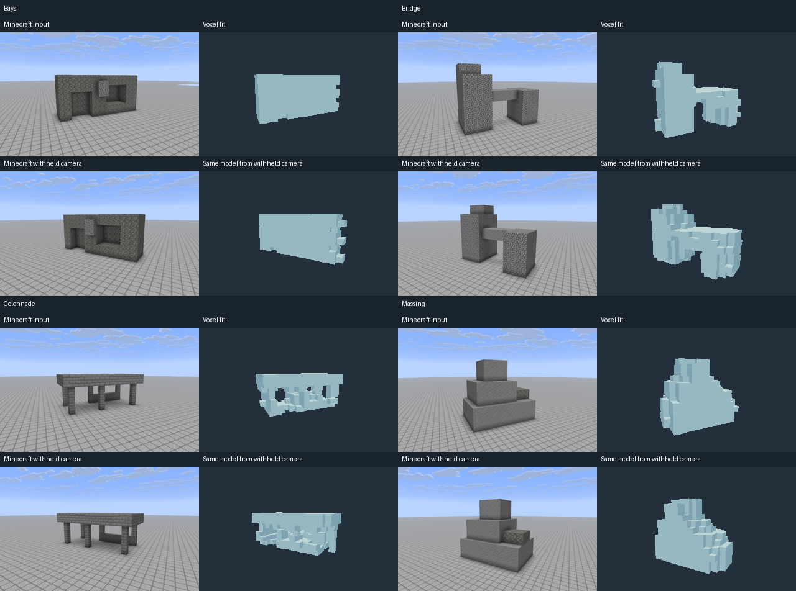

# Fitting a solid model to one screenshot

`python reconstruct.py fit-voxels IMAGE --out RUN` fits occupied XYZ cells, writes the projection and cell coordinates in `model.json`, and draws the fitted volume and its visible creases in `model.png` and `outline.png`. Pass `--atlas ATLAS_DIRECTORY` to also create a versioned smooth-stone datapack and placement manifest. Use `verify-build` to place that export in a private world. The experimental command defaults to `--method symmetric`. The regular material reconstruction command has its own geometry path.

## From image to proposed blocks

1. Detect long line segments, fit groups consistent with orthogonal world axes and refine the foreground silhouette. The camera projects 90-degree world corners to angles determined by perspective.
2. Estimate the camera and one-block scale from repeated perpendicular lines in the pavement. Estimate the footprint from silhouette contacts and cast foreground rays through a bounded grid. Each cell needs six of nine projected samples supported by the mask.
3. Apply one of the candidate shape rules below. Reproject the exposed faces of the actual occupied cells. A model can be turned around or placed in Minecraft without inferring geometry again.
4. A cropped screenshot without a supported metric ground grid can pass `--relative`. This branch fits a finite perspective volume from the Manhattan vanishing points, with 36 sampling units on the longest reference-plane span and a depth budget of 35% of that span. Its units and depth are assumptions. A Minecraft placement in this mode represents each sketch cell with one block.

## Experiment

Seven deterministic methods produced single-image predictions. Selection used five development buildings with two oblique views each. Rank by building-averaged occupied-cell intersection over union (IoU), then withheld-camera silhouette IoU, then input silhouette IoU. Also test majority occupancy among the three top development methods. Freeze the selected method and the committee before opening confirmation scores. For an inference failure, score zero.

Four additional Java 26.3 buildings served as confirmation. They use different compositions, each with two real clear-noon Minecraft captures and server readbacks of its volume. Each prediction received one framebuffer image. For scoring, register the inferred local origin and axes to the world ground plane using the recorded camera. The evaluator rounds to the nearest grid intersection and never translates the model to maximize agreement with the target. The opposite image supplies a withheld camera for evaluation. Both silhouette scores compare a projected model to the projected server-confirmed geometry. Each building has equal weight.

| Method | Dev 3D | Confirmation 3D | Input outline | Withheld outline |
| --- | ---: | ---: | ---: | ---: |
| Depth symmetry of the silhouette volume | 44.6% | 52.6% | 83.9% | 76.2% |
| Subtract pockets supported by projected interior edges | 42.1% | 50.0% | 82.1% | 70.2% |
| Majority vote (symmetry, pockets, layers) | 41.4% | 49.5% | 82.1% | 70.3% |
| Stack horizontal footprints from ground edges | 41.6% | 49.0% | 82.3% | 70.1% |
| Keep all silhouette-supported cells | 41.1% | 48.9% | 82.0% | 70.0% |
| Carve volume using rendered creases, shading and ground contacts | 39.7% | 35.0% | 88.0% | 75.6% |
| Greedily add rectangular solids with silhouette and crease support | 29.2% | 15.6% | 85.1% | 64.1% |
| One-block facade at the best-supported depth | 8.7% | 11.6% | 80.4% | 70.8% |

Symmetry keeps the largest intersection of the volume and its depth reflection. On confirmation it recovered 84.1% of occupied blocks with 59.2% precision. Both input angles preserved the probe under the bridge and the roof above the colonnade gap. Both angles filled both tested bay entrances. The pocket cutter left one of those four air probes clear. Inspecting an opening's correct rear plane and entrance is more informative than building-wide voxel overlap alone.

A diagnostic using extra input intersected the two independently estimated silhouette volumes after registration with their recorded camera poses. This reached 53.3% voxel IoU. Both views were used as input for that control. Four buildings establish an observed ordering for this run; they are too few for a precise estimate of performance on arbitrary builds. The benchmark uses full cubes, clear lighting and metric pavement. Crops, shaders, partial blocks and invisible backs add uncertainty.



## Run the comparison

`benchmark.voxel_inputs OUTPUT 'CAPTURE_ROOT|building_id' ...` (via `python -m`) freezes the two oblique screenshots for each building. It writes only image-derived arrays to the input NPZ files. Hold development and confirmation data in separate directories.

```console
python -m benchmark.voxel_eval DEV_INPUTS DEV_RESULTS --methods sheet cone symmetric boxes carving layers recess --select
python -m benchmark.voxel_eval CONF_INPUTS CONF_RESULTS --methods sheet cone symmetric boxes carving layers recess --committee symmetric recess layers
python -m benchmark.voxel_diagnostics CONF_INPUTS CONF_RESULTS symmetric
```

The evaluator emits per-frame metrics, per-building-weighted summary metrics and predicted grids. The diagnostic produces a four-building visual comparison, logic-probe results and the two-view control. Fresh fixture generation is in `benchmark.voxel_fixture`. Use a new set of buildings before assessing any changes motivated by these confirmation results.

## Research behind the candidates

Perspective calibration and shape ambiguity are grounded in [Single View Metrology](https://www.robots.ox.ac.uk/~vgg/publications/2000/Criminisi00a/) and [the visual hull](https://doi.org/10.1109/34.273735). The cuboid and pocket experiments adapt ideas from [volumetric primitive assembly](https://shubhtuls.github.io/volumetricPrimitives/) and [constructive solid geometry programs](https://hippogriff.github.io/CSGNet/) to deterministic integer-grid search. Classical [space carving](https://www.cs.toronto.edu/~kyros/pubs/00.ijcv.carve.pdf) uses multiple views. Our single-image cuts rely on weaker cues, and their accuracy is measured separately.
