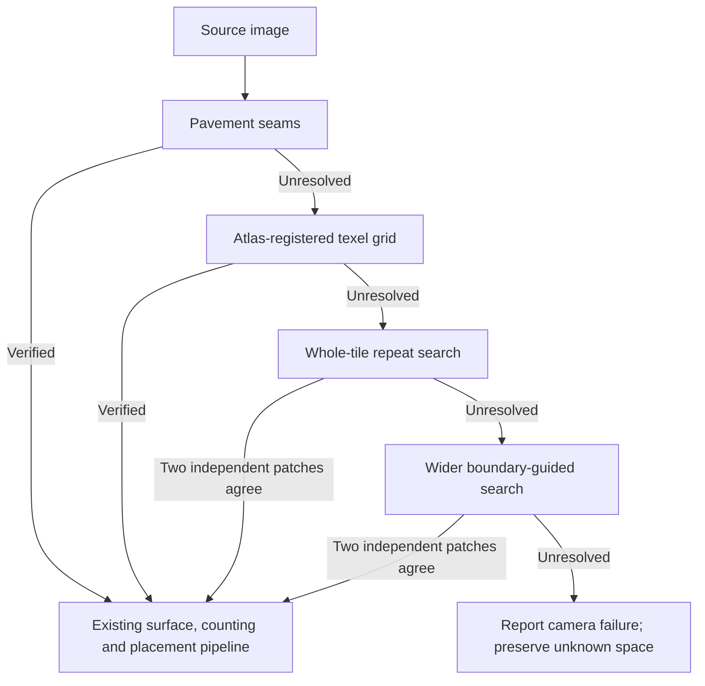

# Camera models, joint grids and the new default

The default now preserves the ordinary camera successes, then tries whole-tile floor repeats and a wider image-boundary search. GeoCalib and MoGe remain experiments. GeoCalib recovered the same held-out Harbor views as its image-only search control; its two additional recoveries were palette variants of one training viewpoint. MoGe and the coupled camera/grid proposals could earn translated placement credit with physically incorrect cameras, so their source checks remain necessary.

## Default placement on every dataset

Every failed camera remains in the score. Positions are evaluated after one integer translation of the whole build, preserving all internal relationships. Material IDs use the same translation. Facade F1 makes very thin horizontal-only targets optional while charging all extras.

| Dataset | Views | Strict placement, before → default | Facade placement, before → default | Facade gain | Camera failures, before → default |
| --- | ---: | ---: | ---: | ---: | ---: |
| Fixed trend | 104/104 | 91.27% → 91.27% | 93.42% → 93.42% | 0.00 pp | 0 → 0 |
| Visible Builds v3 | 144/144 | 8.08% → 21.84% | 8.51% → 22.75% | +14.24 pp | 108 → 70 |
| Decorative Builds v1 | 40/40 | 54.33% → 63.46% | 56.11% → 65.23% | +9.12 pp | 10 → 0 |

| Dataset | Correct / missed / extra positions | Strict / facade position + ID F1 | Change in correct / extra positions |
| --- | ---: | ---: | ---: |
| Fixed trend | 20,773 / 2,929 / 1,046 | 84.68% / 88.51% | 0 / 0 |
| Visible Builds v3 | 28,086 / 186,064 / 14,949 | 14.13% / 14.79% | +18,787 / +8,090 |
| Decorative Builds v1 | 9,240 / 7,686 / 2,957 | 50.51% / 52.56% | +2,120 / +795 |

The previous whole-tile experiment accounts for 40 camera recoveries and most of this round's gain over the former default. The wider image-only search adds eight v3 recoveries beyond those 40: 4,288 correct positions and 2,305 extras, improving v3 strict/facade F1 from 18.99%/19.88% to 21.84%/22.75%. Its three Harbor validation images cover one layout across two angles. They gain 802 correct positions and 496 extras. It recovers no additional Castle test view. All earlier supported exports remain identical.

## The three experiments

| Method, following the whole-tile fallback | v3 strict / facade placement | v3 strict / facade position + ID | Decision |
| --- | ---: | ---: | --- |
| Wider search using the source-image boundary | 21.84% / 22.75% | 14.13% / 14.79% | Default |
| GeoCalib-guided search | 22.36% / 23.25% | 14.59% / 15.24% | Experimental; no extra held-out coverage |
| MoGe surface-first camera | 20.21% / 21.14% | 12.54% / 13.15% | Experimental; camera verification fails |
| Joint camera/grid refinement after the new default | 21.84% / 22.75% | 14.13% / 14.79% | Experimental; zero accepted additions |

All four composed policies preserve fixed 104 at 91.27%/93.42% placement and decorative at 63.46%/65.23%. The MoGe standalone arm, tested before the whole-tile fallback, is reported separately in its linked report.

**GeoCalib.** Official pinhole weights supplied focal length and gravity from RGB. Independent texture matching then established block scale. A matched-budget image-only control recovered eight of its ten new cameras, including the same three Harbor validation images. GeoCalib's validation advantage over that control was six correct positions and three correct IDs, with zero net extra positions; its unique coverage was confined to training. The model remains on `experiment/camera-geocalib`. [Scores, setup and source overlays](../camera-geocalib-01/README.md)

**MoGe surface-first.** Full predicted points and surface directions supplied an initial frame. Atlas-verified visible faces estimated block scale. Following the earlier repeat fallback this added 2,145 correct positions and 3,969 extras on five v3 views, with little gain in position-and-ID score. Across all 13 standalone accepted cameras, only seven of 20,420 checked visible corners projected within two pixels. The held-out Castle view had a median native error of 482 pixels. Keep `experiment/camera-moge-surface-first` experimental. [Scores and failed source alignments](../camera-moge-surface-first-01/README.md)

**Joint camera/grid refinement.** MoGe and GeoCalib proposals initialized alternating camera scale/phase and integer wall-level fits. The actual placer consumed those levels, verified through its returned plane offsets and masks. Of the 70 residual camera failures, 29 produced 171 candidate fits; 41 lacked sufficient observations. None supplied two independent held-wall anchors within three pixels. No source-only candidate was accepted. A limited reference chooser over four exported joint proposals on two frames gained 0.14 strict percentage points beyond the available raw-candidate chooser, but both selected cameras still had large native errors. This is headroom only within those finite options, not a perfect reconstruction result. Keep `experiment/camera-grid-joint` experimental. [Actual consumer checks, ablations and source overlays](../camera-grid-joint-01/README.md)

## What actually runs by default

The new runtime needs no GeoCalib download or extra learned model. Java 26.3, image-size and verified-atlas guards apply to both new searches. An explicitly supplied atlas is used throughout. Missing or corrupt assets leave the camera unresolved. Negative checks with a real atlas rejected noise, a flat image, stripes and an affine tiled wall. Only visible-face-supported blocks may be exported; this change introduces no hidden-area completion.

Runtime revision `d48a296` reproduced all 118 fallback camera matrices and serialized evidence exactly: 40 original repeat successes, eight wider-search successes and 70 abstentions. Independent grading verified all 288 source/reference pairs, decoded the 48 changed exports and retained 240 checked earlier packs. Ordinary CLI checks passed four original samples, four repeat samples and five combined samples, including two Harbor recoveries, an ordinary success, a repeat success and an abstention. Cached source-only detector fields were reused; camera recovery, downstream reconstruction and export ran normally. The final combined implementation passed 465 unit tests. The interactive report passed 60 chart checks across all 12 new method/cohort combinations. [Independent controls and CLI receipts](../camera-model-controls-01/README.md) · [Release validation and file fingerprints](validation.json)

## Where to focus next

The remaining 70 v3 camera failures account for 148,107 visible misses. Independent block-scale evidence on visible walls is still weak: no retained joint candidate transferred its grid accurately to the held-out wall patches. Better renderer-aware texture sampling and cross-wall block-size measurements are more useful than relaxing that verification threshold.

Camera recovery is not the only bottleneck. The new Harbor cameras project checked corners within roughly one pixel, yet the kiln high-right view places only 131 correct blocks with 222 extras and four exact IDs. That is now a clear downstream surface/count/placement/material problem. Harbor kiln rear-oblique does better, recovering 518 correct positions with 55 extras. These two views let the next experiment isolate downstream behavior without an uncertain camera.

[Current interactive scorecard and experiments](../pipeline-impact-01/viewer.html#cohorts) · [Verified default scores by split](../camera-model-controls-01/independent-matched-summary.json) · [All default source cases and camera reasons](../camera-model-controls-01/independent-matched-cases.json.gz)
