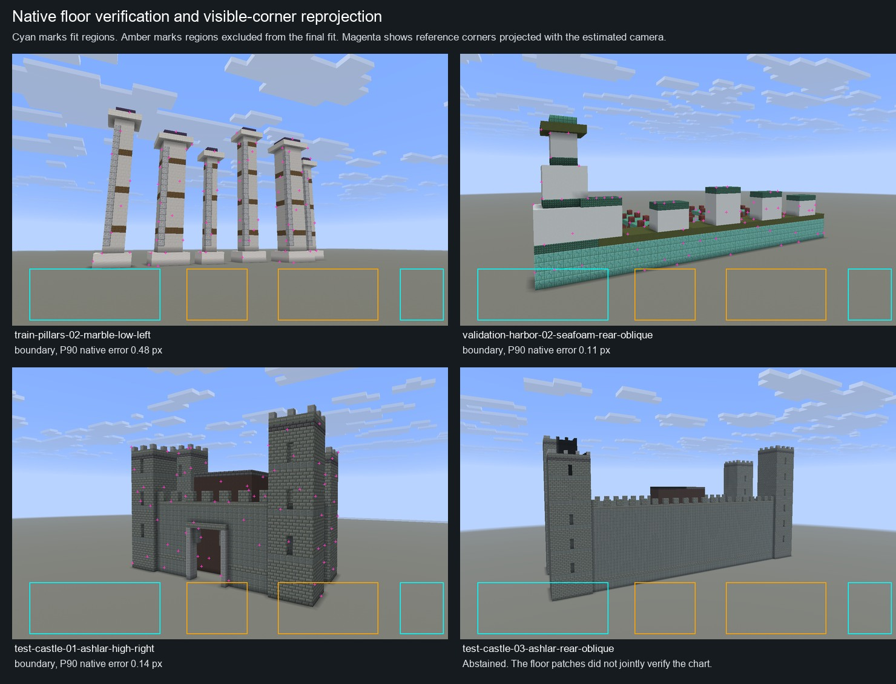

# Native pavement texture and metric camera recovery

**Merge the model-free camera fallback on `experiment/camera-native-floor-inverse`.** It recovers 63 of 70 previously missed Visible Builds v3 cameras, including all five remaining Harbor validation cameras and 11 of 16 Castle test cameras. The ordinary placement runs use the recovered camera before inset detection and carry it through material assignment and export. Every earlier supported camera bypasses the new work.

The research composition also tries an RGB GeoCalib horizon and focal proposal. That adds one training camera and one Castle camera after the model-free search. The engine port uses only the border-seeded search. Keep GeoCalib experimental until additional layouts and floor materials establish how often it adds a usable camera. The source policy was frozen at `d6990f9` on base `62611ee` before evaluating Harbor or Castle. The model-free engine port is `aac7da7`.

## Decoded placement

| Cohort and policy | Tested | Strict F1 | Facade F1 | Strict position + ID F1 | Facade position + ID F1 | Correct / missed / extra positions | Failed cameras |
| --- | --- | --- | --- | --- | --- | --- | --- |
| Fixed trend · All policies, carried forward | 104/104 | 91.27% | 93.42% | 84.68% | 88.51% | 20,773 / 2,929 / 1,046 | 0 |
| Visible Builds v3 · Previous | 144/144 | 21.84% | 22.75% | 14.13% | 14.79% | 28,086 / 186,064 / 14,949 | 70 |
| Visible Builds v3 · Model-free engine | 144/144 | 46.63% | 48.04% | 28.04% | 29.08% | 77,774 / 136,376 / 41,629 | 7 |
| Visible Builds v3 · With GeoCalib fallback | 144/144 | 47.33% | 48.75% | 28.47% | 29.52% | 79,572 / 134,578 / 42,550 | 5 |
| Decorative Builds v1 · All policies, carried forward | 40/40 | 63.46% | 65.23% | 50.51% | 52.56% | 9,240 / 7,686 / 2,957 | 0 |

The model-free fallback adds 49,688 correct positions and 26,680 extras. All 218 previously supported exports retain their incumbent pack hashes. Exact ID on correctly placed v3 blocks is 60.14%. The seven model-free abstentions account for 26,122 visible misses. Camera-supported v3 views score 50.60% strict placement F1, with 0 supported empty exports. See the machine-readable reports for registration, assignment and split counts. [All cohort and split scores](summary.json) · [Decoded receipts](build-receipts.json.gz)

### Development, Harbor and Castle

| v3 split and policy | Views | Strict placement | Facade placement | Strict position + ID | Facade position + ID | Failed cameras |
| --- | --- | --- | --- | --- | --- | --- |
| Development · Previous | 108 | 26.58% | 27.70% | 17.56% | 18.36% | 49 |
| Development · Model-free | 108 | 48.70% | 50.12% | 28.36% | 29.36% | 2 |
| Development · With GeoCalib | 108 | 48.81% | 50.24% | 28.43% | 29.42% | 1 |
| Harbor · Previous | 18 | 22.77% | 27.15% | 12.91% | 15.73% | 5 |
| Harbor · Model-free | 18 | 35.70% | 40.98% | 21.19% | 25.28% | 0 |
| Harbor · With GeoCalib | 18 | 35.70% | 40.98% | 21.19% | 25.28% | 0 |
| Castle · Previous | 18 | 5.58% | 5.56% | 3.09% | 3.08% | 16 |
| Castle · Model-free | 18 | 43.55% | 43.54% | 29.20% | 29.22% | 5 |
| Castle · With GeoCalib | 18 | 46.29% | 46.29% | 30.86% | 30.89% | 4 |

## What the source image established

The fixed comparison uses a single RGB screenshot, Java 26.3 vanilla art and the incumbent abstention decision. The learned arm additionally uses the official pinned GeoCalib RGB prediction for that same image. Border evidence or learned horizon/focal evidence proposes an upright ground chart. Seventeen horizon trials compete on autocorrelation peaks. A maximum of 20 distinct physical translation pairs reach period fitting. The inverse chart maps native pixel centers to a versioned tile. A low-contrast color mask excludes foreground structure and smooth illumination gradients are removed.

In a separate training diagnostic, the recorded ground chart competed against chart scales 0.5, 0.98, 1.02 and 2.0. At each mip, nearest-texel correlation across all sprites, orientations and offsets shortlisted a registration, then both nearest and bilinear sampling were measured in native pixels. All 49 training residuals selected light gray concrete from the 448 opaque atlas textures. Forty-one chose a 16×16 template and eight chose an 8×8 mip. All chose bilinear interpolation. The weakest correlation across either separated source region was 0.634 for the correct chart. The strongest verification-region correlation of any wrong-scale competitor was 0.238. This included all 24 development frames that the earlier true-chart floor diagnostic rejected. The inference process reads no recorded pose, geometry, building identity, sibling capture, or capture field of view. [Train-only reference discrimination](train-reference-discrimination.json)

At inference, the four native floor regions must each contain at least 400 color-consistent samples. West pixels initialize sprite orientation, scale and phase. Two regions supply the seven chart-parameter updates. Two additional, spatially separate regions are excluded from those updates. All four must correlate at least 0.60 with the same bilinear tile, and the minimum must exceed every independently phase-fitted wrong-scale alternative by at least 0.26. A color gate checks the observed light gray concrete appearance. The search uses a wider part of the image for proposals.

The matched-budget no-model and GeoCalib arms independently recovered 47/49 and 47/49 development cameras, 5/5 and 5/5 Harbor cameras, and 11/16 and 12/16 Castle cameras. The composition takes a verified boundary result first, then tries the refined GeoCalib result. It adds a Pillars marble high-right and Castle limestone high-right over the model-free arm. [Proposals, source verification scores and recorded scoring-only audit](native-cameras.json.gz)

## Physical calibration and failure cases

An independent evaluator fits one integer XYZ displacement on alternating unique visible reference corners and tests the remaining corners. All 77,126 check corners across 63 model-free cameras fall within two native pixels. The two additional learned proposals bring the research result to 80,158 of 80,158. Worst per-view P90 is 0.79 px on development, 0.26 px on Harbor and 0.89 px on Castle. Four low-left Pillars images exceed two pixels under the old single-ray origin convention. Their P90 errors after the single fitted integer translation are 0.47–0.79 px. Both measurements are retained.

The source search produced 225 refined, physically liftable candidates across both arms. Choosing among them with reference corners would yield 68 of 70 cameras with P90 at most two pixels. The three additional fits are a training Pillars rear view and both Castle rear-oblique palette variants of the third layout. For its two high-right Castle views the best candidate errors are 3.01 and 6.19 px. These counts measure available camera proposals. Only source-accepted cameras contributed new exports.

On Castle 01 ashlar high-right the model-free fallback adds 1,033 correct positions, including 583 exact IDs, and 235 extras. On Harbor 02 seafoam rear-oblique it adds 488 correct positions, 477 exact IDs and 185 extras. The model-free fallback recovers the Pillars marble low-left camera with a held-corner P90 below one pixel, yet the downstream build places only 160 correct blocks and adds 708 extras. On Harbor seafoam high-right the build adds 218 correct positions and 391 extras. Camera recovery enables placement without correcting every later surface or depth decision.



The positive real training screenshot passed. Projecting four actual atlas sprites onto one source-derived chart with matched mean color and contrast accepted light gray concrete and rejected stone, light gray wool and polished andesite. Flat color, seeded noise, one-axis stripes, a projectively rendered vertical atlas wall, conflicting left/right tile phase, conflicting near/far tile phase and an incompatible material color all abstained. [Research stress cases](negative-controls.json) · [Production stress cases](production-controls/negative-controls.json) · [Equal-color, equal-contrast atlas controls](material-controls.json)

## Reproduction and entry-point checks

Run the following commands from the experiment checkout with the documented saved source datasets, atlas, model proposals and expanded-baseline handoffs. Use `OPENBLAS_NUM_THREADS=1` for exact matrix comparisons.

```powershell
python -m benchmark.camera_native_floor_diagnostic
python -m benchmark.camera_native_floor_negatives
foreach ($split in 'train','validation','test') {
    python -m benchmark.camera_native_floor_run predict $split
    python -m benchmark.camera_native_floor_run build $split
}
python -m benchmark.camera_native_floor_audit
python -m benchmark.camera_native_floor_material_controls
python -m benchmark.camera_native_floor_port_check camera
python -m benchmark.camera_native_floor_port_check cli
python -m benchmark.camera_native_floor_sheet
python -m benchmark.camera_native_floor_report
```

The engine uses local OpenCV. When the caller lacks it, a configured MCIR_RECOVERY_PYTHON can perform the image-only fit offline. Without either backend the fallback records an abstention. The 70 ordinary camera calls exactly reproduced the frozen model-free matrices or abstentions. Five normal `reconstruct.py build --through placement` calls used the verified same-RGB field cache and matched the historical texel, original repeat, widened repeat, newly recovered and still-abstaining exports by decoded coordinates and IDs. Two additional normal Windows launcher builds used live pinned vision inference. The fixed seam control reproduced all 336 typed blocks. Harbor reproduced all 673 typed blocks with the primary Python and the configured offline OpenCV interpreter. The 471-test unit suite passed. [Production matrix replay](production-camera.json) · [Cached-field CLI comparisons](production-cli.json) · [Live-field CLI comparisons](live-primary-cli.json) · [Fingerprints](manifest.json)
