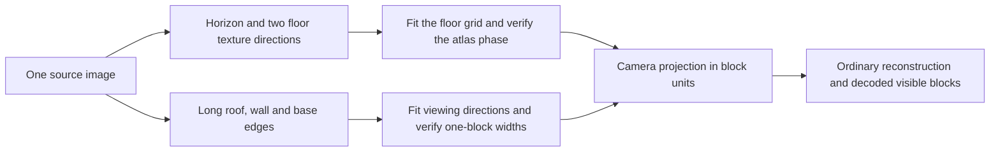

# Recover the camera from the floor and from the structure

A camera fit needs the viewing directions and scale. The horizon helps estimate tilt on level ground. It can come from two horizontal vanishing directions or from a long sky–ground boundary on flat terrain. Orthogonal edges on a roof, wall or base add other constraints on orientation and focal length. A known block-width cue then helps resolve how far the camera is from the visible structure.

The floor experiment keeps a shortlist of two-dimensional texture directions so one direction and its harmonic cannot masquerade as a grid. The structure experiment uses long visible edges as a scaffold for the camera. The inferred scaffold supplies geometric constraints. Surface and placement evidence still determines which cells the export includes.

The fixed 104 trend starts with zero camera failures. Visible Builds v3 has 108 failures out of 144 and Decorative Builds v1 has ten out of 40. Castle contributes 18 held-out failures. All eight decorative test images already have a supported camera. A recorded-camera replay replaces the failed camera and sends the source image through the ordinary reconstruction. It measures which downstream stages can use a correct camera.

[Expanded baseline and scoring rules](../expanded-baseline-01/README.md) · [Why pavement calibration failed](../expanded-baseline-01/camera-diagnosis.md)

## Repeating pavement recovers scale

The current atlas fallback estimates a horizon from changes in the apparent texture frequency across image rows. The first variant keeps more candidate tracks, rejects parallel texture directions and adds the sky–ground boundary as a weak estimate. That boundary increased support from 12 to 13 of 118 failed views. All of those were training images, and one fit passed the texture check with about 120 pixels of native corner error.

The stronger variant rectifies the pavement and fits two translations of the full 16-texel motif. Its independent texture check recovers 40 of 118 rejected views. A horizon search without the visible border recovered the same 40. The border was useful as a hypothesis, and the full block texture supplied the additional scale evidence. Modulo an integer-block origin, the recovered cameras' median per-frame pavement phase error was about 0.005 blocks. Their median per-frame horizontal span error was about 0.05%.

Using the border as an optional seed changed 32 of the 40 camera matrices and 22 decoded aligned exports. Removing it gained 20 correct v3 positions and added 50 extras. On decorative it lost nine correct positions and 21 correct IDs and added 30 extras. A source image with an unclear horizon can use the regular horizon search.

| Dataset | Camera failures, before → after | Strict placement F1, before → after | Facade placement F1, before → after |
| --- | ---: | ---: | ---: |
| Fixed 104 | 0 → 0 | 91.27% → 91.27% | 93.42% → 93.42% |
| Visible Builds v3 | 108 → 78 | 8.08% → 18.99% | 8.51% → 19.88% |
| Decorative Builds v1 | 10 → 0 | 54.33% → 63.46% | 56.11% → 65.23% |

On v3 the fitted cameras recovered 14,499 visible positions and added 5,785 extras. Both of the new Castle results were low-left views of the same layout, one per palette. No Harbor validation camera was recovered. Decorative recovered 2,120 positions with 795 extras. Its eight test images already had working cameras. The fallback leaves all 170 ordinary camera-supported exports identical.

[Floor experiment, ablations and decoded scores](../camera-horizon-floor-01/README.md)

The repeat search is the candidate for a guarded fallback after the ordinary camera abstains. Before enabling it, exercise the ordinary entry point on source images with usable and unusable pavement, with the Java 26.3 image-size and verified-atlas checks in place. Keep the border optional. Its small effect on the fit is useful to measure separately from whether the camera succeeds.

## Structure edges recover viewing directions

Without any floor fit, long structure edges give three viewing directions in 76 of the 118 failed images. The earlier raw line fit produced 60. For the 47 images with both estimates, the worst-axis error improved on 41. Across all failures, the number meeting both a 2° worst-axis tolerance and 5% focal error rose from 19 to 39. On Castle none of the structure fits met both thresholds.

Two scale cues were tested. Atlas-verified whole sprites supply a one-block width. Repeated patterns on a straightened wall supply a period checked on separate bands of the image. Two training views gave provisional heights within 3% of the recorded height. Their visible junctions did not support the inferred integer-block grid. The original corner test and a follow-up with higher corners each accepted zero metric cameras. Forcing four unaccepted fits through the ordinary build gave strict placement F1 from 22.9% to 60.7%, including one fit that produced 1,200 extras. These source lines are more promising as a constraint in another fit than as the only source of camera scale.

[Structure scaffold results and rejected-fit diagnostics](../camera-structure-scaffold-01/README.md) · [Castle and Pillars source overlays](../camera-structure-scaffold-01/castle-and-pillars.jpg)

## What remains with an exact camera

Supplying the recorded camera on all 118 rejected source images produced a nonempty build in every case. The injected projection reproduced the recorded coordinates of 245,460 unique per-image visible corners to within a billionth of a pixel. Surface detection, counting, placement and materials still ran on the source image.

| Dataset | Strict placement F1 | Facade placement F1 | Strict placement and material F1 |
| --- | ---: | ---: | ---: |
| Fixed 104 | 91.27% | 93.42% | 84.68% |
| Visible Builds v3 | 51.72% | 53.26% | 29.06% |
| Decorative Builds v1 | 64.96% | 66.87% | 51.98% |

On held-out Castle, the recorded camera on all 18 images yielded 60.64% strict placement, with 26,269 correct, 26,133 missed and 7,963 extra positions. In one Castle image, a wall mask covered every visible pixel of a missed block. The Counter returned no grid dimensions and the depth selector placed the wall one block too far back. This replay measures what the current downstream pipeline does with a correct camera.

On the same 40 images recovered by the source-only floor method, the two arms produced 16,619 and 17,603 correct positions respectively. The estimated camera gave higher strict placement F1 on seven of those 40 views. A downstream decision can change when a camera measurement improves, so the recorded-camera run is a measured intervention.

[Recorded-camera experiment and image examples](../camera-recorded-pose-01/README.md)

## Which cues to combine next

Among the 78 remaining camera failures, 40 have enough pavement texture for the current atlas to recognize if given the correct chart. The structural fit found viewing directions on 29 of these 40 and met both orientation and focal tolerances on 18. Test those independently detected directions as proposals for the floor repeat search, alongside its existing horizon hypotheses. Use the same two-patch atlas check and measure the ordinary exported build. The split into 40 and 38 remaining cases comes from reference-camera evaluation and is only used for grading.

The other 38 failed even when the atlas sampled their floor at the recorded coordinates. A second source of block scale is more relevant there. Test widely separated visible wall or base regions against the same candidate scale, with an independent visible junction to check the grid origin and with the full-block versus half-block alternatives scored separately.
