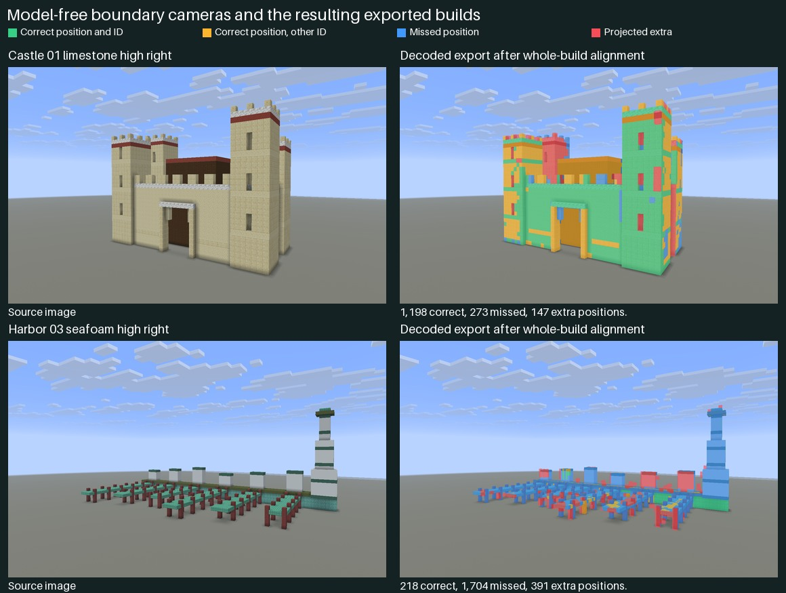
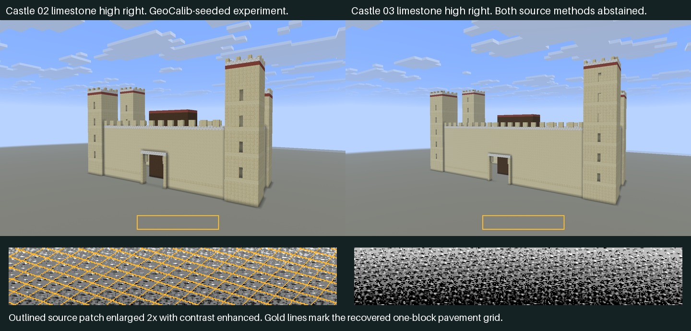

# Camera recovery on the remaining 70 views

**Promote the model-free native pavement fit.** After the earlier camera stages abstain, it recovers 63 of 70 v3 cameras. Visible Builds v3 strict placement F1 rises from 21.84% to 46.63%, with 49,688 additional correct visible positions and 26,680 additional extras. The absolute gain is 24.79 percentage points. Exact-position-and-ID F1 rises from 14.13% to 28.04%. All 218 previously supported exports retained their hashes.

| Cohort | Camera failures, before → model-free | Strict / facade placement, before → model-free | Strict / facade position + ID, model-free |
|---|---:|---:|---:|
| Fixed 104/104 | 0 → 0 | 91.27 / 93.42 → 91.27 / 93.42 | 84.68 / 88.51 |
| Visible Builds v3 144/144 | 70 → 7 | 21.84 / 22.75 → 46.63 / 48.04 | 28.04 / 29.08 |
| Decorative Builds v1 40/40 | 0 → 0 | 63.46 / 65.23 → 63.46 / 65.23 | 50.51 / 52.56 |

V3 strict counts are 77,774 correct, 136,376 missed and 41,629 extras. Of correctly placed blocks, 46,771 have the correct material ID (60.14%). Camera coverage is now 137 of 144 views (95.14%). The seven abstentions account for 26,122 misses, while the 137 supported views still miss 110,254 visible positions. The default has the larger remaining opportunity in downstream reconstruction. [Independent model-free grades](../camera-native-recovery-controls-01/independent-default-summary.json)

**Keep the optional GeoCalib seed experimental.** It adds a genuinely accurate camera on one training Pillars and one previously reviewed Castle image. Across v3 this adds 1,798 correct positions, 921 extras and 1,104 correct IDs beyond the model-free fit, giving 47.33% / 48.75% strict / facade placement and 28.47% / 29.52% strict / facade position + ID. Supporting an additional learned model and inference path for one more measured Castle viewpoint needs broader evidence. The real ordinary launcher passed end-to-end checks using the model-free path. [Independent composed grades](../camera-native-recovery-controls-01/independent-composed-summary.json)

## What a supplied camera can recover

At revision `62611ee`, Visible Builds v3 has 70 camera failures and 148,107 required visible positions on those images. Supplying the recorded camera only on those views adds 61,204 correct positions and 29,650 extras in the ordinary downstream reconstruction. Visible Builds v3 strict placement rises from 21.84% to 51.31%. This is a measured diagnostic using existing decoded packs with matching screenshot and reference hashes. It supplies the entire camera projection and does not estimate the performance of a source-only camera method. [Per-cohort reference composition](opportunity.json)

| Dataset | Views | Strict / facade placement, current | Strict / facade placement with recorded cameras on residuals | Strict / facade position + ID with that intervention |
|---|---:|---:|---:|---:|
| Fixed trend | 104/104 | 91.27 / 93.42 | 91.27 / 93.42 | 84.68 / 88.51 |
| Visible Builds v3 | 144/144 | 21.84 / 22.75 | 51.31 / 52.86 | 28.55 / 29.57 |
| Decorative Builds v1 | 40/40 | 63.46 / 65.23 | 63.46 / 65.23 | 50.51 / 52.56 |

The fixed and decorative results carry forward their byte-verified baseline exports. The composition also keeps the current 74 supported v3 exports. Recorded-camera packs come from the earlier ordinary downstream replay; no new build was run for this composition. On v3 the resulting strict counts are 89,290 correct, 124,860 missed and 44,599 extras. The historical 112-view score was not remeasured.

## Native pavement measurements

The floor experiment compared a photographed pavement patch with a bilinearly filtered, mipmapped atlas tile at its original image coordinates. A 448-sprite scan on training screenshots selected light gray concrete. Regions from different parts of each photograph had to agree on a chart and discriminate competing scale factors, including half and double scale. This is a narrow material fallback. The source policy froze at `d6990f9` before the Harbor and Castle run. A source-only boundary proposal supplies 63 cameras. Adding GeoCalib focal length and horizon as later search seeds supplies two more. Both use the same native texture fitter.

| v3 camera failures on entry | Source cameras recovered, either seed | Native corners checked after one integer shift | Worst per-view 90th-percentile error |
|---|---:|---:|---:|
| Training, 49 | 48 | 57,965 | 0.79 px |
| Harbor validation, 5 | 5 | 5,089 | 0.26 px |
| Castle test, 16 | 12 | 17,104 | 0.89 px |

All 80,158 withheld native vertices were within two pixels. The maximum per-frame median error in relative ground spans was 0.036%. Ordinary ground-ray registration alone gave a worst P90 of 22.33 px on training. The acceptance decision saw only the source image and declared atlas/model inputs; recorded camera and visible-corner data enter at grading. The two model-only recoveries were Pillars 03 marble high-right and Castle 02 limestone high-right. Five images remained without a camera under the combined policy. [Per-image calibration and source fingerprints](native-calibration.json.gz)

The independently decoded Castle 01 limestone high-right export had 1,198 correct, 273 missed and 147 extra positions, for 85.09% strict F1. Its held-corner P90 was 0.14 px. Harbor 03 seafoam high-right achieved 0.10 px, yet its exported build had only 218 correct positions, 1,704 misses and 391 extras, for 17.23% strict F1. The Harbor camera now provides a reliable projection for diagnosing the downstream surface, counting, placement and material decisions.





### Can a learned confidence rule recover the last five?

After both native proposal arms, three of the five abstentions still contained a refined pose with disjoint-corner P90 at or below two pixels. Forcing those three actual poses into the ordinary pipeline adds 4,102 correct positions, 1,840 extras and 1,812 exact IDs. This is a reference-selected intervention. The two Castle rear palettes account for 3,779 of the positions. The best available pose on each of the two Castle high-right images still exceeded the calibration tolerance, with P90 errors of 3.01 and 6.19 px. [Three decoded diagnostic exports](rejected-option-exports.json)

The new confidence model used seven measurements of atlas agreement and full-unit versus half-unit pixel repeats. It trained on 72 deduplicated development options across six building families. The source gate recovered only the Pillars development image, contributing 323 correct placements, 551 extras and 255 exact IDs. No additional Castle image passed. Keep `experiment/camera-native-fit-confidence` experimental. The 68-of-70 calibrated-pose ceiling is an opportunity among the offered candidates; the combined source policy actually recovers 65 and the learned extension 66.

On the five abstentions, zero of 98,756 actual native verification samples hit a labeled frontmost structure face. Shadows and other background features are outside these structure labels. With the exact chart, all five selected one 8×8 bilinear mip level. Every Pillars region passed 0.60 correlation, while each Castle image had at least one region below it. In a separate diagnostic the scorer chose a blend of 16×16, 8×8 and 4×4 tile levels on the west region. It improved held-region agreement but still left at least one Castle region per view below 0.60. The projection and thresholds in ordinary inference were unchanged. These results favor a spatially varying sampling model over a foreground mask as the next experiment. [Region counts, fixed-mip and blended-mip measurements](five-abstention-regions.json)

### Can the silhouette supply a different physical ruler?

The independent silhouette trial froze its rule at `493350c` and stored its result at `dd14ec2`. It measured a geometric signal that looks convincing on training buildings. All 46 native-confirmed training step traces rose one block. All 14 confirmed Castle traces rose two blocks. On Harbor, 15 of 16 measured traces combined incompatible points or different planes and one missed native junctions. Inferring a single block from a repeated step would systematically underscale these Castle views.

Independent unit and ground checks accepted zero of 70 residuals and preserved all 288 outputs. An oracle that selected among 12 forced, source-grounded alternatives on seven images found additional translated strict placement versus the earlier empty outputs but every tested pose exceeded two pixels of median error even after one global integer origin adjustment. The native floor method already solved all seven. Keep `experiment/camera-silhouette-ruler` experimental.

## Two causes left by the floor matcher

| v3 residual | Train | Harbor validation | Castle test | Correct positions supplied by recorded-camera replay | Extras |
|---|---:|---:|---:|---:|---:|
| Existing atlas matcher accepts the correct ground chart | 25 | 1 | 6 | 24,494 | 11,719 |
| Existing atlas matcher rejects the correct ground chart | 24 | 4 | 10 | 36,710 | 17,931 |

On the first group the existing verifier can recognize a correct solution, so source search has room to improve. On the second group the previous verifier cannot recognize the correct chart under its sampling rule. This says nothing about how much texture information survives in the original pixels. The two source experiments compare direct atlas prediction of native floor pixels against a separate block ruler derived from visible architectural steps. Both receive one screenshot. Every building, palette and view stays in its original split. Harbor and Castle are previously reviewed regression families.

## A fairer check of relative camera geometry


The published camera registration anchors an image ray to the staging ground. A ground-height error or biased focal length can move the whole building far from its recorded world coordinates even if some internal dimensions are preserved. For a second diagnostic, the scorer fits one integer XYZ translation using alternating sorted visible vertices and scores the other half. This permits one shared origin for all walls, roofs and disconnected parts. It fixes compass orientation using the ordinary evaluator. It estimates a continuous translation with reprojection least squares, then selects the lowest pixel RMS within two integer blocks on each axis around the rounded solution. It uses native front-visible corner labels only for grading. [Disjoint-corner results and known-camera controls](relative-calibration.json)

| Previously evaluated candidate | Published registered median error | Median after one XYZ shift | 90th percentile | Median error in projected block lengths |
|---|---:|---:|---:|---:|
| MoGe, Castle 03 limestone rear | 481.7 px | 14.46 px | 24.29 px | 1.55 |
| Joint proposal 2, Castle 03 limestone rear | 405 px | 13.72 px | 21.77 px | 1.47 |
| Joint proposal 2, Viaduct 02 riverstone rear | 209 px | 9.10 px | 20.60 px | 0.53 |

Block length here uses the longest of three unit-axis projections at each scored vertex, a conservative denominator. MoGe's 13 accepted views put 240 of 10,208 withheld vertices within two pixels under the fitted translation. Both exact-camera controls, including one shifted by [123, −27, 48] blocks, put every withheld corner within two pixels. The large registered errors mixed whole-build displacement with shape error. Even after origin alignment, the Castle hypotheses displace a typical vertex by more than one projected block. Keep those earlier options experimental. [Earlier MoGe result](../camera-moge-surface-first-01/README.md) · [Earlier joint result](../camera-grid-joint-01/README.md)

## Candidate selection and new model opportunities

The previous joint camera and grid trial retained two source-ranked hypotheses on each of 29 images. Another 41 images had no candidate. A reference chooser allowed to see every one of the 58 retained poses finds zero with disjoint-corner 90th-percentile error at or below two native pixels, even after optimizing the relative origin. The best errors were 7.65 px on training, 4.51 px on validation and 9.91 px on test. This measures calibration headroom over actual retained options. The original trial's separate strict-placement oracle used only the four joint proposals it exported. Training a selector over the 58 current poses cannot recover the missing calibrated solution under this criterion.

1. The native renderer resolved most of the earlier proposal deficit. For the remaining two physically inaccurate high-right poses, a small local estimator trained on synthetic atlas renderings could generate candidate ground derivatives before numerical refinement. Vary projected size, tilt, material, phase and filtering instead of learning the dataset camera settings. Compare against the numerical proposal generator at the same budget. Two reviewed views of one layout offer limited additional coverage; evaluate on another building and different pavement materials before generalizing.
2. For the two Castle rear palettes that already contain an accurate source proposal, investigate independently predicting pixel appearance across multiple mip levels at different screen heights. The present native rule and the learned repeat-confidence rule both withhold the camera. A direct photometric residual on additional source pixels would test whether filtering, shading or missing phase accounts for the low scores. Do not lower the gate using the known Castle answers.
3. If camera recovery on other floors remains limited, test consistency of learned focal length and rotation across known digital crops of the same source image, then grade independent block-scale evidence. The earlier GeoCalib experiment showed that an orientation hint alone recovered little beyond a matched image-only search. Generic monocular depth has lower priority until a metric, visible cue can verify its scale.

Run the two diagnostics from `review/camera-recovery-next` with the saved data under the stable checkout. The first uses the standard library. The second uses the existing NumPy benchmark environment.

```powershell
python -m benchmark.camera_residual_opportunity
../mask-scalelsd/runs/env/Scripts/python.exe -m benchmark.camera_relative_calibration
../mask-scalelsd/runs/env/Scripts/python.exe -m benchmark.camera_recovery_native_audit
../mask-scalelsd/runs/env/Scripts/python.exe -m benchmark.camera_floor_patch_diagnosis
../mask-scalelsd/runs/env/Scripts/python.exe -m benchmark.camera_rejected_option_replay
../mask-scalelsd/runs/env/Scripts/python.exe -m benchmark.camera_recovery_sheet
../mask-scalelsd/runs/env/Scripts/python.exe -m benchmark.camera_recovery_round
```

The model-free runtime candidate is `aac7da7`. Its experiment report is `7a4bc80`; the independent scorer and all 288-frame grades are `bf6d269`. The source silhouette run is `dd14ec2`, and the confidence model froze at `38eb566`. The report compares actual ordinary exports from the accepted source poses with byte-verified retained controls. The CLI checks include five archived-field source paths and two live model-field runs through the Windows launcher. Across the 63 model-free cameras, all 77,126 withheld native vertices are within two pixels. [Review manifest](manifest.json) · [Scorecard entries](panel-entries.json) · [Independent production checks](../camera-native-recovery-controls-01/independent-production-check.json)
