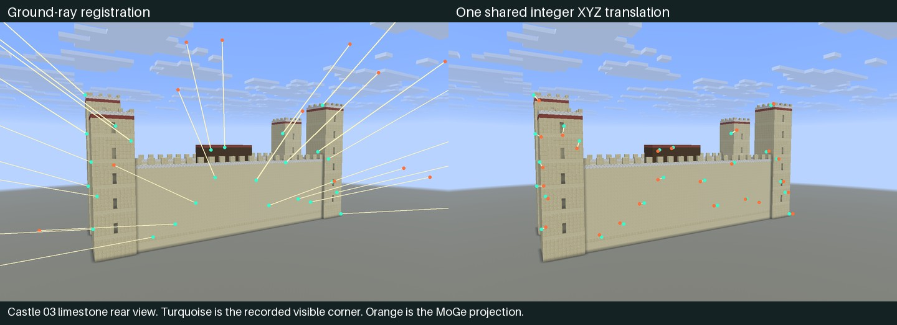

# Camera recovery on the remaining 70 views

At revision `62611ee`, Visible Builds v3 has 70 camera failures and 148,107 required visible positions on those images. Supplying the recorded camera only on those views adds 61,204 correct positions and 29,650 extras in the ordinary downstream reconstruction. Visible Builds v3 strict placement rises from 21.84% to 51.31%. This is a measured diagnostic using existing decoded packs with matching screenshot and reference hashes. It supplies the entire camera projection and does not estimate the performance of a source-only camera method. [Per-cohort reference composition](opportunity.json)

| Dataset | Views | Strict / facade placement, current | Strict / facade placement with recorded cameras on residuals | Strict / facade position + ID with that intervention |
|---|---:|---:|---:|---:|
| Fixed trend | 104/104 | 91.27 / 93.42 | 91.27 / 93.42 | 84.68 / 88.51 |
| Visible Builds v3 | 144/144 | 21.84 / 22.75 | 51.31 / 52.86 | 28.55 / 29.57 |
| Decorative Builds v1 | 40/40 | 63.46 / 65.23 | 63.46 / 65.23 | 50.51 / 52.56 |

The fixed and decorative results carry forward their byte-verified baseline exports. The composition also keeps the current 74 supported v3 exports. Recorded-camera packs come from the earlier ordinary downstream replay; no new build was run for this composition. On v3 the resulting strict counts are 89,290 correct, 124,860 missed and 44,599 extras. The historical 112-view score was not remeasured.

## Native pavement measurements

The floor experiment compared a photographed pavement patch with a bilinearly filtered, mipmapped atlas tile at its original image coordinates. A 448-sprite scan on training screenshots selected light gray concrete. Regions from different parts of each photograph had to agree on a chart and discriminate competing scale factors, including half and double scale. This is a narrow material fallback. The source policy froze at `d6990f9` before the Harbor and Castle run. A source-only boundary proposal supplies 63 cameras. Adding GeoCalib focal length and horizon as later search seeds supplies two more. Both use the same native texture fitter.

| v3 camera failures on entry | Source cameras recovered, either seed | Native corners checked after one integer shift | Worst per-view 90th-percentile error |
|---|---:|---:|---:|
| Training, 49 | 48 | 57,965 | 0.79 px |
| Harbor validation, 5 | 5 | 5,089 | 0.26 px |
| Castle test, 16 | 12 | 17,104 | 0.89 px |

All 80,158 withheld native vertices were within two pixels. The maximum per-frame median error in relative ground spans was 0.036%. Ordinary ground-ray registration alone gave a worst P90 of 22.33 px on training. The acceptance decision saw only the source image and declared atlas/model inputs; recorded camera and visible-corner data enter at grading. The two model-only recoveries were Pillars 03 marble high-right and Castle 02 limestone high-right. Five images remained without a camera under the combined policy. [Per-image calibration and source fingerprints](native-calibration.json.gz)


## Two causes left by the floor matcher

| v3 residual | Train | Harbor validation | Castle test | Correct positions supplied by recorded-camera replay | Extras |
|---|---:|---:|---:|---:|---:|
| Existing atlas matcher accepts the correct ground chart | 25 | 1 | 6 | 24,494 | 11,719 |
| Existing atlas matcher rejects the correct ground chart | 24 | 4 | 10 | 36,710 | 17,931 |

On the first group the existing verifier can recognize a correct solution, so source search has room to improve. On the second group the previous verifier cannot recognize the correct chart under its sampling rule. This says nothing about how much texture information survives in the original pixels. The two source experiments compare direct atlas prediction of native floor pixels against a separate block ruler derived from visible architectural steps. Both receive one screenshot. Every building, palette and view stays in its original split. Harbor and Castle are previously reviewed regression families.

## A fairer check of relative camera geometry



The published camera registration anchors an image ray to the staging ground. A ground-height error or biased focal length can move the whole building far from its recorded world coordinates even if some internal dimensions are preserved. For a second diagnostic, the scorer fits one integer XYZ translation using alternating sorted visible vertices and scores the other half. This permits one shared origin for all walls, roofs and disconnected parts. It fixes compass orientation using the ordinary evaluator. It estimates a continuous translation with reprojection least squares, then selects the lowest pixel RMS within two integer blocks on each axis around the rounded solution. It uses native front-visible corner labels only for grading. [Disjoint-corner results and known-camera controls](relative-calibration.json)

| Previously evaluated candidate | Published registered median error | Median after one XYZ shift | 90th percentile | Median error in projected block lengths |
|---|---:|---:|---:|---:|
| MoGe, Castle 03 limestone rear | 481.7 px | 14.46 px | 24.29 px | 1.55 |
| Joint proposal 2, Castle 03 limestone rear | 405 px | 13.72 px | 21.77 px | 1.47 |
| Joint proposal 2, Viaduct 02 riverstone rear | 209 px | 9.10 px | 20.60 px | 0.53 |

Block length here uses the longest of three unit-axis projections at each scored vertex, a conservative denominator. MoGe's 13 accepted views put 240 of 10,208 withheld vertices within two pixels under the fitted translation. Both exact-camera controls, including one shifted by [123, −27, 48] blocks, put every withheld corner within two pixels. The large registered errors mixed whole-build displacement with shape error. Even after origin alignment, the Castle hypotheses displace a typical vertex by more than one projected block. Keep those earlier options experimental. [Earlier MoGe result](../camera-moge-surface-first-01/README.md) · [Earlier joint result](../camera-grid-joint-01/README.md)

## Candidate selection and new model opportunities

The previous joint camera and grid trial retained two source-ranked hypotheses on each of 29 images. Another 41 images had no candidate. A reference chooser allowed to see every one of the 58 retained poses finds zero with disjoint-corner 90th-percentile error at or below two native pixels, even after optimizing the relative origin. The best errors were 7.65 px on training, 4.51 px on validation and 9.91 px on test. This measures calibration headroom over actual retained options. The original trial's separate strict-placement oracle used only the four joint proposals it exported. Training a selector over the 58 current poses cannot recover the missing calibrated solution under this criterion.

1. Fit a native-pixel floor renderer first. The recorded-chart development audit can distinguish failures of the previous sampling model from failures to propose a pose. A prospective learned extension would train a small local estimator on synthetic renderings of versioned textures under varied scale, tilt, focal length, phase and rendering filters. Its output would be candidate ground derivatives and uncertainty; withheld native pixel patches could verify the resulting global projection. Test it against the numerical search on the same proposal budget once the source-only proposal deficit is known.
2. Look for unit-scale evidence on actual visible architectural steps when the floor is unusable. Repeated turns constrain axes, integer ratios and phase. Scaling every length and camera distance by the same integer preserves the silhouette, so independent scale evidence must identify the block unit. A source-only chooser cannot remove that ambiguity if the inputs supply only identical silhouettes.
3. Test calibrated focal length and rotation from multiple digital crops of the same screenshot only if the missing floor proposals show an orientation bottleneck. Known crop and resize transforms give a consistency check without additional captured views. The earlier GeoCalib experiment showed that an orientation hint alone recovered little beyond a matched image-only search. Generic monocular depth has lower priority until a metric, visible cue can verify its scale.

Run the two diagnostics from `review/camera-recovery-next` with the saved data under the stable checkout. The first uses the standard library. The second uses the existing NumPy benchmark environment.

```powershell
python -m benchmark.camera_residual_opportunity
../mask-scalelsd/runs/env/Scripts/python.exe -m benchmark.camera_relative_calibration
```
