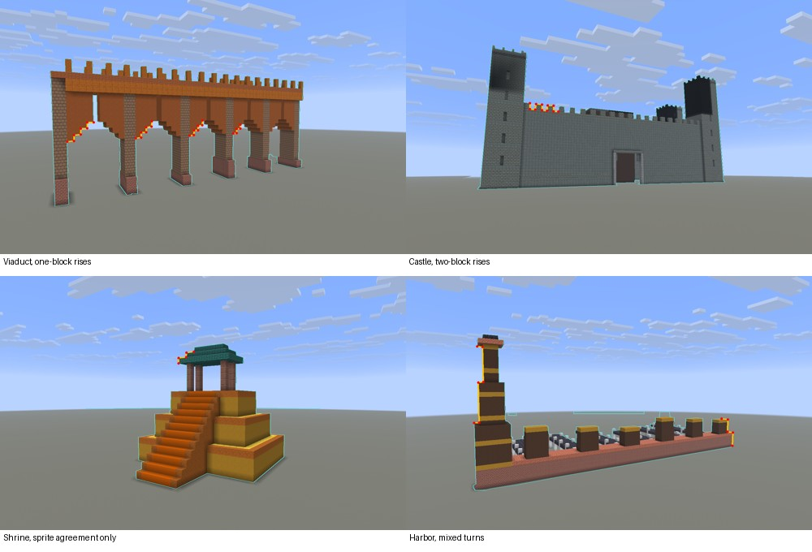

# Camera from repeated silhouette steps

Keep `experiment/camera-silhouette-ruler` experimental. The source rule recovered zero cameras from the 70 remaining Visible Builds v3 abstentions at `62611ee`. The training examples with independently confirmed repeats all had one-block rises. Both confirmed Castle examples had two-block rises. A rule that interprets each repeated step as one block would halve the scale on those views.



The teal lines show outlines from native RGB and observed part masks. Yellow marks measured turn candidates, including a Shrine texture check discussed below. Archive references, poses, and visibility labels enter only the scorer.

## Placement after the frozen source rule

| Cohort | Views | Geometry strict / facade | Position + ID strict / facade | Strict correct / missed / extra |
|---|---:|---:|---:|---:|
| Fixed historical | 104/104 | 91.27% / 93.42% | 84.68% / 88.51% | 20,773 / 2,929 / 1,046 |
| Visible Builds v3 | 144/144 | 21.84% / 22.75% | 14.13% / 14.79% | 28,086 / 186,064 / 14,949 |
| Decorative v1 | 40/40 | 63.46% / 65.23% | 50.51% / 52.56% | 9,240 / 7,686 / 2,957 |

All scores carry forward the independent matched packs. The accepted-camera arm took the incumbent path on all 288 views. The 218 earlier cameras retain their packs, the 70 v3 failures retain their misses, and the changes in recovered, lost, and extra positions and IDs are zero. The historical 112 were not regraded. The recorded full-projection intervention on the same 70 failures previously added 61,204 correct positions and 29,650 extras. It estimates camera-handoff opportunity across all 70.

## What a repeated turn measures

A native GrabCut contour starts from observed building masks. A five-corner window must contain four consecutive alternating horizontal and vertical segments, each at least 4.5 pixels. On the hypothesized facade, rectified widths and rises must each repeat within a factor of 0.78–1.28. GeoCalib supplies focal length and gravity, with horizontal direction from observed lines. The predictor separately tries rises of one, two, three and four blocks. Every integer dilation of a scene and camera displacement preserves the same silhouette in projection.

The scale check requires an independently verified tile on the same observed surface. One arm reads disjoint native atlas quads from the earlier MoGe source run, ignoring its scale and camera. Another projects the turn-conditioned grid and scans up to 20 complete cells on a disjoint region of the mask, requiring two separated native full-sprite agreements. For ground, the same visible surface must adjoin an upward-facing floor with continuous depth across several columns and consistent metric height. Acceptance further requires integer phase at the steps and a disjoint, phase-consistent turn on the same surface. The source detector, projection and gates froze on 49 training views at `493350c`, before opening 5 Harbor validation and 16 Castle test outcomes. The held-out buildings are reviewed regression examples.

| Residuals | Source orientation | Any repeated trace | Traces | Wall/scale options | Options with separate sprite | Options with floor | Accepted |
|---|---:|---:|---:|---:|---:|---:|---:|
| Training, 49 | 46 | 25 | 218 | 219 | 2 | 5 | 0 |
| Harbor, 5 | 5 | 4 | 16 | 1 | 0 | 0 | 0 |
| Castle, 16 | 16 | 10 | 34 | 84 | 0 | 48 | 0 |

Each trace is an overlapping five-corner window. Scoring queries all five native corners against recorded visible vertices within 3 px. Each of its four physical edges must follow one axis, the two axes must alternate on a single facade, and the two vertical edges must have equal integer length. Ambiguous coincident projections use a feasible match among the five nearest visible candidates per point. These counts establish **compatibility** with visible, coplanar unit or multi-block turns. Only six training views (Viaduct) and two Castle views (one layout/angle, two palettes) returned compatible traces.

| Native check | One block | Two blocks | All five near vertices but wrong axis/depth | At least one unmatched corner |
|---|---:|---:|---:|---:|
| Training, source orientation | 46 | 0 | 65 | 107 |
| Training, recorded orientation/intrinsics | 48 | 0 | 67 | 115 |
| Harbor, source orientation | 0 | 0 | 15 | 1 |
| Harbor, recorded orientation/intrinsics | 0 | 0 | 12 | 1 |
| Castle, source orientation | 0 | 14 | 10 | 10 |
| Castle, recorded orientation/intrinsics | 0 | 14 | 10 | 10 |

The exact-orientation diagnostic keeps the same native contours, window procedure and tolerances. The source metric fits used their source-estimated orientation throughout. The 14 Castle traces were on Castle 03 low-left. The four Castle 03 high-right/rear-oblique views missed by the parallel floor method produced only two repeated traces across four screenshots, and neither trace had an eligible supporting wall. The fifth residual, Pillars 03 marble rear-oblique, produced two wall/scale options and zero independent tiles or floor contacts. Unique accepted cameras beyond the floor method were zero.

## Ground height and metric camera

Two training traces, both Shrine, agreed with a disjoint atlas match at the one-block interpretation. Neither passed the native five-vertex check or the source ground gate. The diagnostic forces their cameras through ordinary placement twice. Both arms keep the same source orientation, silhouette-derived facade distance, and two horizontal camera coordinates. The mask-base arm estimates eye height from the lower outline of the wall, without checking support. The exact-height arm replaces only this one scalar using the recorded eye height above ground. Deterministic export scoring decodes the packs and allows one integer XYZ translation. The independent native-corner score fits a single integer offset on alternating visible world vertices and grades the rest.

| Shrine view | Eye height, mask base / recorded as fraction of true | Median held corner error, mask base / exact height | Strict F1, mask base / exact height | Strict +ID, mask base / exact height |
|---|---:|---:|---:|---:|
| 01 ochre high-right | −0.62 / 1.00 | 5.87 / 4.46 px | 9.28% / 24.64% | 9.28% / 16.99% |
| 03 ochre rear-oblique | −0.45 / 1.00 | 7.11 / 4.56 px | 3.10% / 29.01% | 0.00% / 23.31% |

The unverified lower edges put both cameras below the floor. A known floor datum helps each forced export, while native median errors remain above four pixels in both exact-height runs. The source ground checks correctly abstained.

## Bounded reference chooser

We decoded 12 forced ground-supported options from seven views, retaining the first enumerated representative per proposed integer rise per frame. The 53 source-ground options contain many overlapping windows. The chooser covers only the 12 executed options and the incumbent. It selects the best strict placement F1 per frame, using the same choice and translation for IDs. Exact-height interventions are excluded.

On v3 the chooser raised strict/facade geometry from 21.84%/22.75% to 25.35%/26.39%, and strict/facade position + ID from 14.13%/14.79% to 16.41%/17.17%. It added 5,649 correct positions, removed 5,649 misses, and added 3,368 extras. The resulting strict totals were 33,735 correct, 180,415 missed, and 18,317 extra. All seven views already overlap the independently successful floor method. None of the twelve poses reached two-pixel median native accuracy even after an independently fitted integer offset. Offset-tolerant median errors ranged from 3.00 to 12.54 px, and ordinary registered medians ranged from 22.90 to 633.40 px. This is measured opportunity for a reference chooser, with zero accepted source-only gains.

## Reproduction

Use the matching registered fixture worktrees and `mask-scalelsd/runs/env/Scripts/python.exe`. The manifest binds the frame set and incumbent packs. Per-frame source reports fingerprint the native images, source masks, orientation, depth field and tile evidence. Raw proposals, native-check outcomes and diagnostic pack information are in [cases.json.gz](cases.json.gz). Pooled metrics and paired interventions are in [summary.json](summary.json).

```powershell
python -m benchmark.camera_silhouette_round train source
python -m benchmark.camera_silhouette_round train score
python -m benchmark.camera_silhouette_round held source
python -m benchmark.camera_silhouette_round held score
python -m benchmark.camera_silhouette_diagnostics
python -m benchmark.camera_silhouette_report
```

The next source measurement would be a complete, identifiable unit tile on the visible wall tied to the same independently observed floor contact. A reliable count of repeats alone cannot resolve the two-block Castle counterexample. This branch adds benchmark code and evidence only. Nothing merged into main.

