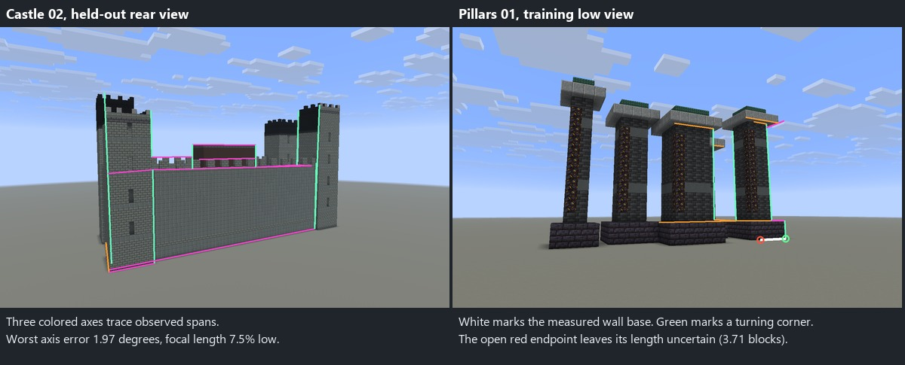

# Camera from visible building structure

Branch `experiment/camera-structure-scaffold` began at `7f63d4a`. It tests camera orientation from roof, wall and base outlines, followed by metric camera placement from visible wall scale and ground contact. Keep it experimental. The outlines improved orientation on several building families. Neither metric acceptance rule recovered a failed camera on held-out buildings.



## Orientation

We fitted an unknown centered square-pixel focal length to three observed vanishing directions. Native OpenCV line detection and frozen M-LSD segments supplied line candidates. The structure arm kept long segments near observed mask boundaries, joined differently oriented spans at projected junctions and propagated relative depths through connected edges. This produces a partial 3D scaffold in arbitrary units. No missing sides were added.

| Ordinary camera failures | Views | Raw line orientations | Structure orientations | Raw within 2° and 5% focal | Structure within both |
| --- | ---: | ---: | ---: | ---: | ---: |
| Visible Builds v3 | 108 | 55 | 69 | 18 | 36 |
| Decorative Builds v1 | 10 | 5 | 7 | 1 | 3 |
| Both | 118 | 60 | 76 | 19 | 39 |

The median worst-axis error among each method’s returned orientations was 4.16° for raw lines and 0.75° for structure. Among 47 cases with both fits, structure improved the worst axis on 41. The improvement depends on building family. All 36 v3 structure fits within both tolerances were on training buildings. On held-out Castles, raw lines returned 7 of 18 orientations with one within both tolerances. Structure returned one with a 1.97° worst-axis error and a focal length 7.5% low. Decorative validation returned three orientations, two within both tolerances.

## Scale, origin and whole-build placement

Of 76 orientations, 70 had a connected three-axis scaffold and 51 survived the 10% loop discrepancy test. Native full-sprite checks scanned 403 wall planes, found matches on 106, and found separated repeats with consistent phase on 77. Only five combinations of matches and observed base spans supported a tentative height, all on one training view. Their camera heights were 0.65–0.67 times the recorded height. They failed the separate floor-phase check.

A second scale cue used 26 wall charts with texture repetition verified in independent image bands. Four spans coincided with a visible wall base. Three gave tentative positive heights. Their ratios to recorded height were 0.998 on Pillars, 0.971 on Shrine and 2.107 on Viaduct. Each had only one turning junction at a measured base endpoint. The other endpoint stopped along an edge. On Pillars and Shrine the measured lengths also differed from the nearest integer by 0.29 and 0.31 blocks.

The primary gate accepted zero of 118 failures. A follow-up required a grounded turning corner, two separated elevated junctions and a strict majority of elevated junctions within 0.20 block of the same lattice. It also accepted zero. Pillars supported 4 of 9 elevated junctions, Shrine 6 of 28 and Viaduct 0 of 2. Its threshold was recorded before evaluating the rule. Development examples informed this follow-up.

| Full cohort | Views | Strict geometry F1 | Facade geometry F1 | Strict position + ID F1 | Facade position + ID F1 |
| --- | ---: | ---: | ---: | ---: | ---: |
| Fixed historical controls | 104 | 0.9127 | 0.9342 | 0.8468 | 0.8851 |
| Visible Builds v3 | 144 | 0.0808 | 0.0851 | 0.0616 | 0.0650 |
| Decorative Builds v1 | 40 | 0.5433 | 0.5611 | 0.4343 | 0.4534 |

Both source rules retain the verified ordinary export on abstention. These scores therefore carry forward for all 288 controls. Recovered positions, lost positions, extras added and extras removed are all zero. No successful ordinary cameras were modified.

### Rejected-fit diagnostic

For each of the four images with tentative metric cameras, the diagnostic forced the first source estimate into ordinary pre-inset placement and scored the decoded export. The source gate rejects every one. Reprojection below is the median registered native visible-corner error. Whole-build placement scores permit the established integer translation.

| Training view | Height ratio | Reprojection (px) | Correct / missed / extras | Strict geometry F1 | Strict position + ID F1 |
| --- | ---: | ---: | --- | ---: | ---: |
| Pillars 01 basalt low-left | 0.998 | 13.6 | 214 / 169 / 108 | 0.607 | 0.448 |
| Shrine 01 limestone rear-oblique | 0.971 | 5.2 | 289 / 240 / 135 | 0.607 | 0.447 |
| Amphitheater 02 ashlar low-left | 0.666 | 54.2 | 237 / 1268 / 325 | 0.229 | 0.002 |
| Viaduct 02 travertine high-right | 2.107 | 164.0 | 394 / 697 / 1200 | 0.293 | 0.059 |

The saved [case scores](cases.json.gz), [source fits](source-fits.json.gz), [dataset and split summaries](summary.json), [forced camera checks](forced-tentative.json), [elevated-corner outcomes](elevated-summary.json) and [input fingerprints](manifest.json) distinguish source predictions, registered camera checks and full-export measurements.

## Reproduction

Run in the feature checkout with the bundled Codex Python runtime, the frozen images and atlas, the sibling `full-expanded-controls` output and the shared replay helper from `experiment/camera-horizon-floor`. The manifest records the helper digest. The production build and models are unchanged.

```powershell
python -m benchmark.camera_structure_run predict --workers 4
python -m benchmark.camera_structure_run replay
python -m benchmark.camera_structure_run aggregate
python -m benchmark.camera_structure_diagnostic
python -m benchmark.camera_structure_elevated
python -m benchmark.camera_structure_sheet
```
