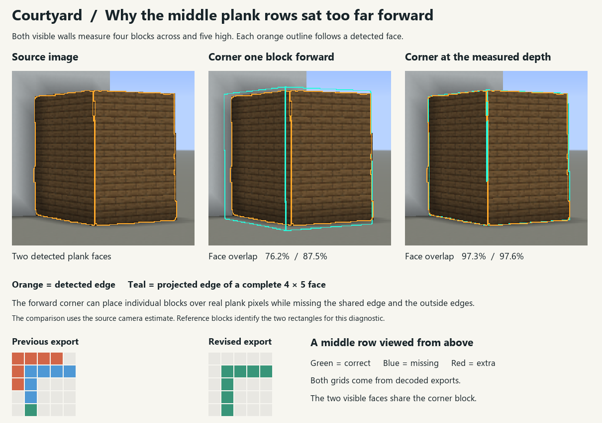

# Courtyard plank corner

On the low-left plaster Courtyard view with light gray concrete pavement, the two spruce faces measure four blocks wide by five high. They share a five-block vertical edge, so the source image shows 35 distinct plank positions. The previous export got 19 of them right. Seventeen extras belonged to the plank corner. The other 13 extras came from a separate pale wall.

## Where the placement failed

Surface Finder kept the two main faces separate. On the left face the Block Counter estimated 4.12 × 5.03 repeats, and on the right it estimated 4.00 × 5.07. Both rounded to 4 × 5. The wall-plane selector proposed the correct depth for each face. A second path used the texture crops to estimate depths independently, then kept any complete block face that fell inside its mask. It contributed eight blocks from one wall and nine from the other. All 17 were one block forward on their respective planes.

Those 17 blocks still projected over spruce pixels. Placement gave them priority, and its visibility check then discarded 16 correct positions behind them. The top and base rows were correct even in the previous export. The three middle rows made the corner appear to protrude. [Original chart-to-block placement](../../../engine/visible_grid.py) · [Visibility vote](../../../engine/visible_placement.py)

The shared edge distinguishes the depths. In this view it meets the pavement at approximately source pixel (879, 592). Intersecting that ray with the estimated ground plane gives local X = 11.05 and Z = −11.10. Using the integer corner (11, −11), the two projected 4 × 5 faces overlap their detected masks by 97.3% and 97.6%, measured as intersection over union. Moving the corner one block forward on both axes drops the overlaps to 76.2% and 87.5%. The diagram uses reference IDs to identify the rectangles for illustration. The placement rule uses the source image, detected masks, counts and estimated camera.

## Variations

| Variation | Measured result | Decision |
| --- | --- | --- |
| Delete individual blocks that improve the projected silhouette or face direction | A strict deletion check changed none of the eight Courtyard views. Relaxing it could remove a correct block on another view. | Keep as a diagnostic. |
| Correct the two texture-crop depths before the ordinary visibility vote | On the reported view it recovered the plank corner, lost one correct pale-wall block and introduced three pale-wall extras. | Keep experimental. |
| Use matching top and base rows and check the entire revised corner against the source masks | Restored 16 correct blocks and removed 17 extras on the reported view. A genuine projecting middle section passed through intact in a regression test. | Retain as a benchmark comparison. |
| Recheck both counted faces together at the shared ground corner, then edit only the conflicting placements | Restored 25 correct positions and removed 25 extras across two Courtyard views. All 202 other evaluated views kept their previous placements. | Ordinary default. |

The default checks pairs of upright, perpendicular faces with compatible counts and a shared edge in the source image. It projects neighboring integer ground corners and requires a unique fit of at least 90% intersection over union on both masks. In the reported view its sampled grid gives 94.46% and 97.48% agreement at the selected corner. The higher-resolution illustration above measures overlap at native source-image pixels. The selected corner must also agree with the placement stage's wall planes. Wrong-depth blocks supported independently by another chart or by visible samples on a separate surface are protected. Each restored block must win the visibility check in the revised build. [Default rule](../../../engine/counted_ground_corner.py) · [Geometry-only comparison](summary.json) · [Individual deletion experiment](removal-trial.json)

## Scores and replay

| Scope | Previous facade-priority F1 | Current facade-priority F1 | Current correct / missed / extra |
| --- | ---: | ---: | ---: |
| Plaster low-left, light gray concrete floor | 83.19% | 92.57% | 162 / 13 / 13 |
| Plaster low-left, smooth stone floor | 93.71% | 98.58% | 173 / 2 / 3 |
| Fixed 104 source images | 93.2075% | 93.3307% | 18,934 / 1,642 / 1,064 |

Fixed strict F1 went from 91.0788% to 91.1887%, with 20,755 correct, 2,947 missed and 1,064 extra. Camera-registered strict F1 is also 91.1887%. Historical 112-view strict F1 is 90.4259%. Both improved images show the same previously reviewed layout on different floors. The 100 additional controls retained their prior scores. [Per-frame results](../counted-ground-corner-01/cases.json) · [Pooled scores and hashes](../counted-ground-corner-01/summary.json) · [Two scored exports](../counted-ground-corner-01/default-exports.zip)

Both ordinary source-image builds matched the coordinates and materials in the scored datapacks. The tested default is `141bc91`. Run `python -m benchmark.counted_ground_corner_eval` with the frozen fixtures to repeat the default comparison. Run `python -m benchmark.courtyard_corner_sheet` to draw the close-up and `python -m benchmark.current_placement_viewer` to refresh the interactive review. The earlier geometry-only experiment can be reproduced with `python -m benchmark.courtyard_corner_release`. [Ordinary build verification](../counted-ground-corner-01/ordinary.json) · [Tests for competing corners, incomplete counts and a projecting step](../../../tests/test_counted_ground_corner.py)
