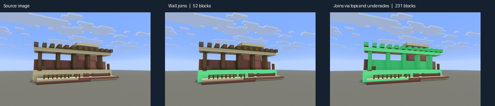

# Can visible edges connect the measured walls?

[Compare the 13 placement variants, including material scores and source-image overlays](placement.md). The source-only whole-wall sampler with the masked atlas is the next floating-branch candidate. It improves geometry on 35 of 38 views and typed placement on 26, with two geometry losses and eight typed losses. It emits 5,302 extra positions, up from 107 in the ordinary source baseline. A fresh layout-level validation should test whether projected cell boundaries, texture alignment and opening evidence can suppress those extras. These 38 images have already informed multiple experiment choices.

Use the corrected numeric-count and corrected grid-pitch runs to distinguish consumers of the same information. Changing the counter numbers alone gains 0.72 percentage points in strict placement. Applying the local pitch directly to an existing grid and resampling its supported cells gains 10.70 points over the same resampling rule. The latter improvement is concentrated in Castle. Precise corners, occupancy and charts for additional walls together account for much greater potential. With exact grids, an edge mismatch of about one pixel can still join Castle walls tens of blocks apart. Evaluating multiple separated edge segments and estimating pixel uncertainty per grid should help distinguish those joins from real short garden returns.

The reference-only diagnostic uses the original 38 Java 26.3 test views from eight layouts across three structure families. Each node is a recorded, visibly occupied full-cube surface. A join requires perpendicular surfaces sharing a physical unit edge and at least one coincident sample with visible pixel ownership on both sides. Each surface supplies its own internally correct grid. We count distinct positions with a visible vertical full-cube face, including blocks with multiple observed faces only once.

| Dataset | All visible target blocks | Largest direct wall group | Largest via walls, tops and undersides | Via walls, tops and undersides with two edges ≥4 px | All visible wall blocks with known relative positions |
|---|---:|---:|---:|---:|---:|
| Visible Builds v2 | 3,414 | 1,358 | 1,474 | 1,474 | 3,062 |
| Visible Builds v3 | 52,402 | 29,610 | 29,628 | 29,604 | 52,278 |
| Decorative Builds v1 | 3,622 | 656 | 1,822 | 1,366 | 2,310 |
| All 38 | 59,438 | 31,624 | 32,924 | 32,444 | 57,650 |

Counts sum the largest group separately in each view. They assume exact ownership, face direction and relative offsets inside a group. The last column additionally supplies correct relative offsets between all groups. Under that assumption wall blocks alone cover 97.0% of all target positions, equivalent to 98.47% strict placement F1 with zero extras. This describes reference coverage. The downstream placement experiments measure what the assembler can actually use. The Castle family contributes 88% of target positions, so the per-family results matter.

For Walled Garden 2, warm palette, low left view, direct wall corners connect 52 blocks. Adding visible horizontal surfaces as bridges connects 231 of 298 visible wall blocks. The overlay highlights only vertical faces belonging to the selected wall blocks. Exact relative positions of disconnected surfaces and geometry of partial decorative blocks would require additional evidence. For the 18 Castle views, adding horizontal bridges gains only 18 positions in total.

Run `python -m benchmark.expanded_wall_connectivity` from the worktree to reproduce [per-view counts](coverage.json) and the comparison image. Evaluator code and reference labels stay on the floating experiment branch.
