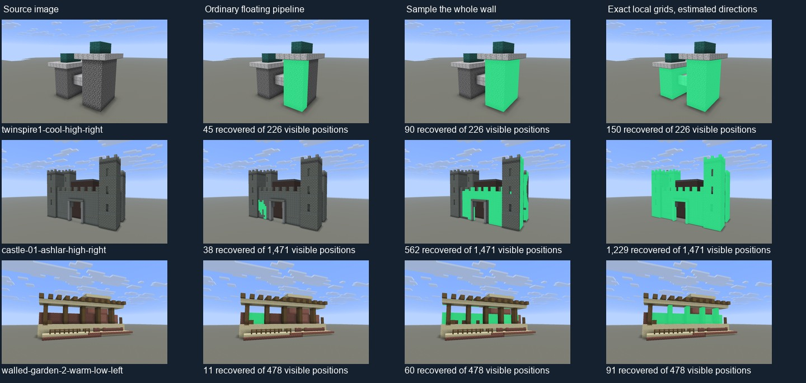

# Floating wall experiments across 38 held-out images

All values are pooled block F1 percentages. Each export receives one whole-build translation. The cohorts contain 12 Twin Spire, 18 Castle and eight Walled Garden images, with eight distinct layouts across the three families. The fixed 104 production trend uses a different pipeline and cohort.

The source baseline uses the ordinary surface finder. The native baseline supplies exact frontmost surface masks. The rulers/noop export uses those masks and the existing predicted wall grid, sampling cells over the entire mask. Spacing then supplies the true local pitch along both predicted axes. Origin also snaps one central grid corner to the reference lattice. The complete-grid exports additionally supply the individual visible cells and projected corners of full-cube walls, including walls originally missed by the counter. Source-normal estimates face directions from the source image. Signed supplies the recorded axis and facing. Both leave inter-wall offsets and depth to the assembler and estimate materials from source pixels. Two-edge variants require two matching segments for a perpendicular join. The count-only arm replaces the numeric dimensions at the counter handoff. The source_material arm retains original IDs for existing cells and uses the masked atlas matcher on newly sampled cells. The ordinary masks and grids are the only geometry inputs to both source resampling variants.

Green highlights visible positions recovered after one whole-build translation. Extra placements are included in F1 and omitted from the overlays.

## Visible position

| Export | Visible v2 | Visible v3 | Decorative v1 | All 38 |
|---|---:|---:|---:|---:|
| source | 30.90 | 1.57 | 3.79 | 3.72 |
| rulers/source_resample | 41.90 | 35.89 | 21.14 | 35.34 |
| rulers/source_material | 41.90 | 35.89 | 21.14 | 35.34 |
| native | 31.24 | 6.80 | 8.03 | 8.47 |
| rulers/counts | 28.44 | 7.92 | 7.24 | 9.19 |
| rulers/noop | 46.04 | 42.56 | 12.16 | 41.18 |
| rulers/spacing | 45.43 | 54.47 | 11.89 | 51.88 |
| rulers/origin | 48.04 | 55.84 | 12.86 | 53.32 |
| grids/source-normal | 83.08 | 90.42 | 34.08 | 87.76 |
| grids/signed | 83.16 | 84.87 | 44.15 | 83.13 |
| grids/source-normal-two-edges | 83.08 | 92.95 | 32.47 | 90.00 |
| grids/signed-two-edges | 83.16 | 94.76 | 39.52 | 91.92 |
| grids/signed-tight-edges | 83.16 | 95.87 | 44.15 | 93.04 |

## Facade-priority position

| Export | Visible v2 | Visible v3 | Decorative v1 | All 38 |
|---|---:|---:|---:|---:|
| source | 32.90 | 1.58 | 4.21 | 3.76 |
| rulers/source_resample | 44.06 | 35.82 | 22.76 | 35.55 |
| rulers/source_material | 44.06 | 35.82 | 22.76 | 35.55 |
| native | 33.32 | 6.82 | 8.72 | 8.56 |
| rulers/counts | 30.36 | 7.93 | 8.02 | 9.30 |
| rulers/noop | 48.27 | 42.63 | 13.26 | 41.57 |
| rulers/spacing | 47.66 | 54.53 | 13.14 | 52.33 |
| rulers/origin | 50.35 | 55.92 | 14.21 | 53.78 |
| grids/source-normal | 86.83 | 90.52 | 37.20 | 88.35 |
| grids/signed | 86.91 | 84.96 | 47.92 | 83.66 |
| grids/source-normal-two-edges | 86.83 | 93.05 | 35.47 | 90.60 |
| grids/signed-two-edges | 86.91 | 94.85 | 43.01 | 92.52 |
| grids/signed-tight-edges | 86.91 | 95.98 | 47.92 | 93.65 |

## Position and material

| Export | Visible v2 | Visible v3 | Decorative v1 | All 38 |
|---|---:|---:|---:|---:|
| source | 16.87 | 0.31 | 1.90 | 1.54 |
| rulers/source_resample | 9.24 | 0.44 | 0.45 | 0.99 |
| rulers/source_material | 19.42 | 3.62 | 2.07 | 4.51 |
| native | 23.18 | 1.29 | 4.12 | 2.89 |
| rulers/counts | 18.59 | 2.58 | 5.22 | 3.76 |
| rulers/noop | 10.81 | 2.17 | 0.64 | 2.68 |
| rulers/spacing | 6.38 | 4.97 | 0.73 | 4.85 |
| rulers/origin | 12.11 | 8.28 | 1.50 | 8.21 |
| grids/source-normal | 75.00 | 50.52 | 21.12 | 50.66 |
| grids/signed | 75.02 | 46.96 | 22.72 | 47.41 |
| grids/source-normal-two-edges | 75.00 | 51.19 | 20.35 | 51.24 |
| grids/signed-two-edges | 75.02 | 50.83 | 21.84 | 50.92 |
| grids/signed-tight-edges | 75.02 | 51.27 | 22.72 | 51.32 |

## Facade-priority position and material

| Export | Visible v2 | Visible v3 | Decorative v1 | All 38 |
|---|---:|---:|---:|---:|
| source | 17.96 | 0.31 | 2.10 | 1.55 |
| rulers/source_resample | 9.71 | 0.43 | 0.48 | 0.99 |
| rulers/source_material | 20.44 | 3.60 | 2.24 | 4.53 |
| native | 24.72 | 1.29 | 4.56 | 2.92 |
| rulers/counts | 19.85 | 2.59 | 5.78 | 3.81 |
| rulers/noop | 11.36 | 2.17 | 0.70 | 2.71 |
| rulers/spacing | 6.72 | 4.97 | 0.80 | 4.90 |
| rulers/origin | 12.74 | 8.30 | 1.65 | 8.28 |
| grids/source-normal | 78.38 | 50.58 | 23.05 | 51.00 |
| grids/signed | 78.40 | 47.01 | 24.66 | 47.71 |
| grids/source-normal-two-edges | 78.38 | 51.24 | 22.23 | 51.58 |
| grids/signed-two-edges | 78.40 | 50.88 | 23.77 | 51.25 |
| grids/signed-tight-edges | 78.40 | 51.32 | 24.66 | 51.66 |
