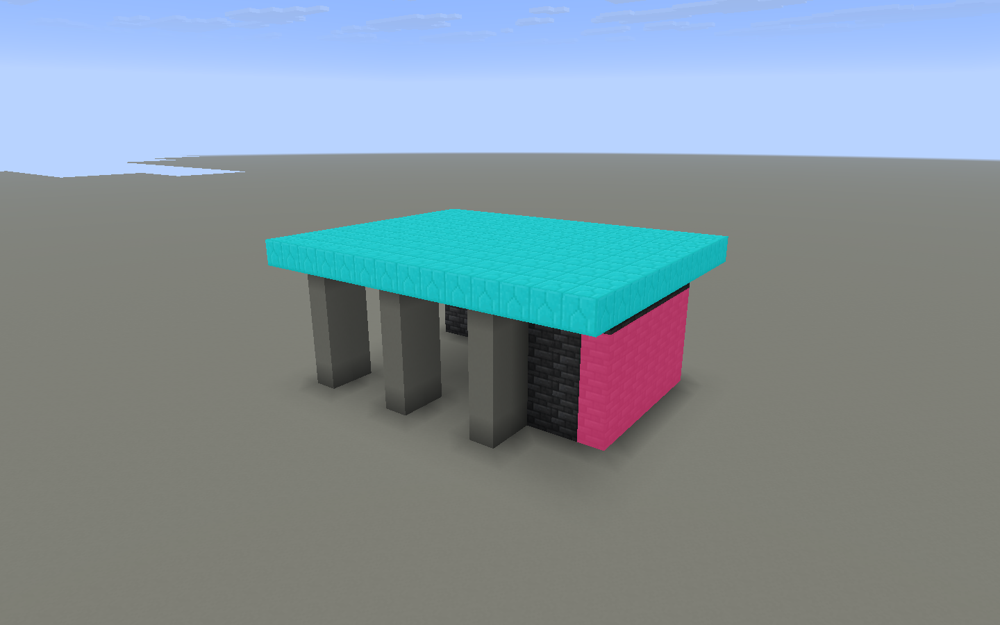
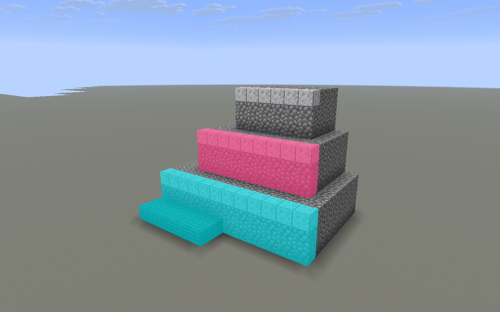
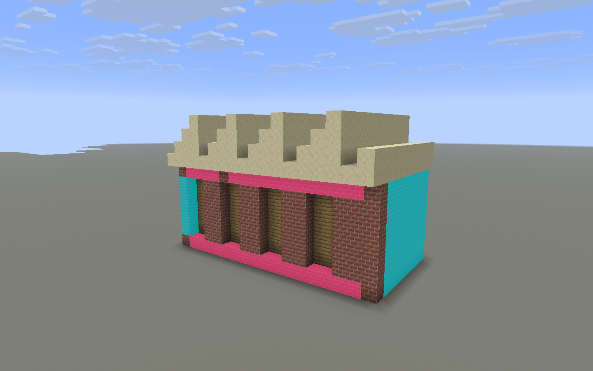
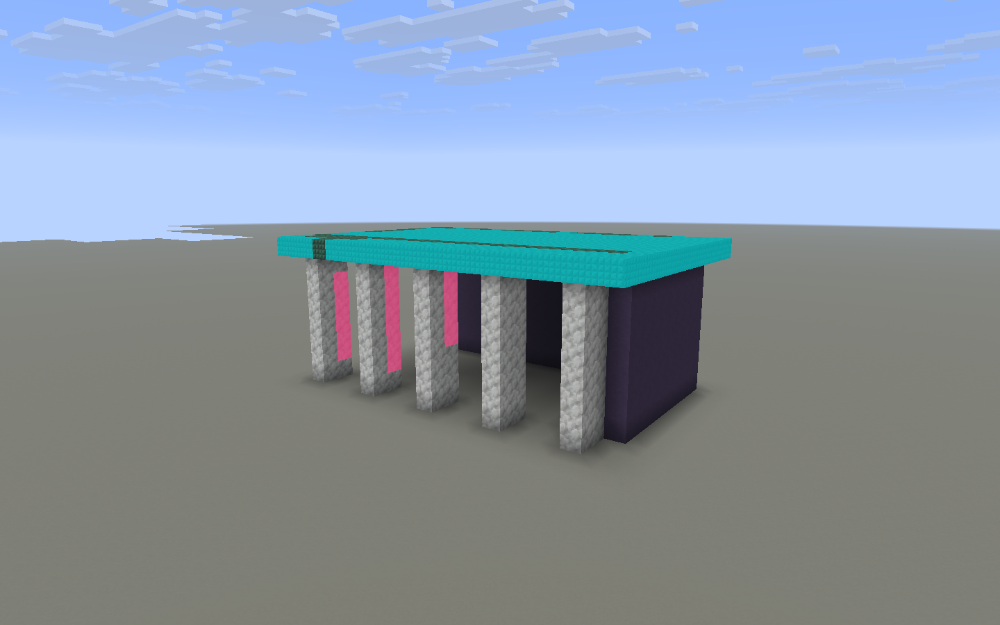

# Floating visual review queue

Original Visible Builds V1 replay. Baseline — Expanded split-border compared with Candidate 1 — Guarded depth-first refit.

Open a PNG at full size to inspect native pixels. Cyan marks gained correct positions and pink marks lost correct positions. Color follows the recorded frontmost block face. Extra positions have no native owner and appear in the counts. An amber outline shows the photographed support of a dropped parent chart.

## Visible Builds

144 scored views. 0 had a net decline in correct placements.

### train-arcade1-cool-high-right

Disjoint component selection.

Correct positions gained 154, lost 28. Extras added 0, removed 0. Exact material matches gained 153, lost 24.

[Open placement overlay](visible/original/train-arcade1-cool-high-right/placement.png)

[Dropped chart mask-2](visible/original/train-arcade1-cool-high-right/dropped.png)

### train-terrace1-cool-high-right

Disjoint component selection.

Correct positions gained 42, lost 27. Extras added 0, removed 0. Exact material matches gained 42, lost 20.

[Open placement overlay](visible/original/train-terrace1-cool-high-right/placement.png)

[Dropped chart mask-1](visible/original/train-terrace1-cool-high-right/dropped.png)

### train-sawtooth3-earth-high-right

Most previously correct positions lost.

Correct positions gained 61, lost 31. Extras added 0, removed 8. Exact material matches gained 60, lost 9.

[Open placement overlay](visible/original/train-sawtooth3-earth-high-right/placement.png)

### train-arcade3-cool-high-right

Most new correct positions.

Correct positions gained 218, lost 15. Extras added 2, removed 1. Exact material matches gained 63, lost 12.

[Open placement overlay](visible/original/train-arcade3-cool-high-right/placement.png)

## Floating branch scorecard

Saved scores from the supplied stage report. Queue generation reruns neither inference nor scoring.

| Cohort and method | Strict / facade placement F1 | Strict / facade position + ID F1 | Strict correct / missed / extra |
|---|---:|---:|---:|
| Visible Builds, 144 views, Baseline — Expanded split-border | 37.64% / 40.20% | 15.11% / 16.42% | 9,623 / 24,831 / 7,052 |
| Visible Builds, 144 views, Candidate 1 — Guarded depth-first refit | 39.38% / 41.37% | 17.06% / 18.54% | 10,156 / 24,298 / 6,974 |
