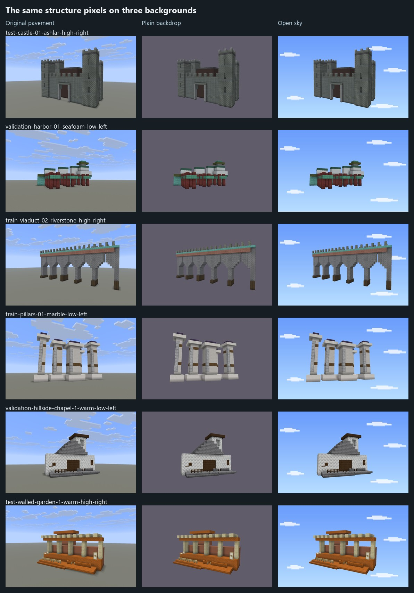

# Floating builds and local grid

**Keep both branches experimental.** The ordinary camera failed on every paired background replacement. The image-only grid recovered small visible sections.

## Matched results

| Method | Background | Views | No full projection | Local-only exports | Strict / facade placement F1 | Strict / facade position + ID F1 | Strict correct / missed / extra |
| --- | --- | ---: | ---: | ---: | ---: | ---: | ---: |
| Ordinary default | Pavement | 6 | 0 | 0 | 73.46% / 73.94% | 50.59% / 50.76% | 2,743 / 1,298 / 684 |
| Ordinary default | Plain backdrop | 6 | 6 | 0 | 0.00% / 0.00% | 0.00% / 0.00% | 0 / 4,041 / 0 |
| Ordinary default | Open sky | 6 | 6 | 0 | 0.00% / 0.00% | 0.00% / 0.00% | 0 / 4,041 / 0 |
| Build-local grid from image | Pavement | 6 | 6 | 0 | 0.00% / 0.00% | 0.00% / 0.00% | 0 / 4,041 / 0 |
| Build-local grid from image | Plain backdrop | 6 | 6 | 2 | 1.18% / 1.21% | 0.64% / 0.65% | 24 / 4,017 / 0 |
| Build-local grid from image | Open sky | 6 | 6 | 1 | 1.28% / 1.31% | 1.08% / 1.11% | 26 / 4,015 / 0 |
| Build-local grid with native wall fallback | Pavement | 6 | 6 | 1 | 0.64% / 0.66% | 0.39% / 0.40% | 13 / 4,028 / 0 |
| Build-local grid with native wall fallback | Plain backdrop | 6 | 6 | 4 | 3.17% / 3.23% | 2.00% / 2.04% | 65 / 3,976 / 0 |
| Build-local grid with native wall fallback | Open sky | 6 | 6 | 3 | 2.30% / 2.25% | 1.71% / 1.75% | 47 / 3,994 / 0 |
| Recorded projection, floor on | Pavement | 6 | 0 | 0 | 76.34% / 76.78% | 56.01% / 56.19% | 2,861 / 1,180 / 593 |
| Recorded projection, floor on | Plain backdrop | 6 | 0 | 0 | 71.67% / 72.20% | 50.42% / 50.74% | 2,546 / 1,495 / 518 |
| Recorded projection, floor on | Open sky | 6 | 0 | 0 | 71.55% / 71.81% | 46.97% / 47.05% | 2,666 / 1,375 / 745 |
| Recorded projection, floor off | Pavement | 6 | 0 | 0 | 40.15% / 40.14% | 28.42% / 28.25% | 1,143 / 2,898 / 509 |
| Recorded projection, floor off | Plain backdrop | 6 | 0 | 0 | 34.44% / 34.38% | 22.09% / 21.97% | 965 / 3,076 / 598 |
| Recorded projection, floor off | Open sky | 6 | 0 | 0 | 36.76% / 36.43% | 23.56% / 23.16% | 1,050 / 2,991 / 621 |
| Recorded projection, roof origin, floor on | Pavement | 6 | 0 | 0 | 14.21% / 14.15% | 0.34% / 0.35% | 331 / 3,710 / 286 |
| Recorded projection, roof origin, floor on | Plain backdrop | 6 | 0 | 0 | 18.97% / 19.28% | 7.73% / 7.87% | 459 / 3,582 / 339 |
| Recorded projection, roof origin, floor on | Open sky | 6 | 0 | 0 | 12.33% / 12.31% | 0.20% / 0.21% | 306 / 3,735 / 618 |
| Recorded projection, roof origin, floor off | Pavement | 6 | 0 | 0 | 40.15% / 40.14% | 28.32% / 28.15% | 1,143 / 2,898 / 509 |
| Recorded projection, roof origin, floor off | Plain backdrop | 6 | 0 | 0 | 34.44% / 34.41% | 21.98% / 21.86% | 965 / 3,076 / 598 |
| Recorded projection, roof origin, floor off | Open sky | 6 | 0 | 0 | 36.76% / 36.43% | 23.49% / 23.09% | 1,050 / 2,991 / 621 |
| Recorded projection and anchor depth, floor off | Open sky | 6 | 0 | 0 | 62.08% / 62.39% | 44.83% / 45.13% | 2,454 / 1,587 / 1,411 |

Moving the local Y origin from base to roof with floor policy **floor** preserved the same decoded geometry on **0/18** paired inputs and the same geometry plus IDs on **0/18**.

Moving the local Y origin from base to roof with floor policy **floating** preserved the same decoded geometry on **18/18** paired inputs and the same geometry plus IDs on **18/18**.

Every arm scores the same 4,041 visible positions per background. The facade score exempts 86 visible sliver-only targets. Scores permit one whole-build integer XYZ translation. For local sheets the evaluator registers tangent axes to the recorded view, then applies that same translation rule. On Castle, ties between geometry-optimal translations can change the reported material score for identical rebased packs. The origin check compares decoded materials directly.

The subset contains four Visible Builds v3 views and two Decorative Builds v1 views. The full historical cohorts carry forward from [the measured default at e3bd220](../camera-native-round-01/README.md). Fixed 104 placement is 91.27% strict / 93.42% facade with 20,773 correct, 2,929 missed and 1,046 extra. Full v3 is 46.63% / 48.04% and full decorative is 63.46% / 65.23%.

## What each comparison isolates

- All labeled structure pixels, relative viewpoint and visible targets are identical within each triplet. Plain and sky replace all remaining pixels. The horizonless sky is synthetic and preserves the original camera visibility and occlusions. Three views look upward.

- The image-only candidate rebuilds Regions First masks and Block Counter using the source and its predicted normal and depth fields. Native texture fits establish a local scale and phase. The exploratory fallback also grows connected wall sheets with separate texture verification per adjoining cell after a full grid fails.

- Exact-projection runs share each background’s frozen Surface Finder and Counter handoff. Both policies rerun ranked placement and materials and omit the same build-level post-placement passes. Floor-off disables assumed contact and keeps signed Y. The default distance seed is about 23 blocks, derived from lens and frame height. The distance diagnostic receives the actual median depth of the visible labeled block centers as additional reference information.

## Reproduce

Use the pinned Java 26.3 model assets and atlas. From the stable checkout set PYTHONPATH to that checkout, then run prepare_fixtures.py and run_baseline.py. From their candidate checkouts run python -m benchmark.floating_build_local_run with the fixture manifest as its positional argument, both with and without --native-fallback, and python -m benchmark.floating_exact --wait. Back in the stable environment run report_round.py, validate_round.py and archive_results.py. The local report and original run artifacts live under runs/floating-build-grid-01 in the stable checkout. [Fixture, pose and score receipts](results.json)

The local grid and paired review are on experiment/floating-build-local-grid. Placement bypasses are on experiment/floating-build-floor-bypass. Main stays on its verified default.
