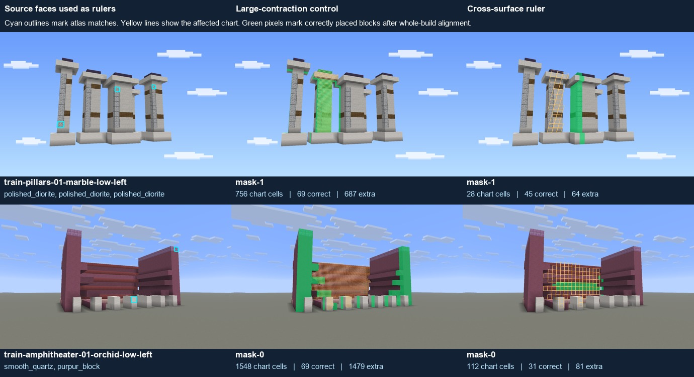

# Calibrating oversized wall grids from other visible block faces

Keep this rule experimental. It reduced excessive placements on both changed training views while losing correctly placed blocks on each. All 48 validation and test conditions kept their old export. No reconstruction behavior landed on integration or production.

In the Amphitheater low-left view the source atlas recognized the purpur block at the upper right and a smooth quartz block near the front. The source-image wall chart implied a 6.97-pixel vertical unit after correcting for perspective. The two independent faces implied 24.67 pixels at the target wall's estimated depth. Resampling at that scale reduced the wall from 1,548 cells to 112. The final build had 1,398 fewer extra positions and 38 fewer correct positions. This feedback view is a regression example. The comparison covers the archived layouts used to investigate the failure.

## How the scale transfers

Use verified, complete atlas faces on two other wall charts. Each face must score at least 0.80 correlation and have a neighboring match at 0.70, or score 0.90 itself. The donor homography predicts the vertical unit at the donor surface's center. Its vertical vanishing direction corrects for image position. Two donors fit a slope and intercept between this corrected height and their surfaces' estimated relative inverse depths. The model's normalized disparity can have an arbitrary offset. Values across the wall use the target's own perspective projection.

Allow only positive slopes, donor depth separation of at least 0.04 normalized units, and extrapolation of at most one donor interval. Estimates from different eligible pairs must agree within a factor of 1.5. Only expand the unit by a factor between 2.5 and 8 on an existing wall with 256 or more cells. Keep previous large-contraction substitutions. Anchor the replacement lattice at an existing chart intersection near its center and use the regular visible-mask, RGB material, join and export steps. A donor match provides scale evidence only. It establishes neither a common lattice origin nor the correctness of the target outline.

The rule was specified from the reviewed Amphitheater failure and run once on the frozen 92 view conditions. Atlas hits existed on 57 conditions. The gate considered 36 walls on 34 conditions. Only three walls had a usable depth estimate. Viaduct high-right measured 18.82 against a 20.99-pixel old unit and abstained. Pillars marble low-left had three accepted polished diorite rulers on other surfaces. They estimated 31.20–31.37 pixels against 6.65 on the target chart. Its corrected unit reduced 756 chart cells to 28. Both changed exports still failed to position much of the visible structure.

## Paired decoded exports

| 92 view conditions | Strict placement | Facade placement | Strict position + ID | Facade position + ID | Correct / missed / extra |
|---|---:|---:|---:|---:|---|
| Large-contraction control | 32.13% | 32.67% | 5.10% | 5.20% | 21,240 / 72,356 / 17,374 |
| Transfer from other surfaces | 32.55% | 33.11% | 5.17% | 5.28% | 21,178 / 72,418 / 15,353 |

The candidate gained 66 correct positions and lost 128, added 134 extras and removed 2,155. Strict exact-ID matches declined by four. Only Visible Builds v3 changed, with strict F1 increasing from 32.20% to 32.73% on 38 conditions (37 unique of 144). The 24 Decorative Builds v1 conditions (23 unique of 40) stayed at 24.75%. The 30 Visible Builds v2 conditions stayed at 42.83%. The earlier 86 conditions went from 32.52% to 32.65%, and the six-condition fifth panel went from 18.34% to 26.78%. All changed views belonged to the 44 training conditions. No lighting pairs or production suites were rerun.

From this worktree run `python -m benchmark.floating_cross_ruler` then `python -m benchmark.floating_cross_ruler_sheet`. The base is `d83afec`. The immutable assembly, chart and offer receipts use the sibling isolation worktree at `e97dd44`. The source-only chooser receives verified image-derived masks, relative depth, homographies, material proposals and image dimensions. Scoring uses each decoded pack's one whole-build registration and the original visible reference. The private assemblies are under `runs/cross-ruler`. [Per-condition hashes and decisions](conditions.json.gz) · [Paired metrics by dataset and split](summary.json)

## Floating branch scorecard

| Six fixed sky composites | Strict placement | Facade placement | Strict position + ID | Facade position + ID | Correct / missed / extra |
|---|---:|---:|---:|---:|---|
| Integration sparse default, carried forward at `7033891` | 12.64% | 12.90% | 4.68% | 4.77% | 273 / 3,768 / 5 |
| Large-contraction control | 27.50% | 27.73% | 5.96% | 5.99% | 890 / 3,151 / 1,542 |
| Cross-surface ruler | 29.73% | 30.14% | 6.59% | 6.69% | 866 / 3,175 / 919 |

Against the large-contraction control, strict F1 rose 2.23 points with 24 fewer correct and 623 fewer extra positions. Against integration the candidate adds 593 correct positions and 914 extras. Only the experiment branch received this rule. The separate fixed-104 production result carries forward at 91.27% strict and 93.42% facade.
