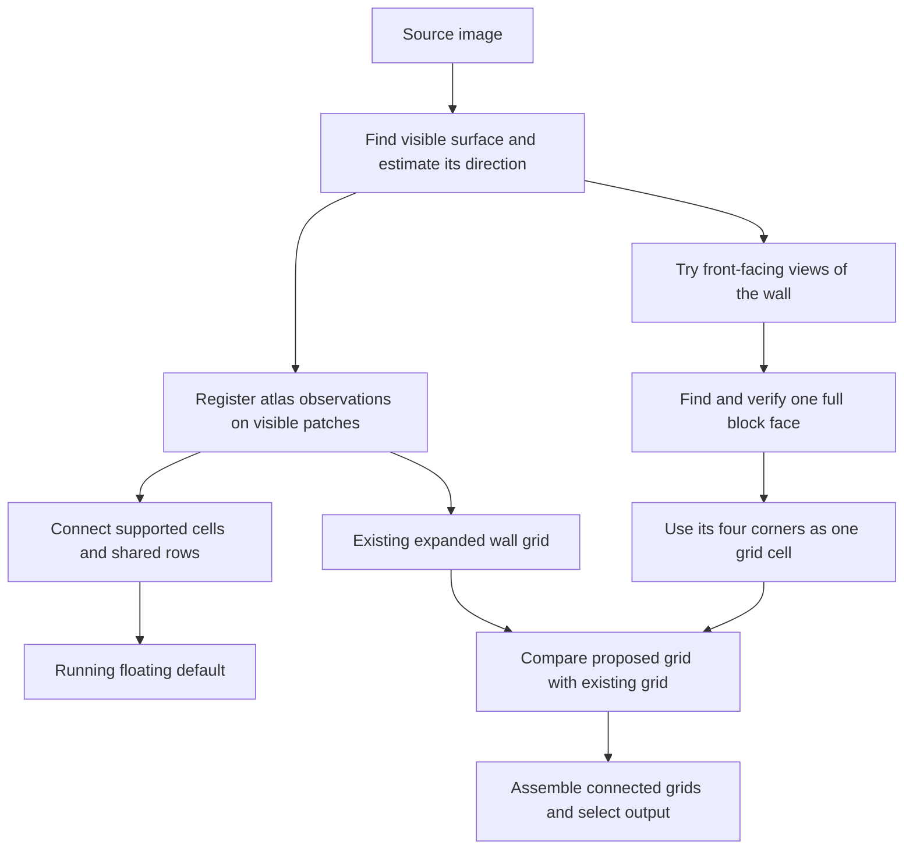
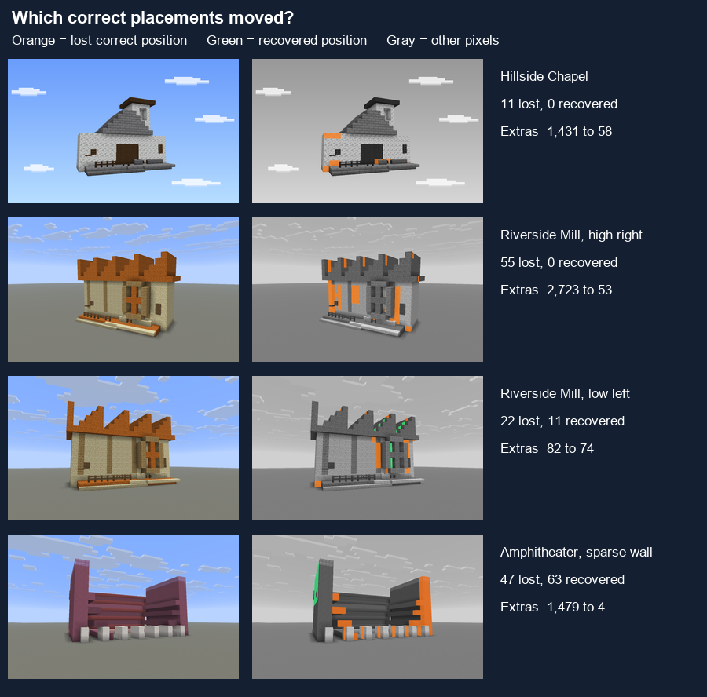

# When to replace a floating wall grid

The chart-by-chart replay isolates a useful trade. Adopt the large-contraction rule as the benchmark challenger for the floating pipeline. The six-sky integration default still has much higher precision, and the expanded challenger still needs an independent confirmation on a new layout where the rule actually fires.

[Open the six-case interactive review](review.html) locally to inspect the source, mask, both grids and the visible reference boundaries. Use the reference toggle after choosing a grid if you want a blind comparison. Feedback can be downloaded as JSON. Rebuild the portable page with `python -m benchmark.floating_extra_feedback`.

## How one face becomes a grid

A surface mask marks pixels that the finder believes belong to one plane. A block face is one side of one block within that mask. For a wall the experimental search tries to undo the apparent narrowing toward the far end using the estimated surface direction and straight edges. In that front-facing view it searches for a square of unknown size and verifies its atlas texture against source pixels. An accepted square gives four source-image corners for one block. The projection maps a grid of equal block-size squares on the wall back into the source image, where the distant squares appear narrower. Ordinary assembly then joins compatible grids and chooses a connected group to export.

A convincing tile can establish local spacing even when the mask crosses a corner or the estimated wall angle is slightly wrong. The farther the grid extends, the larger those errors can become. If no full face qualifies, this challenger keeps the existing expanded wall grid. The prospective Amphitheater test below shows why that fallback matters.

## Intervention

Build the original wall grid and the proposed grid from the confirmed full face. Replace an individual chart only if the original contains at least 256 cells and the replacement has at most a quarter as many. Keep the rest of the assembly and registration procedure fixed. The thresholds were chosen from the earlier panels and frozen before scoring the six new views. The rule uses visible source evidence and chart sizes. It can be run from the [isolation experiment](https://github.com/jeremyepling/minecraft-image-reconstruction/tree/experiment/floating-extra-isolation).

Across the 86 prior view conditions, only five exports changed under the rule. They include repeat views or conditions of the same structures. Counts below are pooled across views. Correct and extra refer to positions after one whole-structure alignment.

| Policy | Correct | Missed | Extra | Precision | Recall | Strict placement F1 |
|---|---:|---:|---:|---:|---:|---:|
| Whole-wall challenger | 20,993 | 70,774 | 20,667 | 50.39% | 22.88% | 31.47% |
| Replace whenever a full-face ruler is accepted | 20,507 | 71,260 | 15,455 | 57.02% | 22.35% | 32.11% |
| Replace only on a large contraction | 20,905 | 70,862 | 15,884 | 56.82% | 22.78% | **32.52%** |

Against the whole wall, each net correct position given up avoided about 54 net extras, and 49 more blocks matched both position and material. Against unrestricted replacement, the rule recovered 398 net correct positions and conceded 429 net extras. Those are different comparisons and support different choices when extra placements are especially costly.

## Where the trade comes from

Orange and green show the visible faces of blocks that left or entered the correctly placed set under unrestricted replacement in the first three rows and the targeted sparse-wall test in the last row. Gray includes both unchanged placements and positions missed by both methods. The extras count includes positions that lack a corresponding visible reference block, so the overlay only colors gains and losses of correct positions.

- On Hillside Chapel, replacing one chart reduced extras from 1,431 to 58 and correct placements from 118 to 107. Exact position and material matches rose from 19 to 39.
- On Riverside Mill high-right, a single wall replacement eliminated 2,670 net extras, costing 55 correct placements. The selected connected component stayed the same. The other three replacements had no individual effect.
- On Riverside Mill low-left, the unrestricted rule lost 22 correct positions and recovered 11, with eight fewer extras and 44 fewer exact material matches. The large-contraction rule preserves the original here.

## Could we just emit fewer blocks?

Across all 92 view conditions, the unrestricted proposal emitted fewer blocks in 28. On each of those 28, we took the previous output and kept exactly the proposed number of blocks, then repeated registration and scoring.

| Which positions filled the same export budget? | Correct visible positions |
|---|---:|
| Reproducible random sample of old placements | 1,849 |
| Prioritize existing atlas seeds, material assignments, then confidence | 1,926 |
| Place using the full-face ruler | **2,164** |

The original untrimmed outputs had 2,737 correct positions. The ruler retained 238 more than the simple evidence ranking at equal size. For Chapel the comparison was 107 versus 22. On Riverside high-right it was 97 versus 46. The random result is one seeded draw. This is a size-matched diagnostic using the candidate's emitted count. It does not establish that the program knows the ideal output size.

Run the size controls with `python -m benchmark.floating_extra_budget`, then `python -m benchmark.floating_extra_budget holdout5`. Run `python -m benchmark.floating_extra_examples` to render the figure. The two compressed JSON files contain per-view placement, material, and paired changes. They consume the saved worktrees and exported inputs described in the [audit](https://github.com/jeremyepling/minecraft-image-reconstruction/tree/experiment/floating-extra-audit).

## Prospective check and distant seams

On six fresh views of three held-out layouts, the threshold never fired. Strict placement F1 was 18.34% before and after, compared with 18.01% for the running floating default and 18.80% for unrestricted replacement. Exact position and material F1 was 11.22% for the contraction rule and 17.81% for the running default. These six views did not provide a fresh positive example for the gate. They cover Visible Builds v2 and v3.

We also tested whether a proposed grid predicted distant seams in source pixels. On the earlier 86 views, seam-only placement F1 was 31.48%. Accepting either seam evidence or large contraction scored 32.48% versus 32.52% for contraction alone, while position and material F1 improved from 4.92% to 4.98%. On the fresh six the combined rule reached 18.40% placement and 11.66% position and material. Keep the seam rule experimental. [Per-panel seam results](https://github.com/jeremyepling/minecraft-image-reconstruction/tree/experiment/floating-distant-seams/benchmark/reviews/floating-distant-seams-01)

### Dropping the wall that caused the fresh failure

On Amphitheater low-left the two atlas-supported cells in one wall had expanded to 1,548. Its 42 proposed full faces all failed verification, so the contraction rule could not act. We changed only that wall, once keeping its two original cells and once deleting it completely. In both replays the assembler selected the same other group of 89 blocks. Correct positions went from 69 to 85, extras from 1,479 to four, and correct position plus material from three to 48. Strict placement F1 rose from 6.59% to 26.73%. This is a diagnostic selected after inspecting the errors. It suggests testing how the assembler ranks expansive, weakly supported groups against smaller groups before applying a general rejection threshold.

## Floating branch scorecard

Six fixed sky composites. F1 is pooled across visible blocks. Strict counts use correct / missed / extra order.

| Method | Placement F1 | Facade F1 | Position + ID F1 | Facade + ID F1 | Strict counts |
|---|---:|---:|---:|---:|---|
| Running floating default | 12.64% | 12.90% | 4.68% | 4.77% | 273 / 3,768 / 5 |
| Previous whole-wall challenger | 22.93% | 23.07% | 4.40% | 4.40% | 901 / 3,140 / 2,915 |
| Previous unrestricted full-face ruler | 27.45% | 27.68% | 5.97% | 5.99% | 888 / 3,153 / 1,542 |
| New large-contraction challenger | **27.50%** | **27.73%** | 5.96% | 5.99% | 890 / 3,151 / 1,542 |

The new challenger gains 4.57 placement points over the whole wall and 0.05 points over unrestricted replacement. Relative to the running default it gains 14.86 points with 617 more correct positions and 1,537 more extras. The floating integration branch received reporting instructions only, so its runtime gain this round is zero. The fixed 104, v3 and Decorative full production baselines were not rerun in this floating experiment. Keep this experiment separate from main.
