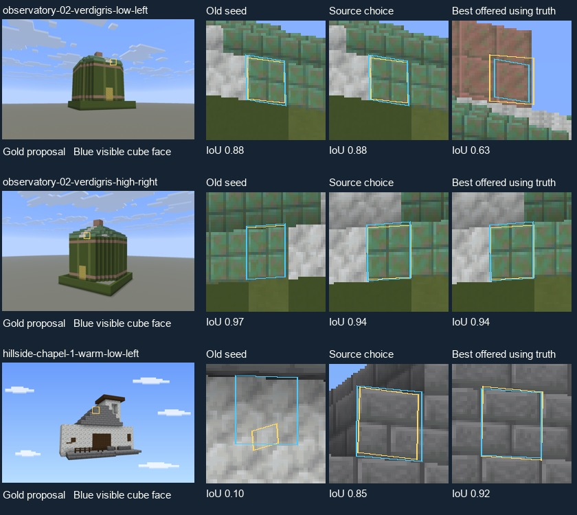

# Finding one full wall tile in the screenshot

On the hillside Chapel sky composite the existing ruler consisted of two sub-block patches of calcite identified as pearlescent froglight. The new search found one visible stone-brick face on a different part of the same mask. Its 768 projected pixels belong to that one face. The recorded block and matched material agree. The predicted quadrilateral has 0.849 intersection-over-union with the recorded face, 0.064 blocks RMS corner error and side lengths of 0.891 by 0.952 true blocks. Feeding its four source-predicted corners into the existing whole-mask sampler reduced the Chapel export from 1,549 to 165 placements. Correct positions fell from 118 to 107, extras fell from 1,431 to 58 and exact position-plus-material matches increased from 19 to 39.



On Observatory low-left the source rule retained the existing ruler. The export kept 195 correct positions, 189 extras and 32 correct IDs. On high-right, two replacement rulers raised correct positions from 184 to 192 and exact position-plus-material matches from 25 to 36. The 23 extras stayed constant. The visible waxed copper tiles can match the identical unwaxed texture.

## Source rule

Each comparison starts from the same existing populated wall masks and ends with whole-mask resampling, source-only material ranking and the horizontal-face assembler. The challenger uses the source screenshot, parent mask, predicted parent normal, native outline line segments and the calibrated Java 26.3 atlas. The old seed supplies eligibility and the fallback. Its pitch, origin, projected corners and material do not enter proposal generation.

A wall is rectified with the predicted normal and, where image lines supply an independent compass, also with the closest wall direction from those lines. In each rectification the search tries 16 square pitches between 6 and 64 rectified pixels. It locates strong four-sided edges and slides complete atlas textures across at least 98.5% supported windows at every tested pitch. Both approaches offer competing native quadrilaterals. The matcher verifies them in the source pixels including four half-tile correlations. A high full-tile correlation and native atlas support one cell away or strong four-sided RGB edges qualify a replacement. The strongest accepted candidate defines a new homography. The normal, parent mask and chart confidence remain fixed. Every new cell is sampled again for its material. Size, threshold and weight choices were frozen at `a4ce17a` before reading either new panel. The method changed no production code.

## Evaluation

The shared seed-audit grader looks at the native reference after source prediction. It requires projected face IoU of at least 0.65, at least 70% native face visibility, normalized four-corner RMS error no greater than 0.20 blocks and at least 55% of proposed pixels owned by the reference face. A chart with at least one qualifying old seed counts as already aligned. For replacement charts only the newly selected ruler counts. An exact block ID is recorded separately. A second geometric metric measures IoU against in-frame wall faces with at least 90% of their projected area visible. The overlay labels that second metric. Comparing offers with native labels measures potential face coverage. All reported placement outcomes use the frozen image-only choice.

Decoded exports use one whole-build integer translation. For two older Cloister baselines and one Cloister challenger the source compass hint is missing. All shared wall normals have the same unique signed-bearing transfer from the ordinary fixed compass. The transferred yaw agrees with the stored score in every case. The original Castle 03 empty export remains all misses. [Paired scores](scores.md) · [Per-view placements and material scores](placement.json.gz) · [Strict native alignment by chart](audit-alignment.json.gz) · [Geometric face comparisons and input hashes](face-matches.json.gz) · [Frozen method and fixtures](manifest.json)

The original panel contains 38 test views, followed by 12 and six previously measured views, six sky composites and the six-view holdout panels. The packaged fixtures supply additional layouts from their training partition without fitting on those layouts. The historical production trend is carried forward at 91.27% strict and 93.42% facade (20,773 / 2,929 / 1,046 strict correct / missed / extra). Production delta is zero.

Across 86 exports the old method had an aligned seed on 312 of 367 evaluated wall charts. A qualifying new face was offered on 319 charts. The union covered 355, adding options on 43 charts and leaving 12 without an aligned candidate. The source rule replaced 183 rulers and 170 replacements aligned. Keeping old seeds on declined charts gave 318 aligned charts, with 15 recoveries and nine losses.

The third holdout gained two net correct positions and removed 223 extras. On the fourth holdout all 15 replacements aligned. Strict position F1 rose from 18.63% to 32.38%, while correct positions fell from 513 to 445 and extras fell from 2,979 to 290. On Riverside Mill 1 high-right alone, 2,723 extras fell to 53 and 152 correct positions fell to 97. On low-left, exact material matches fell from 52 to eight. A complete local face can still give the wrong scale or phase elsewhere on a mixed mask.

The source-only proposal branch should remain experimental. On the original 38, 605 previously missed positions were recovered and 846 previously correct positions were lost. The first reviewed six-view holdout lost 15 correct positions, and the next lost 87 while gaining seven. The Chapel result demonstrates a working replacement ruler. Generalizing that gain requires evidence for where its scale and axes apply.

## Reference-selected repair

This separate control keeps every chart with at least one aligned old seed. When all old seeds miss, reference data selects the highest-IoU qualifying quad from the same source-generated options. If there is none, the control keeps the existing chart. The only supplied answer is which proposed quadrilateral to use. Occupancy, material recognition and horizontal assembly rerun on the source inputs. All 86 packs were decoded and each control export had a fixed compass. The original and repair rows below use strict position and exact position-plus-ID F1 percentages. [Per-view repair scores, facade scores and coordinate changes](reference-repair.json.gz)

| Panel | Position, baseline → repair | Position + ID, baseline → repair | Correct / missed / extra after repair |
|---|---:|---:|---|
| Original 38 | 35.64 → 35.84 | 4.63 → 4.80 | 13,993 / 45,445 / 4,646 |
| Previously measured 12 | 30.43 → 31.67 | 6.85 → 7.09 | 1,617 / 5,897 / 1,080 |
| Supplemental six | 39.92 → 39.92 | 9.27 → 9.27 | 900 / 2,353 / 356 |
| Floating-sky six | 22.93 → 30.30 | 4.40 → 6.54 | 871 / 3,170 / 837 |
| Holdout 1 | 18.83 → 17.54 | 3.39 → 3.40 | 474 / 4,139 / 319 |
| Holdout 2 | 22.15 → 22.89 | 4.93 → 5.81 | 453 / 2,653 / 399 |
| Holdout 3 | 25.61 → 31.13 | 2.05 → 2.64 | 1,779 / 6,009 / 1,864 |
| Holdout 4 | 18.63 → 32.94 | 5.96 → 11.87 | 458 / 1,556 / 309 |

All 55 repair cases with no changed chart reproduced the baseline's local and registered coordinates and block IDs exactly. All 30 untouched source-only cases passed the same check. Both Amphitheater views lost recall after the best qualifying face was chosen. Low-left fell from 132 correct positions to 44 and high-right from 376 to 238. On Chapel the highest-IoU offered face exported 96 correct / 32 extras / 11 correct IDs, while the source-selected face exported 107 / 58 / 39. These interventions measure the downstream effect of optimizing local face agreement. A chooser that ranked final placement outcomes would answer a different question.

## Reproduction

Run from this checkout with the benchmark Python. The frozen inputs and original horizontal exports come from the registered sibling worktrees. The independent native audit lives in the sibling `experiment/floating-face-audit` checkout. All source outputs, candidate lists and packs are written to this checkout's private `runs/face-proposals` directory. The per-chart compressed offer files contain the projected quadrilaterals, native sprite correlations, neighbor scores, edge scores and frozen source choice.

```powershell
python -m benchmark.floating_face_proposal_run original fresh supplemental sky holdout holdout2
python -m benchmark.floating_face_proposal_run new6 --extra ../floating-face-audit/runs/floating-holdout3
python -m benchmark.floating_face_proposal_run new7 --extra ../floating-face-audit/runs/floating-holdout4
python -m benchmark.floating_face_proposal_report
python -m benchmark.floating_face_proposal_alignment
python -m benchmark.floating_face_proposal_repair
```
