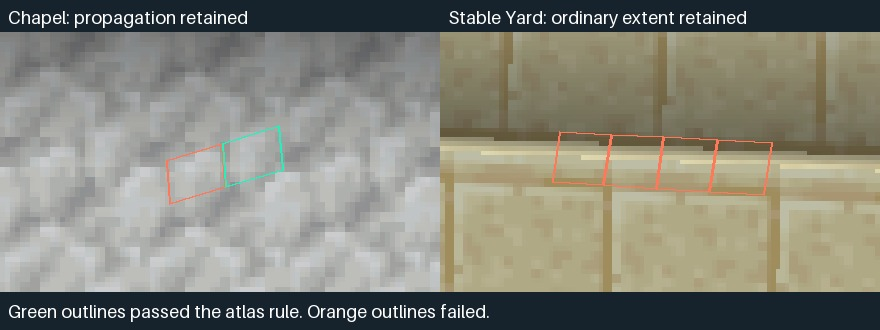

# Full-face verification before wall expansion

Keep this gate experimental. It measures whether a source chart contains at least one plausible full cube face. The ordinary extent is preserved when every seed fails. Qualifying a seed leaves the complete expansion and the horizontal assembler unchanged.

The rule was frozen at 0adb7d2. Fit an atlas texture and orientation on one native RGB pixel fold. On disjoint native pixels, verify correlation and challenge the proposed extent with 0.75× and 1.25× footprints. Seek the same template on a full adjacent cell, allowing a strong held-out match to stand alone. Source masks, atlas candidates and chart proposals come from the ordinary pipeline, so the held-out pixels are independent of this verification fit only.

The ridge logistic model uses these same features with one frozen probability threshold of 0.70. Its training data comprises 318 wall seeds and 292 positives from Watchpost 2, Observatory 02 and Riverside Mill 2. Each layout has equal weight. The six supplemental images use leave-one-layout-out predictions. Other panels use the model fit on all three training layouts. The rule and fitting recipe were fixed before measuring the two final six-frame panels. The native qualification control gives the same gate exact labels and is a diagnostic of that decision, not an oracle for final placement.

## Seed and chart qualification

Seed precision and recall use the native audit criterion. Chart precision and recall grade whether an accepted chart contains any aligned seed. These denominators include only the wall seeds that this experiment can gate.

| Panel | Method | Seed precision | Seed recall | Chart precision | Chart recall |
|---|---|---:|---:|---:|---:|
| original | Ungated | 1859/2286 (81.3%) | 1859/1859 (100.0%) | 158/182 | 158/158 |
| original | Atlas rule | 1060/1131 (93.7%) | 1060/1859 (57.0%) | 144/163 | 144/158 |
| original | Logistic | 1473/1797 (82.0%) | 1473/1859 (79.2%) | 146/170 | 146/158 |
| fresh | Ungated | 455/543 (83.8%) | 455/455 (100.0%) | 44/53 | 44/44 |
| fresh | Atlas rule | 373/394 (94.7%) | 373/455 (82.0%) | 43/49 | 43/44 |
| fresh | Logistic | 419/482 (86.9%) | 419/455 (92.1%) | 43/52 | 43/44 |
| supplemental | Ungated | 292/318 (91.8%) | 292/292 (100.0%) | 19/19 | 19/19 |
| supplemental | Atlas rule | 182/184 (98.9%) | 182/292 (62.3%) | 18/18 | 18/19 |
| supplemental | Logistic | 292/317 (92.1%) | 292/292 (100.0%) | 19/19 | 19/19 |
| sky | Ungated | 215/394 (54.6%) | 215/215 (100.0%) | 21/29 | 21/21 |
| sky | Atlas rule | 116/147 (78.9%) | 116/215 (54.0%) | 17/24 | 17/21 |
| sky | Logistic | 186/307 (60.6%) | 186/215 (86.5%) | 18/26 | 18/21 |
| holdout | Ungated | 117/126 (92.9%) | 117/117 (100.0%) | 15/17 | 15/15 |
| holdout | Atlas rule | 42/44 (95.5%) | 42/117 (35.9%) | 12/13 | 12/15 |
| holdout | Logistic | 43/48 (89.6%) | 43/117 (36.8%) | 13/15 | 13/15 |
| holdout2 | Ungated | 155/179 (86.6%) | 155/155 (100.0%) | 16/21 | 16/16 |
| holdout2 | Atlas rule | 84/90 (93.3%) | 84/155 (54.2%) | 16/19 | 16/16 |
| holdout2 | Logistic | 95/108 (88.0%) | 95/155 (61.3%) | 16/21 | 16/16 |
| holdout3 | Ungated | 134/189 (70.9%) | 134/134 (100.0%) | 14/18 | 14/14 |
| holdout3 | Atlas rule | 124/154 (80.5%) | 124/134 (92.5%) | 14/17 | 14/14 |
| holdout3 | Logistic | 134/189 (70.9%) | 134/134 (100.0%) | 14/18 | 14/14 |
| holdout4 | Ungated | 181/225 (80.4%) | 181/181 (100.0%) | 25/28 | 25/25 |
| holdout4 | Atlas rule | 168/196 (85.7%) | 168/181 (92.8%) | 25/28 | 25/25 |
| holdout4 | Logistic | 174/217 (80.2%) | 174/181 (96.1%) | 25/28 | 25/25 |
| all | Ungated | 3408/4260 (80.0%) | 3408/3408 (100.0%) | 312/367 | 312/312 |
| all | Atlas rule | 2149/2340 (91.8%) | 2149/3408 (63.1%) | 289/331 | 289/312 |
| all | Logistic | 2816/3465 (81.3%) | 2816/3408 (82.6%) | 294/349 | 294/312 |

## Decoded placements

Strict / facade F1 grade all visible positions and facade-priority positions respectively. ID scores require the correct block at the same registered coordinate. Each pair uses the geometry-selected translation. A baseline or candidate with zero blocks is included.

| Panel | Method | Strict | Facade | Strict + ID | Facade + ID | ID correct among correct positions | Correct / missed / extra | Recovered / lost / extras added / removed |
|---|---|---:|---:|---:|---:|---:|---|---|
| original | horizontal | 35.64 | 35.82 | 4.63 | 4.65 | 1828/14065 | 14065 / 45373 / 5422 | 0 / 0 / 0 / 0 |
| original | verified | 34.37 | 34.53 | 4.55 | 4.57 | 1779/13424 | 13424 / 46014 / 5263 | 126 / 767 / 2 / 161 |
| original | logistic | 35.41 | 35.58 | 4.53 | 4.55 | 1785/13951 | 13951 / 45487 / 5419 | 49 / 163 / 0 / 3 |
| original | oracle | 25.13 | 25.29 | 4.78 | 4.80 | 1734/9110 | 9110 / 50328 / 3968 | 255 / 5210 / 40 / 1494 |
| fresh | horizontal | 30.43 | 31.11 | 6.85 | 7.36 | 360/1600 | 1600 / 5914 / 1401 | 0 / 0 / 0 / 0 |
| fresh | verified | 30.84 | 31.55 | 6.90 | 7.42 | 364/1626 | 1626 / 5888 / 1404 | 26 / 0 / 3 / 0 |
| fresh | logistic | 30.43 | 31.11 | 6.85 | 7.36 | 360/1600 | 1600 / 5914 / 1401 | 0 / 0 / 0 / 0 |
| fresh | oracle | 30.25 | 31.47 | 6.75 | 7.30 | 340/1524 | 1524 / 5990 / 1038 | 54 / 130 / 66 / 429 |
| supplemental | horizontal | 39.92 | 43.08 | 9.27 | 10.00 | 209/900 | 900 / 2353 / 356 | 0 / 0 / 0 / 0 |
| supplemental | verified | 38.98 | 42.10 | 9.25 | 9.99 | 207/872 | 872 / 2381 / 349 | 0 / 28 / 0 / 7 |
| supplemental | logistic | 39.92 | 43.08 | 9.27 | 10.00 | 209/900 | 900 / 2353 / 356 | 0 / 0 / 0 / 0 |
| supplemental | oracle | 39.92 | 43.08 | 9.27 | 10.00 | 209/900 | 900 / 2353 / 356 | 0 / 0 / 0 / 0 |
| sky | horizontal | 22.93 | 23.07 | 4.40 | 4.40 | 173/901 | 901 / 3140 / 2915 | 0 / 0 / 0 / 0 |
| sky | verified | 23.36 | 23.50 | 5.07 | 5.08 | 199/917 | 917 / 3124 / 2894 | 35 / 19 / 0 / 21 |
| sky | logistic | 22.93 | 23.07 | 4.40 | 4.40 | 173/901 | 901 / 3140 / 2915 | 0 / 0 / 0 / 0 |
| sky | oracle | 27.57 | 27.96 | 6.47 | 6.57 | 181/771 | 771 / 3270 / 782 | 74 / 204 / 6 / 2139 |
| holdout | horizontal | 18.83 | 20.12 | 3.39 | 3.70 | 126/700 | 700 / 3913 / 2120 | 0 / 0 / 0 / 0 |
| holdout | verified | 20.71 | 22.66 | 5.21 | 5.87 | 151/600 | 600 / 4013 / 580 | 0 / 100 / 0 / 1540 |
| holdout | logistic | 18.83 | 20.12 | 3.39 | 3.70 | 126/700 | 700 / 3913 / 2120 | 0 / 0 / 0 / 0 |
| holdout | oracle | 15.69 | 17.14 | 4.21 | 4.81 | 109/406 | 406 / 4207 / 155 | 194 / 488 / 10 / 1975 |
| holdout2 | horizontal | 22.15 | 23.16 | 4.93 | 5.27 | 111/499 | 499 / 2607 / 901 | 0 / 0 / 0 / 0 |
| holdout2 | verified | 20.52 | 21.44 | 3.90 | 4.17 | 86/453 | 453 / 2653 / 856 | 0 / 46 / 0 / 45 |
| holdout2 | logistic | 22.15 | 23.16 | 4.93 | 5.27 | 111/499 | 499 / 2607 / 901 | 0 / 0 / 0 / 0 |
| holdout2 | oracle | 21.72 | 22.86 | 4.63 | 5.00 | 91/427 | 427 / 2679 / 399 | 7 / 79 / 11 / 513 |
| holdout3 | horizontal | 25.61 | 25.97 | 2.05 | 2.02 | 145/1815 | 1815 / 5973 / 4573 | 0 / 0 / 0 / 0 |
| holdout3 | verified | 27.37 | 27.81 | 1.99 | 1.97 | 129/1770 | 1770 / 6018 / 3375 | 18 / 63 / 0 / 1198 |
| holdout3 | logistic | 25.61 | 25.97 | 2.05 | 2.02 | 145/1815 | 1815 / 5973 / 4573 | 0 / 0 / 0 / 0 |
| holdout3 | oracle | 30.25 | 30.92 | 2.45 | 2.50 | 138/1705 | 1705 / 6083 / 1778 | 91 / 201 / 0 / 2795 |
| holdout4 | horizontal | 18.63 | 18.92 | 5.96 | 6.05 | 164/513 | 513 / 1501 / 2979 | 0 / 0 / 0 / 0 |
| holdout4 | verified | 18.63 | 18.92 | 5.96 | 6.05 | 164/513 | 513 / 1501 / 2979 | 0 / 0 / 0 / 0 |
| holdout4 | logistic | 18.63 | 18.92 | 5.96 | 6.05 | 164/513 | 513 / 1501 / 2979 | 0 / 0 / 0 / 0 |
| holdout4 | oracle | 28.87 | 29.79 | 11.99 | 12.37 | 159/383 | 383 / 1631 / 256 | 0 / 130 / 0 / 2723 |

## Chapel and Observatory

On floating Chapel the weaker proposed seed failed the atlas rule. The second seed passed on the wrong froglight-side template, with held-out correlation 0.716, boundary margin 0.108 and neighbor correlation 0.660. Both seeds cover only a fraction of their recorded calcite faces. Both source gates kept the expansion. The native gate recovered the ordinary two-block chart, losing 116 correct placements and removing 1,431 extras. All three gates retained the two Observatory exports.

The fixed 104 production views were unmeasured in this experiment. The carried-forward production trend is 91.27% strict and 93.42% facade (20,773 correct / 2,929 missed / 1,046 extra strict). These experimental builds use the floating branch's 86 frame conditions. The original panel contains official test views and was never used for model fitting. The initial six floating-sky conditions reuse some earlier layouts. Source and reference hashes, panel splits, pack hashes and assigned/fallback counts at chart input are in the manifest.

From this checkout, run the following with the benchmark Python after producing the sibling audit inputs.

```powershell
python -m benchmark.floating_face_verifier
python -m benchmark.floating_face_verifier holdout3 holdout4
python -m benchmark.floating_face_model
python -m benchmark.floating_face_verifier_report
```

## Transfer and fixture coverage

The Stable Yard high-right frame accounts for the complete holdout3 difference. The rule lost 45 net correct positions and removed 1,198 extras on this frame. The other five exports tied the baseline.



Across 86 conditions the comparison covers 35 distinct Visible Builds v3 frames out of 144, 23 Decorative Builds v1 frames out of 40 and 26 Visible Builds v2 frames. Dataset rows pool frame conditions with the same evaluator, including repeated source layouts under different backgrounds.

| Dataset | Method | Strict | Facade | Strict + ID | Facade + ID |
|---|---|---:|---:|---:|---:|
| all | horizontal | 31.47 | 31.96 | 4.67 | 4.76 |
| all | verified | 31.12 | 31.62 | 4.75 | 4.84 |
| all | logistic | 31.32 | 31.81 | 4.61 | 4.70 |
| all | oracle | 26.31 | 26.85 | 5.12 | 5.24 |
| visible-builds-v2 | horizontal | 43.28 | 46.15 | 16.36 | 17.77 |
| visible-builds-v2 | verified | 41.10 | 43.91 | 15.68 | 17.08 |
| visible-builds-v2 | logistic | 41.75 | 44.51 | 15.79 | 17.16 |
| visible-builds-v2 | oracle | 45.54 | 48.90 | 18.63 | 20.36 |
| visible-builds-v3 | horizontal | 32.62 | 32.93 | 3.55 | 3.58 |
| visible-builds-v3 | verified | 32.15 | 32.46 | 3.68 | 3.71 |
| visible-builds-v3 | logistic | 32.62 | 32.93 | 3.55 | 3.58 |
| visible-builds-v3 | oracle | 24.43 | 24.74 | 3.51 | 3.54 |
| decorative-builds-v1 | horizontal | 20.25 | 20.53 | 4.48 | 4.66 |
| decorative-builds-v1 | verified | 21.09 | 21.43 | 4.81 | 5.01 |
| decorative-builds-v1 | logistic | 20.12 | 20.39 | 4.43 | 4.60 |
| decorative-builds-v1 | oracle | 25.95 | 27.23 | 6.93 | 7.49 |