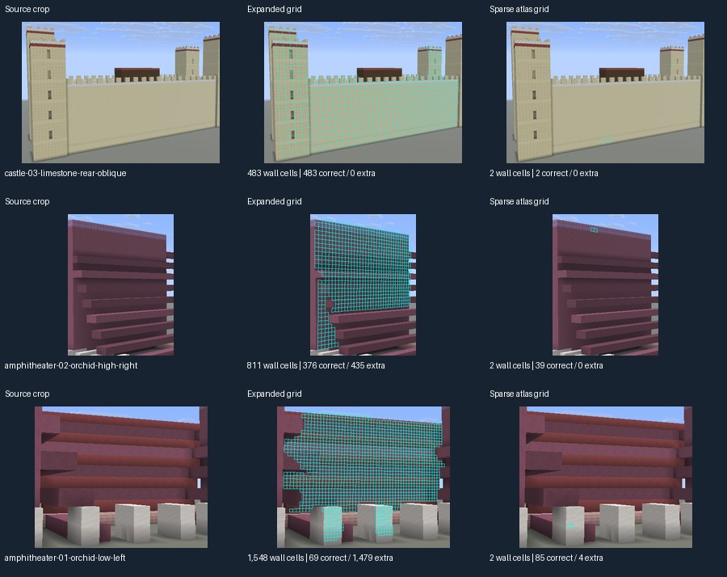

# When a smooth wall has no verified unit face

Keep these fallback rules experimental. On the reviewed Amphitheater wall both fixes remove 1,475 net extra placements and gain 16 correct positions. On the other layouts a failed face search also occurs on correctly sized walls. Restricting fallback to smooth walls protects the castle examples, but still loses 531 net correct positions on 81 feedback-unseen conditions.

| Conditions | Assembly rule | Strict F1 | Facade F1 | Strict + ID | Facade + ID | Correct / missed / extra |
|---|---|---:|---:|---:|---:|---:|
| All 92 | Large contraction | 32.13% | 32.67% | 5.10% | 5.20% | 21,240 / 72,356 / 17,374 |
| All 92 | Return to sparse evidence | 29.15% | 29.69% | 5.03% | 5.14% | 18,149 / 75,447 / 12,769 |
| All 92 | Delete the same charts | 29.14% | 29.68% | 5.03% | 5.14% | 18,142 / 75,454 / 12,769 |
| All 92 | Return to sparse evidence on smooth walls | 31.98% | 32.53% | 5.19% | 5.30% | 20,725 / 72,871 / 15,275 |
| Other layouts, 81 | Large contraction | 32.14% | 32.67% | 4.69% | 4.78% | 20,131 / 69,498 / 15,499 |
| Other layouts, 81 | Return to sparse evidence | 28.61% | 29.11% | 4.46% | 4.55% | 17,024 / 72,605 / 12,369 |
| Other layouts, 81 | Sparse on smooth walls | 31.59% | 32.10% | 4.65% | 4.74% | 19,600 / 70,029 / 14,875 |
| Feedback layouts, 11 | Large contraction | 31.91% | 32.74% | 12.46% | 12.78% | 1,109 / 2,858 / 1,875 |
| Feedback layouts, 11 | Either sparse rule | 40.97% | 42.33% | 17.41% | 17.99% | 1,125 / 2,842 / 400 |

The expansion fallback applies when one or two connected atlas cells supplied the original chart, it grew to at least 256 cells, and the image-based face finder tested candidates and rejected all of them. It replaces that chart with its original cells. A second arm removes the chart entirely. Ten charts in ten views qualified. All ten exports changed. Across the 92, the sparse arm gained 355 previously missed positions, lost 3,446 positions, added 123 extras and removed 4,728 extras.

The second rule also requires a majority of interior native 3×3 pixel neighborhoods to have a luma span below four levels out of 255. It directly tests Jeremy’s observation that the surface looks smooth. The threshold was frozen on the Amphitheater-01 feedback crop after examining the first rule’s results, so this comparison is retrospective. It triggered three times. Across the 81 transfer conditions it gained 20 correct and lost 551 correct while removing 624 extras. The transfer conditions are archived, including other angles and structures in the same family. Eleven regression conditions cover all archived angles and palettes of the five feedback layouts.

On Amphitheater-01 low-left, two cropped atlas matches generated 1,548 cells. All 42 full-face proposals failed. The proportional contraction gate could only retain the expanded chart in the absence of a verified alternative. Returning to the sparse chart or abstaining lets measured walls mask-3 and mask-5 win the component selection. Both exports change from 69 correct / 1,479 extra / 3 exact IDs to 85 / 4 / 48. This recovers a different component. The local ruler on the smooth wall is still unresolved.

On Amphitheater-02 low-left, the broader rule gains 43 correct positions and removes 1,530 extras. Its smoothness fraction is 44.4%, so the smooth gate retains the old output. On the opposite view 79.7% of neighborhoods look smooth, but fallback loses 337 correct positions and removes 435 extras. Observatory-02 low-left also qualifies at 65.4%, losing 194 correct positions and eliminating 189 extras. Castle-03 limestone rear-oblique shows the danger of using face-search failure alone. Two atlas cells expanded to 483 correctly placed blocks with zero extras, and reverting the chart keeps just two. The smooth gate preserves the castle output.

A reference-only per-view chooser between the large-contraction and sparse exports selects fallback on the two low-left Amphitheater views. It reaches 32.95% strict F1 over 92 with 21,299 correct, 72,297 missed and 14,369 extra. It reaches 32.60% on the other 81, including 69,455 remaining misses. This chooser uses the individual frame's strict F1 including the option to keep the control.

Run `python -m benchmark.floating_feedback_support` from this checkout with the archived floating worktrees. It uses the large-contraction packets and connected-atlas exports from the isolation replay at `e97dd44`. Candidate decisions use source-derived masks, atlas seeds, expanded charts and verification receipts. The regular horizontal assembler, winning-component selection and pack exporter rerun for every distinct change. Each pack is decoded, checked against the saved local coordinates and scored under its own geometry-selected whole-build alignment. Identical packets reuse their matching control export. The compressed [paired results](paired.json.gz) include exact scores, paired deltas, thresholds' input measurements, provenance hashes and selected component origins.

The fixed-104 production trend is carried forward at 91.27% strict and 93.42% facade, with 20,773 / 2,929 / 1,046 strict correct / missed / extra. The full Visible Builds v3 and Decorative Builds v1 suites were not rerun.

## Floating branch scorecard

Six fixed sky composites. The running connected-atlas baseline was measured at integration runtime revision `52de2c9`. The prior large-contraction experiment produced 890 correct / 3,151 missed / 1,542 extra, 27.50% strict and 27.73% facade placement, and 5.96% strict and 5.99% facade position-plus-material F1. No sky chart activated either fallback, so both candidates reproduce those figures exactly, including zero change in correct blocks and extras. The carried-forward integration scores are 273 / 3,768 / 5, 12.64% and 12.90% placement, and 4.68% and 4.77% position-plus-material. The experimental pipeline gains 617 correct and adds 1,537 extras against that integration baseline. No fallback landed on integration or production main.
