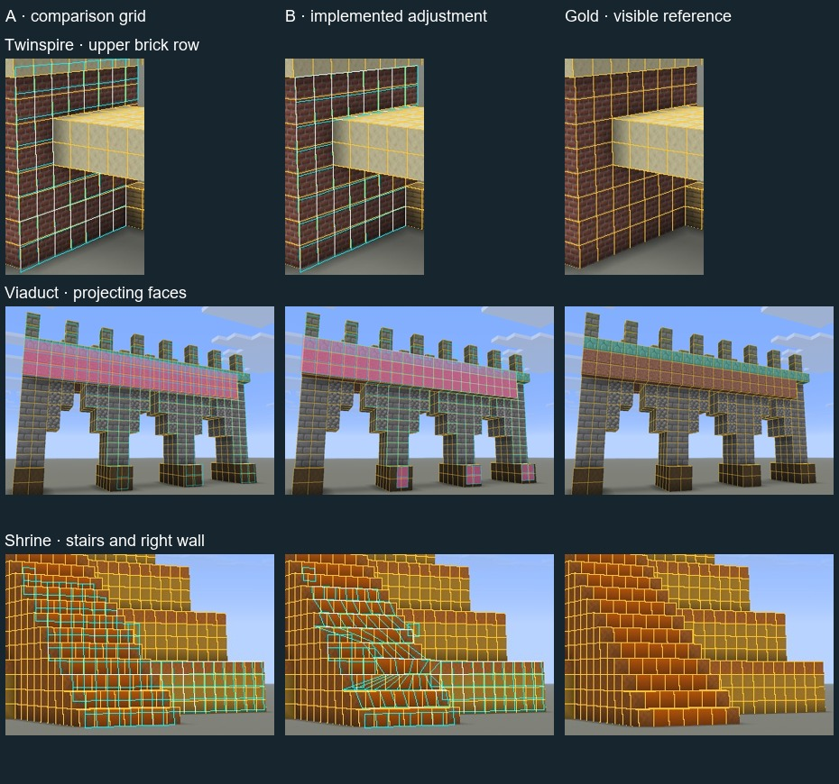

# Grid signoff, second round

[Open the eight-case interactive review](review.html). Each B is an implemented adjustment paired with its actual comparison grid. Coverage, sizing, alignment, comments, comparative votes and proposal decisions are independent. The seven submitted annotations are stored in [their original JSON](feedback.json). Only Twinspire had an explicit A/B dropdown vote. Written preferences informed tests; blank ratings remain unknown. This round uses a separate browser storage key and downloads floating-grid-round-two-feedback.json.

## What changed

| Case | Implemented test | Whole-structure outcome |
|---|---|---|
| Twinspire | Require more than half of each added cell to be supported by the visible patch; adjust height using the brick-to-sandstone seam. | All eight cells improve from 60–62% to 98–100% on the intended brick plane. Median edge distance drops from 12.04 to 1.00 source pixels. The assembler still selects two other walls, so the export stays at 110 correct and 63 extras. One cell still has the wrong material. |
| Mill | Give the already-separated projecting patch a local pitch and origin; preserve the surrounding parent grid. | Ties the prior depth-aware placement at 160 correct and 48 extras. Before introducing depth, it had 121 correct and 82 extras. |
| Viaduct | Find small regions with source-normal agreement and a signed inverse-depth step. Assign separate depth and measure each local grid. | Three of four visible brown bases are detected. The export rises from 170 to 175 correct and falls from 41 to 33 extras. The far-left base has no parent cells. Holding grid spacing fixed on the new patches reproduces the geometry gain. |
| Castle | Compare both sides of each proposed seam before allowing a one-block offset. | Raw depth correctly ordered 7 of 7 tested pairs spanning two planes. The old forced step had the correct world-normal magnitude on 0 of 16 resolved pairs. Only 12 of 21 near-seam contacts supported the move. Withdrawing it restores 14 correct parapet cells, from 548 correct / 417 extra to 562 / 403. |
| Arcbridge | Apply the identical seam check on a transfer layout. | Falls from 44 correct / 10 extra to 35 / 19. The reference view and scored failure are in the viewer. |
| Shrine | Search native lines for a sequence of progressively displaced parallel edges, fit a local chart to each accepted visible band, and retain the parent's other cells. | Eight bands with 51 sampled cells. The assembler exports only the parent. Correct / extra goes from 60 / 64 to 41 / 19. The separate bands need orientation and attachment evidence before they can replace those placements. |
| Pillars | Keep local scale at the center and align the two grid axes to vanishing directions estimated from building outlines. | Principal-plane coverage goes from 77.1% to 94.6%; median corner-coordinate error from 0.29 to 0.24 cell. The selected component remains at 45 correct and 64 extras. |
| Chapel | Adjust shear and grid origin using native line segments. Test the fit against alternate segments excluded from fitting. | From 107 correct / 58 extra to 109 / 57. A building-wide orientation change instead scored 103 / 61. Keep the local correction experimental: on Castle the same local fit lost 259 net correct placements. |

The majority, depth and independent baseline workers used the same frozen active cohort. The fixed six sky cases are a subset of the 84. The seven annotated layouts account for 19 conditions; 65 conditions come from other layouts. The Shrine, Pillars and Chapel refinements in this checkout are seven-view diagnostics. Their gains have not been established on the full active dataset.

## What transferred

| Matched test on the active 84 | Comparison strict F1 | Candidate strict F1 | Change in correct / extras |
|---|---:|---:|---:|
| Majority-supported row plus seam fit | 33.542% | 33.537% | −5 / −7 |
| Independent patch grids, prior depth patches only | 33.782% | 33.787% | −2 / −25 |
| Independent grids plus newly detected small depth patches | 33.782% | 33.805% | +8 / −35 |
| Require corroborated signed seam contacts | 33.782% | 33.789% | +2 / −11 |

On the 65 other-layout conditions, the small-patch candidate gained five correct positions and removed 32 extras against the prior source-depth arm. The seam-contact requirement lost 17 correct positions and added 11 extras on that same subset. Exact visible face corners on the existing patch boundaries did not repair attachment. A per-condition reference chooser among the tested depth options reached 33.882% strict F1. Its limited gain argues for better candidates, especially for visible parts that have no parent grid cells or are dropped at assembly.

For the next experiment, offer an observed child chart an explicit anchor at a shared rim with the retained parent. Verify depth direction and the integer offset against an independent visible return or adjoining face; allow either unresolved depth or keeping the existing output. First replay a reference-only attachment control using the exact visible relative anchor for these same detected children. That distinguishes missing local cells from good local cells that never reach the export. Use Twinspire's omitted wall and Shrine's discarded bands as regression cases, with Viaduct and Castle as opposite checks.

[Majority and seam test](https://github.com/jeremyepling/minecraft-image-reconstruction/tree/experiment/floating-majority-edge/benchmark/reviews/floating-majority-edge) · [Depth refit and controls](https://github.com/jeremyepling/minecraft-image-reconstruction/tree/experiment/floating-depth-refit/benchmark/reviews/floating-depth-refit-01) · [Castle and original signoff audit](https://github.com/jeremyepling/minecraft-image-reconstruction/tree/experiment/floating-signoff-audit/benchmark/reviews/floating-signoff-audit-01)

Run `python -m benchmark.floating_line_shear`, `python -m benchmark.floating_stair_strips`, then `python -m benchmark.floating_second_signoff` from this checkout with the saved worker receipts. The review's local metrics are calculated on visible full faces of the principal plane. In multi-grid views the face center identifies the applicable rendered chart for size and alignment. The whole-build scores come from the decoded exports.

## Floating branch scorecard

| Six fixed sky images | Placement F1 | Facade F1 | Position + ID F1 | Facade + ID F1 | Correct / missed / extra |
|---|---:|---:|---:|---:|---|
| Running sparse default | 12.64% | 12.90% | 4.68% | 4.77% | 273 / 3,768 / 5 |
| Matched expanded control and new depth variants | 27.50% | 27.73% | 5.96% | 5.99% | 890 / 3,151 / 1,542 |
| Majority-supported row and seam correction | 27.59% | 27.83% | 5.95% | 5.97% | 895 / 3,146 / 1,552 |
| Previous cross-surface ruler, carried forward | 29.73% | 30.14% | 6.59% | 6.69% | 866 / 3,175 / 919 |

Keep the changes on their floating experiment branches. The integration branch received the second-round workflow; its reconstruction score delta is zero. The fixed 104 production trend carries forward at 91.27% strict and 93.42% facade. Full production v3 and Decorative suites were not rerun.
