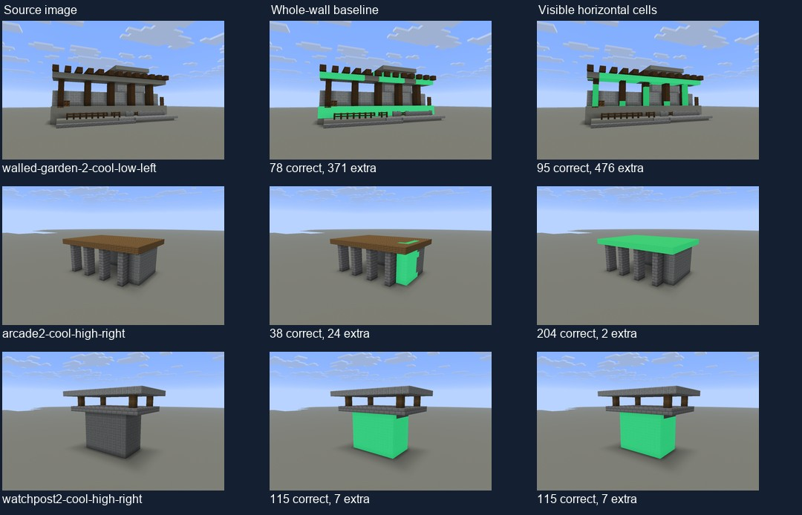

# Do visible tops and undersides connect measured wall grids?

The strongest source-image variation uses two perpendicular counted wall rims to measure the grid of a bounded horizontal surface. It exports a horizontal cell only when its center and at least 78% of its sampled area lie on that surface mask and the projected cell is large enough to measure. Two distinct walls must match edges of the resulting grid. An atlas matcher assigns materials using masked source pixels. The wall intersections and their spacing provide a local coordinate frame. The algorithm receives no floor, camera pose, recorded directions, reference block counts or world coordinates. Large background masks reaching beyond the wall envelope are ineligible.

A second variation extrapolates grid lines across the same visible rim to propose a relative translation of two existing wall charts, without making horizontal cells. It gained 0.29 percentage points strict placement on the first 12 fresh views and tied the whole-wall baseline on the original 38 and supplemental six.

| Source frames | Ordinary strict placement | Whole-wall strict placement | With horizontal cells | Whole-wall → with horizontal cells, position + ID |
|---|---:|---:|---:|---:|
| Earlier 38 original images | 3.72% | 35.34% | 35.64% | 4.51% → 4.63% |
| First 12 fresh original images | 6.75% | 27.25% | 30.43% | 5.63% → 6.85% |
| Six additional images from disjoint families | 14.22% | 39.92% | 39.92% | 9.27% → 9.27% |
| Six original floating-sky composites | 12.64% | 22.93% | 22.93% | 4.40% → 4.40% |

The fresh 12 cover six layouts. Six views belong to the packaged validation split and six use additional dataset-train layouts after freezing the methods. The six further images belong to three different dataset-train layouts. For the six validation-split views alone, horizontal cells move strict placement from 28.39% to 29.37%, and strict position-plus-ID from 9.45% to 10.57%. The ordinary floating-sky typed score is 4.68%. Floor-free material placement remains a regression relative to that baseline.

In Arcade 2 high-right, a visible top produced a 205-cell chart whose edges meet two walls. The export rose from 38 to 204 correct positions and extras fell from 24 to two. In Walled Garden 2 cool low-left, it gained 17 net correct positions but also 105 net extras. A cell can pass the source mask test and still be placed at the wrong relative depth, so the report includes these extras in F1. Across all four panels horizontal cells improved strict placement on ten views, tied on the remainder, and lowered typed F1 on two earlier views. Six floating-sky composites produced the same final placement as whole-wall sampling. Fixed 104 production scores are carried forward at 91.27% strict (20,773 correct, 2,929 missed, 1,046 extra) and 93.42% facade (18,952 correct, 1,624 missed, 1,046 extra), with zero change to production.



Keep the method available as an experimental option. It provides a useful way to measure a visible roof from its adjoining walls, but many views produce too few counted rims to use it. [Scores by cohort and split](scores.md) and [per-view decoded receipts](results.json.gz).

The lowest-precision sky case points to a different error. On Hillside Chapel 1 low-left, two detected cells on mask-0 grew to 1,549 placements, of which 118 were correct. A scoring-only intersection with the native visible labels shows that 140,149 of 141,068 mask pixels belong to the build. They span 105 recorded surface IDs and 211 distinct visible block positions. The two largest surfaces account for 62% and 20% of mask pixels. Foreground isolation would preserve almost the entire mask. Test splitting it into locally consistent planes or requiring a second spatially separated grid measurement before extending the first two cells across it. Recorded surface IDs include individual decorative quads. [Native ownership check](chapel-mask-check.json)

The two Cloister resampled views lacked a fixed camera-orientation anchor at scoring. The fresh baseline audit used surviving shared wall charts to transfer the ordinary compass and recovered the same yaw as the evaluator on both views. The horizontal-cell run used those same two yaw choices. All six additional images had fixed orientation in the ordinary and whole-wall paths. The single whole-build translation preserves relative offsets within each export.

To reproduce, use the benchmark Python in this worktree with the frozen handoffs from the expanded-wall-rulers, crop-ceiling-expanded, floating-fresh-validation and floating-visible-builds worktrees. Run both horizontal variants below. Repeat each of the first two commands with `--fresh` and `--supplemental` for the additional panels.

```powershell
python -m benchmark.floating_horizontal_bridges
python -m benchmark.floating_horizontal_bridges --tiles
python -m benchmark.floating_sky_whole_wall
python -m benchmark.floating_bridges_report
```
