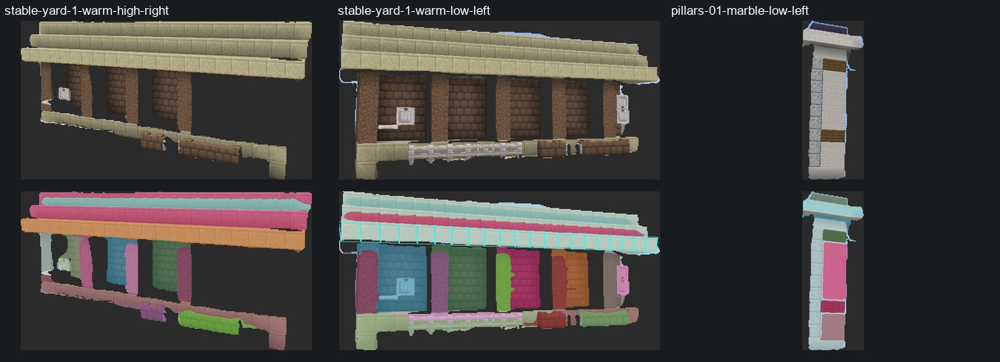

# Fitting a block grid inside a visibly mixed wall mask

One of 40 source regions produced a verified block ruler. On the low-left Stable Yard view, a grid fitted to the pale roof proposed 21 cut-sandstone cells. Native center checks after export matched 21 distinct cut-sandstone faces on the intended plane. The median source-grid area per recorded block was 0.976 cells. The ordinary assembler retained this region as its own 21-block component and exported the other 1,090-block component. Recovering the relative position of the measured patch is the next handoff for this example.

Only source pixels within the existing wall support are colored. Cyan outlines mark the accepted source grid.

## What was tested

The frozen baseline uses the 84 active large-contraction chart packets. The previously measured peer-height guard selects three charts with excessive extrapolation. The candidate partitions their observed pixels using smoothed Lab color and the residual of the source monocular inverse-depth field about a fitted image plane. Four appearance groups are separated into connected regions. Tiny fragments are assigned within the same observed silhouette. All input mask pixels are accounted for, and every existing cell is assigned to a region by its source center. The split-only comparison retains the original homography and cell IDs while passing the grouped charts through ordinary assembly.

The fitter rectifies each region using the source wall's measured quadrilateral and aspect, proposes periods by directional autocorrelation and fits full atlas texture phase at one seed. Both Stable Yard walls lack an independent source counter width and height. A complete-face check compares native atlas matches against quarter-cell shifts at separated positions. A second arm permits partial native patches with at least half the sampled texture visible, consistent atlas orientation, three visible phase competitors, correlation of 0.60 or better and margin of 0.07 over the strongest eligible competitor. It requires two confirmations at least two cells apart, beyond the seed. Regions without a new ruler keep their existing grid. The three charts in the affected set are previously reviewed examples. The remaining 81 images reused their decoded baseline exports.

| Source case | Regions | Dominant native plane share before → after splitting | Old → partial-refit strict correct / missed / extra |
|---|---:|---:|---|
| Stable Yard 1, high-right | 14 | 40.6% → 83.7% | 63 / 291 / 1,198 → 63 / 291 / 1,198 |
| Stable Yard 1, low-left | 17 | 34.9% → 75.9% | 78 / 294 / 1,374 → 75 / 297 / 1,015 |
| Pillars 01, low-left | 9 | 81.0% → 95.1% | 69 / 314 / 687 → 69 / 314 / 675 |

Native plane share measures the largest frontmost direction-and-depth group across the original mask, then sums the largest group independently within each region. This measures partition purity and allows a ground-truth plane to occupy several regions.

No new grid passed the complete-face control. Two low-left roof samples separated by two columns passed partial checks at correlations 0.620 and 0.650, with phase margins 0.119 and 0.105. Their ruler measured 34.5 × 34.5 rectified pixels. The region's former grid had 362 cells. Although its replacement has the right scale, the other component still uses the excessive original grid. Reassembly and whole-build translation lost three strict correct, removed 1,141 extras and added 782 others on this view. Exact IDs fell from 26 to zero. On Pillars the split alone removed twelve extras. High-right tied. [Decoded outcomes and per-region source evidence](rows.json.gz)

## Reference-bounded diagnosis

After the source runs, each eligible observed region received the exact projected ruler of its dominant vertical full-block face plane. Face corners were checked against the capture projection. The sampler still used the whole source region, including any remaining plane mix. The source normals, material sampling and ordinary component selection stayed active. This is a bounded handoff test, not an upper bound on final placement. The resulting packs scored 30 / 324 / 34 correct / missed / extra on high-right, 34 / 338 / 39 on low-left and 45 / 338 / 64 on Pillars. Accurately measuring local grids alone still leaves disconnected or inconsistently selected components. [Native ownership, cell centers and exact-ruler replay](native.json.gz)

Run `python -m benchmark.floating_mixed_wall_refit`, then `python -m benchmark.floating_mixed_wall_native` against the saved charts and source fields. Keep this method experimental. The source segmentation and low-left ruler should be preserved as diagnostic evidence; the partial-refit exports lose three correct positions and 26 material matches. Only benchmark code and results landed on `experiment/floating-mixed-wall-refit`.

## Floating branch scorecard

| Inputs and method | Strict / facade placement F1 | Strict / facade position + ID F1 | Strict correct / missed / extra |
|---|---|---|---|
| Floating integration at `9435934`, six sparse sky views, carried forward | 12.64% / 12.90% | 4.68% / 4.77% | 273 / 3,768 / 5 |
| Same six images with expanded baseline inputs | 27.50% / 27.73% | 5.96% / 5.99% | 890 / 3,151 / 1,542 |
| Same six expanded images, split, complete or partial refit | 27.55% / 27.79% | 5.97% / 6.00% | 890 / 3,151 / 1,530 |
| 84 expanded baseline inputs at `be3cb65` | 33.54% / 34.01% | 5.51% / 5.61% | 18,323 / 61,187 / 11,420 |
| Same 84, split or complete-face refit | 33.55% / 34.02% | 5.51% / 5.61% | 18,323 / 61,187 / 11,408 |
| Same 84, partial-patch refit | 33.65% / 34.13% | 5.48% / 5.59% | 18,320 / 61,190 / 11,049 |

The partial-patch candidate loses three strict correct and removes 371 net extras across 84 views, with 782 added and 1,153 removed. The six expanded controls retain every correct position and remove twelve extras. Neither the sparse integration nor production changed. The separate fixed-104 production trend carries forward at 91.27% strict and 93.42% facade. [Pooled and dataset results](summary.json)
