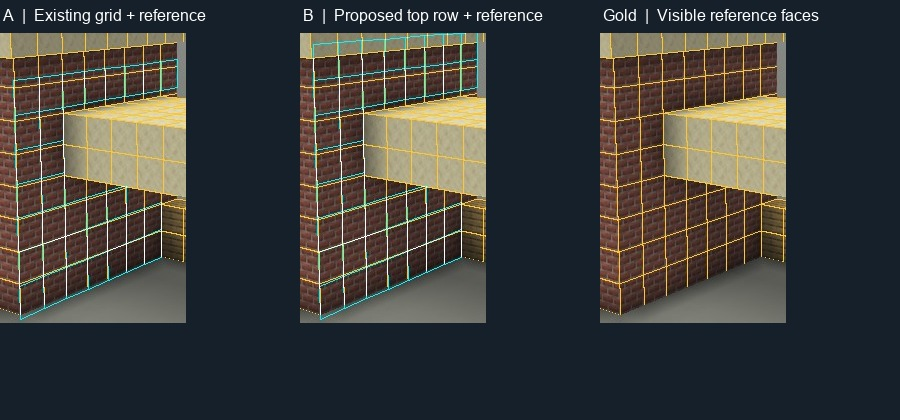

# Reviewing visible grids and relative depth

[Open the seven-case annotation viewer](review.html). It shows the full source image, current and candidate grids with cyan and gold registered in the same crop, and an independent gold-only visible reference. Toggle the reference layer or enlarge any panel. For each grid the viewer gives a measured first pass on coverage, alignment and block size. Every rating has its own comment. The comparative vote and approval of the proposed adjustment are independent. Unanswered fields carry no implication. The previous eight responses are preserved in [the original feedback](feedback.json).

## Twinspire

The preferred grid already has approximately the right spacing on the main wall. The median complete reference face covers 0.95 grid cells, with a median corner-coordinate error of 0.02 cells over 33 faces. On the top visible brick row the mask covers 4,292 of 4,387 pixels, but only 1,181 are under grid cells. One measured row of eight cells raises principal-plane crop coverage from 80.2% to 92.1%. The assembler selects mask-0 and mask-1 in both exports, so editing mask-2 does not change this build. The same low-confidence extension added five extras on Shrine and three correct positions plus five extras on Chapel. Requiring atlas correlation of 0.65 accepted no three-cell runs in five views. Keep the added row as a reviewable suggestion. [Top-row ownership](twinspire-rows.json) · [Matched exports](top-row.json.gz)

## Same direction at different depths

The native-pixel audit uses the signed plane distance of each recorded frontmost face. A mask is flagged when a second plane in the same direction is at least half a block from the largest one in that direction and covers at least 64 native pixels and 5% of the mask. Connected and disconnected islands at the same plane distance count together. This is a measure of mixed surface support. It cannot tell whether assembly finally exported either region or whether both regions have independently solvable grids. Across the 84 active archived conditions, 284 of 1,824 surface proposals are flagged in 76 views. Across the original 92, there are 341 of 2,108 in 84 views. Overlapping proposals can cover the same source pixels. Riverside Mill low-left mask-0 has 116,892 and 65,630 south-facing pixels one block apart. [Per-mask audit](parallel-depth-audit.json.gz)

The source-only experiment estimates a common depth slope over neighboring similarly directed cells. It tests whether a coherent second group should move one block along the same wall normal. The cell grid, IDs and existing joins remain in use. On 84 active conditions strict F1 rose from 33.54% to 33.78%, gaining 132 net correct positions and removing 127 net extras. Keeping the source-selected patches and supplying their reference step magnitudes (up to four blocks) reaches 33.86%. With reference-assisted one-block offsets on already sampled faces, strict F1 reached 38.24%. This control leaves missing faces missing and clips large depth differences. It is a limited intervention. Inspect the gains on Mill and Viaduct, the bad move on Castle, and the unresolved stairs on Shrine. Next test whether a visible return face supports the direction and magnitude before moving a patch. [Depth experiment and matched outcomes](https://github.com/jeremyepling/minecraft-image-reconstruction/tree/experiment/floating-part-grids/benchmark/reviews/floating-part-depth-01)

## Cross-surface block-size evidence

Purpur and quartz provided a size estimate 3.54 times the old unit on the reviewed Amphitheater. The inferred wall shrank from 1,548 cells to 112, losing 38 correct placements and removing 1,398 extras. This view has been retired from optimization. On the still-active Pillars view, the method removed 623 extras and lost 24 correct positions. No validation or test view changed. Retain the approach as an experiment. [Source and export comparisons](https://github.com/jeremyepling/minecraft-image-reconstruction/tree/experiment/floating-cross-ruler/benchmark/reviews/floating-cross-ruler-01)

## Data selection

The floating integration branch now uses 240 active release captures out of 280. The threshold is at least 80% visible building pixels in concrete or unglazed terracotta for any palette, evaluated across its camera views, plus explicit exclusion of both reviewed Amphitheater layouts. All palettes and views of an excluded layout stay together. The historical 92 conditions retain 84 active cases. Changing the mix changes the baseline; improvements above compare methods on identical inputs. [Selection and matched scores](https://github.com/jeremyepling/minecraft-image-reconstruction/tree/experiment/floating-textured-cohort)

## Floating branch scorecard

| Six fixed sky images | Placement F1 | Facade F1 | Position + ID F1 | Facade + ID F1 | Correct / missed / extra |
|---|---:|---:|---:|---:|---|
| Running sparse default | 12.64% | 12.90% | 4.68% | 4.77% | 273 / 3,768 / 5 |
| Previous large-contraction challenger | 27.50% | 27.73% | 5.96% | 5.99% | 890 / 3,151 / 1,542 |
| One-block depth offsets | 27.50% | 27.73% | 5.96% | 5.99% | 890 / 3,151 / 1,542 |
| Cross-surface ruler | 29.73% | 30.14% | 6.59% | 6.69% | 866 / 3,175 / 919 |

The active cohort and annotation guidance landed on the floating integration branch. Runtime reconstruction defaults were held. Fixed 104 production numbers carry forward at 91.27% strict and 93.42% facade. No full production v3 or decorative run was performed in this floating experiment.
