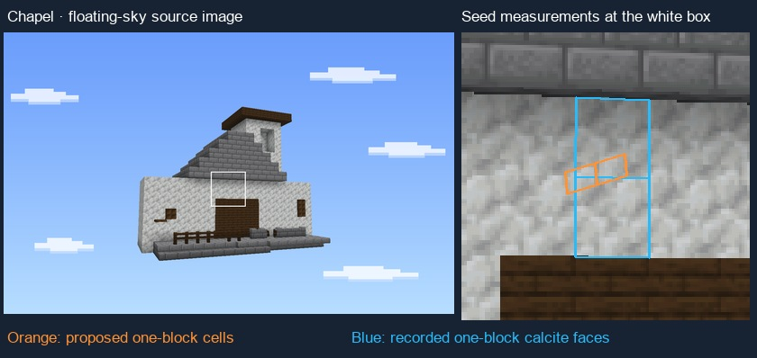

# Where should a measured wall grid stop?

We tested local RGB grid measurements, source-predicted surface normals and inverse depth, and a rule requiring the two methods to agree before dropping a cell. The existing whole-wall candidate with horizontal faces remains the comparison for the source-only experiments. Each method uses the source image and the existing frozen image-derived handoffs. World labels and camera metadata are reserved for evaluation and for explicitly labeled reference controls.

The local RGB method tested pitch, line slope and grid phase in separated areas of each surface. It held back rows to validate the line evidence, and offered a separate grid for a region when both measured axes agreed. Its replacement grids improved only three previously reviewed exports over the simpler variant that just removed suspect cells. Both new six-image panels lost placement accuracy. Requiring depth and RGB vetoes to agree reduced first-holdout extras but still lost 130 net correct placements, and lowered second-holdout geometry F1 from 22.15% to 21.86%. Full results include strict/facade position and position-plus-material F1 for each dataset. [Source-only experiments](source-results.md)

The most selective depth test changed only the Chapel sky export. Across the six sky composites it moved strict/facade geometry from 22.93/23.07% to 25.62/25.82% and strict/facade position-plus-ID from 4.40/4.40% to 4.81/4.81%. On Chapel itself correct positions fell from 118 to 59 and extras fell from 1,431 to 207. Correct IDs fell from 19 to four, lowering Chapel typed F1 from 2.00% to 1.29%. The rule had no effect on either new six-view panel. The broad plane split preserved all 379 correct Observatory placements across both angles but lowered overall placement on the original 38 and first 12. Keep the vetoes available for diagnostic use. The evidence does not justify a new default.

## Why a perfect boundary cannot repair the Chapel grid

Both original atlas seed cells hit the same wall surface but different visible calcite blocks. The source matcher classified both as pearlescent froglight. The orange quadrilaterals measure 0.410 × 0.276 and 0.426 × 0.281 in reference block units, along the proposed axes. The blue quadrilaterals show the corresponding true visible block faces. Their corners were checked against the recorded capture projection. [Measurements](chapel-ruler.json)



The single mask had 1,549 projected cell centers on 44 reference surfaces and 216 visible faces. Confining it to the true surface touched by the seeds still retained 1,086 centers. On Chapel that removed 463 extra positions, preserved all 118 correct ones, and cost two correct IDs. These are reference-assisted results. [Centers on the seed surface in green, other centers in orange](chapel-centers.jpg)

## Controlled handoffs

All four reference runs start with the same whole-wall measurements and the ordinary wall assembler. They retain source-predicted parent normals and source-only material matching. A cell center is projected to its exact frontmost native pixel; one pixel establishes center membership and does not establish that the entire proposed cell lies on that face. Every named face had positive recorded pixel area. A refit verifies all four native corners against the recorded camera and wall-grid projection within 0.0001 pixels, gives each chart its own grid origin, and leaves all inter-chart offsets to the assembler. The control scores exclude the optional horizontal-face stage, so use the whole-wall column in its own report for comparisons.

1. **Seed planes** retains only propagated cells whose center belongs to a native surface touched by a seed center. Surface identity comes from the reference labels.
2. **Split** partitions propagated cells by the native surface at each center. Each fragment inherits the original pixel grid and material estimates. Background centers are dropped.
3. **Split and refit** replaces the lattice on visible full-cube wall fragments with the exact unit corners of the native faces hit by those centers. It samples RGB inside each native face to assign material. Fragments for other geometry retain their original cells.
4. **Regrow supported faces** also takes visible full-cube wall faces elsewhere inside the existing measured wall masks, even if the old grid missed them. It uses only the same mask's owned RGB pixels for material matching and includes a face if at least one pixel belongs to it. It can recover additional surfaces and changes both the available geometry and atlas crops. It supplies no global origin or hidden occupancy.

Across the six sky images, supplying a split alone moved strict geometry from 22.93% to 23.00%. Refitting the sampled faces reached 47.67%. Including supported faces missed by the old grid reached 54.99%. On the first new six, refitting sampled faces alone lowered placement from 18.85% to 15.92%, with zero extras but only 399 correct positions. Regrowing visible faces reached 26.61% with 711 correct and 19 extras. Across those six, 2,416 distinct target positions had visible pixels inside measured wall masks and only 1,446 were hit by any propagated cell center. This makes coverage and one-block scale separate targets for the next local measurement method. These reference inputs measure the outcome of each named handoff with this assembler. [All per-cohort reference scores](reference-controls.md) · [Visible coverage by view](visible-coverage.json)

## Evaluation and reproduction

We measured 74 frame conditions. The first 62 were previously reviewed, including six floating-sky composites that reuse layouts under a different background. The first new six held out three families. The final six were frozen for the follow-up veto rules. All six images and layouts were disjoint from earlier panels. Its two decorative views share the Market Court family with an earlier layout; the packaged Decorative v1 dataset had no unused family. Both panels use data from the packaged training split with frozen rules and no fitting on the new views.

All new baseline exports were nonempty and had fixed scoring yaw. The old empty Castle 03 ashlar high-right export counted fully as misses. The two older Cloister whole-wall views used a compass transfer verified against shared chart orientations. All scores grade the visible structure using one whole-build integer translation. The fixed 104 production trend is carried forward at 91.27% strict and 93.42% facade with zero default delta (20,773 correct / 2,929 missed / 1,046 extra strict; 18,952 / 1,624 / 1,046 facade). 

The companion experiments are on `experiment/floating-patch-validation`, `experiment/floating-patch-lattice` and `experiment/floating-patch-planes`. The scripts resolve saved fixtures, source fields and exports from their registered sibling worktrees. Run from `experiment/floating-patch-controls` with the benchmark Python:

```powershell
python -m benchmark.floating_patch_controls original fresh supplemental sky holdout holdout2
python -m benchmark.floating_patch_controls --regrow original fresh supplemental sky holdout holdout2
python -m benchmark.floating_patch_report
python -m benchmark.floating_patch_coverage
python -m benchmark.floating_chapel_ruler_check
python -m benchmark.floating_patch_consensus
python -m benchmark.floating_patch_consensus holdout2
python -m benchmark.floating_patch_combined planes-horizontal '../floating-patch-planes/runs/patch-planes/{group}/planes/charts'
python -m benchmark.floating_patch_combined opposed-horizontal '../floating-patch-planes/runs/patch-planes/{group}/opposed/charts'
```

Repeat the last two commands with `--groups holdout2` and run `python -m benchmark.floating_patch_round_table` for the combined comparison. Each scored export is decoded to verify its positions and block IDs. The diagnostic scripts and receipts are experimental.
