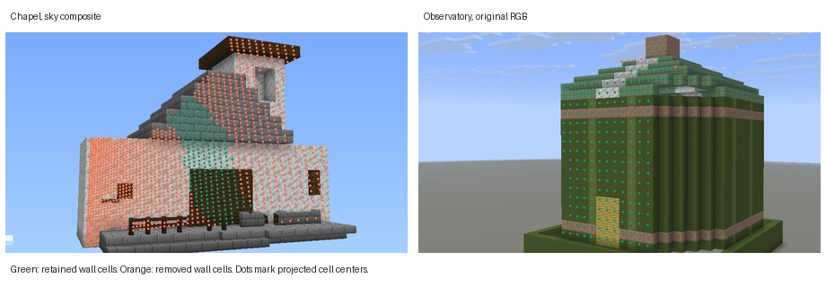

# Can local depth and surface direction bound an inferred wall grid?

The six-view sky panel improved when the source image contradicted the direction in which a wall grid receded. The rule changed one exported build in 74 frame evaluations. On the Chapel composite it cut 1,549 wall cells to 266, removing a net 1,224 extra positions while losing 59 correct positions and 15 exact material IDs. Strict placement rose from 12.41% to 19.09% on that image. Strict position plus ID fell from 2.00% to 1.29%. Keep both rules experimental. The narrower rule preserved the observed large Observatory walls, but its only improvement was the development example. The broader rule lost substantial Castle coverage.

## Handoff and split

The input consists of the photographed image, its saved MoGe normals and Depth Anything relative inverse depth, the ordinary connected-atlas chart and the source-material whole-wall chart. Each inferred cell was already admitted by the whole-wall source mask. The intervention filters chart membership before ordinary assembly, component selection, material export and visible-only scoring. All retained cells keep their chart coordinates, material IDs and confidence. The original homographies stay fixed.

The broad rule was frozen at `e9f2683`. It samples a 3 × 3 inset grid in each candidate cell and takes its median direction and inverse depth. Nearby measured cells seed a local patch. A robust affine fit measures the inverse-depth slope across nearby, similarly oriented cells. Cells must agree with the fitted plane and seed direction and be reachable through edge-adjacent supported cells. A separate local fit handles each cluster of measured seeds. The final chart takes the union of those patches. A seed with insufficient depth evidence leaves the full chart eligible. This experiment refits local depth surfaces only. Recovering a new wall grid for an unsupported, differently oriented patch would need an independent scale and phase measurement.

For a perspective wall chart, the third row of its inverse homography gives the image direction of increasing physical inverse depth after choosing the sign at the seed. If the local measured slope opposes that direction, the chart only retains its locally indistinguishable depth band. The frozen test requires cosine below −0.55 and measured inverse-depth span above both five robust noise estimates and 1.7% of seed depth. The second rule, frozen at `47d0603`, applies the broad filter only when every measured seed patch has a valid fit that passes that same contradiction test. It was chosen after inspecting the broad results.

The 38 original and first 12 additional RGB views, supplemental six and six sky composites were reviewed in earlier rounds. The broad rule also saw six new frames from Arcbridge, Amphitheater and Stable Yard after its freeze. These became development evidence for the second rule. The final six were unseen when both rules froze. They cover two views each of Stepped Hall, Shrine and Market Court. Market Court is a new layout from a family seen earlier. No reference pose, masks, block IDs or sibling views enter prediction. Every score checks decoded local datapack blocks and IDs, source and reference hashes, and registered placements. Each build gets the ordinary geometry-selected yaw and one integer translation for all four scores.

## Paired results

Each table entry gives strict geometry, facade-priority geometry, strict position plus ID, and facade-priority position plus ID F1 in percent. Each linked panel includes per-frame and per-layout counts, correct/missed/extra positions, assigned and fallback IDs, material accuracy, registration status and input/output hashes.

| Panel | Whole wall | Broad seeded patches | All seeds contradict |
|---|---|---|---|
| [Original RGB, 38](original.json.gz) | 35.34 / 35.55 / 4.51 / 4.53 | 30.49 / 30.69 / 4.42 / 4.43 | 35.34 / 35.55 / 4.51 / 4.53 |
| [First additional RGB, 12](fresh.json.gz) | 27.25 / 28.39 / 5.63 / 6.04 | 25.14 / 26.45 / 6.41 / 6.90 | 27.25 / 28.39 / 5.63 / 6.04 |
| [Supplemental RGB, 6](supplemental.json.gz) | 39.92 / 43.08 / 9.27 / 10.00 | 40.55 / 43.84 / 9.47 / 10.24 | 39.92 / 43.08 / 9.27 / 10.00 |
| [Sky composites, 6](sky.json.gz) | 22.93 / 23.07 / 4.40 / 4.40 | 24.13 / 24.35 / 4.58 / 4.65 | 25.62 / 25.82 / 4.81 / 4.81 |
| [First new RGB, 6](new.json.gz) | 18.85 / 20.13 / 3.39 / 3.71 | 18.90 / 20.58 / 3.38 / 3.79 | 18.85 / 20.13 / 3.39 / 3.71 |
| [Second new RGB, 6](new2.json.gz) | 22.15 / 23.16 / 4.93 / 5.27 | 21.48 / 22.52 / 5.54 / 5.95 | 22.15 / 23.16 / 4.93 / 5.27 |

On the original 38, broad filtering recovered 846 correct positions and lost 3,425. It removed 2,336 extras and added 496 after whole-build registration. Castle 03 limestone high-right had a measured slope aligned with its grid (cosine approximately +1). The patch retained 362 of 1,841 cells on its main wall. The export lost 1,170 correct positions and fell from 44.49% to 13.39% strict geometry. On the supplemental Observatory pair, the broad filter kept all 379 correct positions and improved geometry from 36.48% to 37.64%. On the first six new views it lost 220 correct positions and recovered 73. On the second six it lost 93 and recovered 48.

On Chapel, three quarters of the whole-wall cell centers were within 3.25° of the seed patch normal in the initial source diagnostic. The robust depth fit gave cosine −0.913 with the chart's required gradient. Remaining placements numbered 59 correct, 293 missed and 207 extra, with four exact IDs. Across the six sky composites the narrow rule raised pooled typed F1 while reducing exact IDs from 173 to 158. In Twinspire it trimmed two cells on a chart outside the selected export. The other 72 frame evaluations had unchanged wall charts and exports under that rule.



## Scope and camera failures

Original RGB coverage was 22 v2, 28 of 144 v3 and 18 of 40 decorative views across the five panels. Four v3 and two decorative sky composites are separate from the RGB counts. Paired lighting and the historical 112-view replay were unmeasured. The fixed 104 production trend is carried forward from the README's camera-native measurement, 91.27% strict (20,773 correct, 2,929 missed, 1,046 extra) and 93.42% facade (18,952 correct, 1,624 missed, 1,046 extra). This branch carries benchmark experiments only. The ordinary default remains on main.

The floor-free assembler supplies an upright orientation hint where possible. All three arms had one original Castle view without a hint, an empty 5,046-target miss. On the 37 orientation-supported images, strict F1 was 37.76% for whole wall and the narrow rule and 32.72% for broad patches. Two first-additional Cloister views (403 visible targets) used the archived scorer's upright-yaw search. On the ten directly supported views, strict F1 was 25.31% whole and narrow, 22.98% broad. Counting unresolved orientation as a miss and charging unmatched predictions on the full 12 gives 23.90% whole and narrow, 21.64% broad. The supplemental, sky and both new panels resolved upright orientation on every frame. No supported view exported zero blocks.

## Reproduction

Use the benchmark environment from the fresh validation replay, plus the original, six-sky and two held-out fixture worktrees. The fixture producer writes new inputs inside the floating-patch-validation worktree. Each candidate writes its own chart packets, receipt, source overlay and decoded pack under `runs/patch-planes/<panel>/<candidate>/`.

```powershell
$worktrees = (Resolve-Path ..).Path
$env:PYTHONPATH = "$worktrees/surface-round/runs/depth-probe/runtime;$worktrees/surface-round/runs/mlsd-probe/lib"
$runtime = Join-Path $env:USERPROFILE '.cache/codex-runtimes/codex-primary-runtime/dependencies/python/python.exe'
$entry = 'import sys; sys.path.append(r"../mask-scalelsd/runs/env/Lib/site-packages"); from benchmark.floating_patch_planes import main; main()'
& $runtime -B -c $entry original fresh supplemental sky new new2 --candidate planes --workers 6
& $runtime -B -c $entry original fresh supplemental sky new new2 --candidate opposed --workers 6
& $runtime -B -c 'import sys; sys.path.append(r"../mask-scalelsd/runs/env/Lib/site-packages"); from benchmark.floating_patch_plane_report import main; main()'
```
