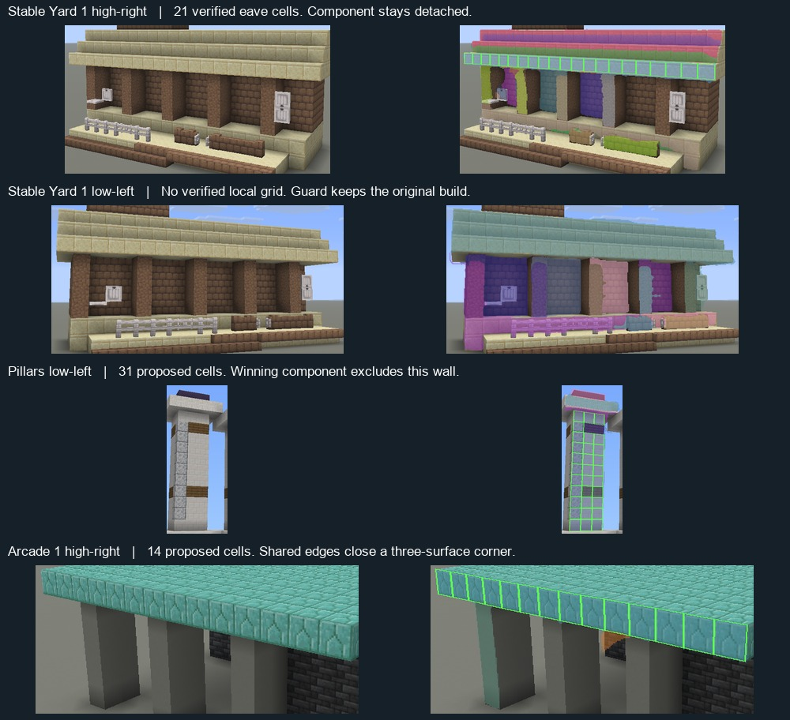

# Fit a block grid after source-depth partitioning

On the 84 adopted floating images, the correct-first source guard gains 183 net visible coordinates and 175 net exact block IDs, with identical extras. Keep this candidate experimental. Two Twinspire layouts from one additional architectural family account for all positive transfer outside the nine pilot images. The size guard was introduced after observing broad transfer.



## Inputs and replay

Base code is `4d9aca1`. The adopted expanded benchmark at `51bd1e9` supplies frozen export, source and chart hashes. All 84 no-op Java packs decode to the same local coordinates and IDs and registered placements as the pinned baseline. The score for each also matches. The cohort includes 30 v2, 30 v3 and 24 decorative images; six fixed sky conditions overlap these 84.

The first three reviewed walls were Stable Yard 1 from both sides and Pillars. The other six pilot images were paired angles of Market Court 1, Arcbridge 2 and Arcade 1. After those nine, the largest eligible source wall (minimum 5,000 source pixels) and three-surface corner rule were frozen in `93d5dfe`. Of 75 remaining frames, 74 supplied an eligible wall. Across all 84 the detector split 83 walls into 802 pieces. Fresh grid witnesses passed on 62 complete and 95 partial hypotheses. These counts can include the same region in both arms.

Native screenshot colors, estimated normals and relative depth partition each target before fitting. Old cells and the old grid homography are removed from fitting. The search uses the parent source quadrilateral if its normal agrees, or independent source-image tangents. It checks separated native texture patches, keeping both full and partial-face alternatives. No reference geometry, face IDs or reference camera participates in this choice. Weak pieces fall back to center-assigned inherited cells except in fresh-only. All arms reapply border-connected sky removal and ordinary assembly. Same-parent coplanar links are suppressed; perpendicular physical joins remain available.

Split-only preserves the inherited grid and changes the source partition. Untouched fallback uses the pinned late guarded depth split and border filter. Consequently the unconditional split on Stable Yard low-left also tests enabling its previously declined split. Neither forced deployment nor unconditional removal of old cells preserves the adopted placement accuracy.

| 84-image export | Correct / missed / extra | Strict / facade placement F1 | Strict / facade placement + ID F1 |
|---|---:|---:|---:|
| Adopted no-op | 18,318 / 61,192 / 9,965 | 33.99 / 34.48% | 5.66 / 5.76% |
| Split only | 16,163 / 63,347 / 5,113 | 32.07 / 32.69% | 5.24 / 5.34% |
| Complete refit | 16,070 / 63,440 / 4,504 | 32.11 / 32.74% | 6.13 / 6.26% |
| Partial refit | 16,192 / 63,318 / 4,512 | 32.31 / 32.95% | 6.38 / 6.52% |
| Fresh only | 5,561 / 73,949 / 956 | 12.93 / 13.20% | 5.42 / 5.58% |
| Connected complete or three-surface corner | 18,478 / 61,032 / 9,884 | 34.26 / 34.76% | 6.20 / 6.32% |
| Nonshrinking connected complete or corner | 18,501 / 61,009 / 9,965 | 34.27 / 34.77% | 5.97 / 6.08% |

The complete gate requires all measured pieces in the winning component, a retained join for each, and retention of the original selected source surfaces. It accepted six additional images across four architectural families. The partial gate requires a triangle of shared perpendicular edges across three different source surfaces, including repeated unit contacts. It passed only Arcade high-right (11, 1 and 11 shared unit edges). Its ordinary registration replaces the unrelated mask-2 singleton with a distinct component. All 28 old correct coordinates are lost, and all 154 correct coordinates of the new group are newly gained. Its 14 measured roof cells all sample different correct visible faces with exact materials.

| Image with an accepted source change | New / lost correct | Added / removed extras | Net exact IDs | Nonshrinking or corner |
|---|---:|---:|---:|---|
| Arcade 1 cool high-right | 154 / 28 | 0 / 0 | +129 | yes |
| Twinspire 1 earth high-right | 24 / 0 | 0 / 0 | +20 | yes |
| Twinspire 3 earth high-right | 33 / 0 | 0 / 0 | +26 | yes |
| Twinspire 2 cool high-right | 0 / 1 | 0 / 1 | +15 | no |
| Riverside Mill 1 warm low-left | 31 / 33 | 1 / 81 | +54 | no |
| Cloister 2 cool high-right | 0 / 11 | 0 / 0 | +10 | no |
| Watchpost 2 cool low-left | 0 / 9 | 0 / 0 | +43 | no |

Complete-or-corner gains 242 and loses 82 correct, adds one and removes 82 extras, and gains 338 and loses 41 exact IDs. The correct-first alternative declines shrinking complete exports using their decoded source-only size. It gains 211 and loses 28 correct and gains 200 and loses 25 exact IDs. Counts and registration are computed from the actual selected whole packs.

## Detached verified cells

Stable Yard high-right yields a 21-cell eave with eight held-out source atlas witnesses. Visible reference diagnostics confirm 21 distinct correct faces and 21 exact IDs. A fresh-only export can represent these cells separately, but the mixed pack picks a different detached piece. Source evidence has yet to establish a perpendicular contact for registering the eave into the adopted component. The reference-only rigid shift agrees at all 21 centers and produces 84 correct / 270 missed / 1,190 extras and 37 exact IDs against 63 / 291 / 1,190 and 16 exact. The guard retains the adopted export. Stable Yard low-left has no accepted fresh grid and retains its existing 74 correct and 25 extras. Pillars produces 31 distinct native visible faces and 24 exact IDs. All positions of the reference-aligned patch already exist in the adopted build. These reference shifts were used only for diagnostics.

## Reproduction

Run the following from this registered checkout with the benchmark Python and original shared immutable handoffs available.

```
python -m benchmark.floating_pregrid_depth_refit --workers 5
python -m benchmark.floating_pregrid_depth_refit --report
python -m benchmark.floating_pregrid_attachment_oracle
python -m benchmark.floating_pregrid_figure
python -m unittest benchmark.test_floating_pregrid_depth_refit
```

[Per-frame decisions, masks, grids, component joins and decoded results](conditions.json.gz) · [Per-arm scores and paired changes](summary.json) · [Reference-only rigid-shift control](reference-attachment.json.gz). The per-frame roots resolve the private selected pack in each arm. Source masks are under `runs/pregrid-depth-refit/<panel>/source/<condition>`.

## Floating branch scorecard

The adopted expanded revision `51bd1e9` and nonshrinking candidate score 890 correct / 3,151 missed / 1,521 extra on the same six sky images, with 27.59 / 27.83% strict / facade placement F1 and 5.98 / 6.01% position-plus-ID F1. Across all 84 images the candidate moves placement from 33.99 / 34.48% to 34.27 / 34.77%, gaining 183 correct with zero additional extras. The existing sparse integration control at `9435934` carries forward 273 / 3,768 / 5 on the fixed six with 12.64 / 12.90% placement and 4.68 / 4.77% position-plus-ID. This experiment publishes candidate behavior only. Independent building-family transfer is needed before adoption.
