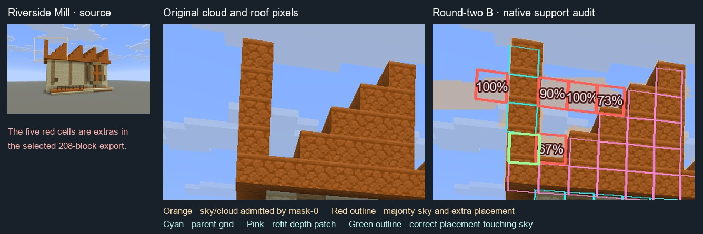

# Riverside Mill sky overlap

Five majority-sky cells on Riverside Mill's round-two B grid are real extra placements. The five come from the retained parent grid. Both completely sky-covered cells export as packed ice. The refitted pink patch touches sky in just two cells, both correctly placed. [Round-two viewer](../floating-grid-signoff-03/review.html#train-riverside-mill-1-warm-low-left-depth)



The [full-resolution overlay](mill-sky-native.jpg) shows all three correctly placed cells with slight sky overlap in green. The [per-cell receipt](mill.json) traces the displayed homographies to the winning writes in the pack. B displays 197 mask-0 cells, with 109 on the retained grid and 88 on the projecting patch. All 197 own distinct voxel positions. The one exported component also contains 11 cells from mask-1. A and B export the same 208 aligned positions and score 160 correct / 273 missed / 48 extra.

## What admits the clouds

The native reference counts screenshot pixel centers inside each projected cell. A zero frontmost building ID on an upward ray is classified as sky/cloud in this level-floor capture. The geometric horizon is at y=547.65 on the 1440 × 900 source. This diagnostic uses recorded camera and visible reference data. The source-only comparison runs the existing RGB sky check on the original screenshot.

| Screen-space test on B's mask-0 grid | Exported cells | Correct | Extra |
|---|---:|---:|---:|
| At least one unlabeled background pixel | 12 | 4 | 8 |
| At least one native sky/cloud pixel | 11 | 3 | 8 |
| More than half native sky/cloud | 5 | 0 | 5 |
| Entirely native sky/cloud | 2 | 0 | 2 |
| At least one pixel marked by the current source sky rule | 0 | 0 | 0 |

The source wall mask already admits 13,566 sky/cloud pixels. It retains 5,637 of the 6,307 sky pixel hits under the B grid. The source RGB rule flags 111 sky pixels anywhere inside that mask, all outside the displayed cells. Its row test misses four majority-sky cell centers where both borders show clouds with blue values of 219–221, below the 230 minimum. The fifth center is on a gray cloud with blue 221 while the border clear sky is blue 255, beyond the allowed difference of four.

The five cells were absent among the 20 initial mask-0 atlas seeds. The dense sampler expands to 197 cells and treats cloud pixels inside the mask as matching atlas candidates, including ice and froglight. The cell at UV `[-6, 7]` covers 1,513 native sky pixels, including 1,196 inside the wall mask. Its aligned export coordinate is `[3070, 77, 0]`. The local relief refit leaves those parent positions in place.

The single-view deletion control rescored subsets of the decoded pack using one whole-build translation. Current source sky removed zero cells and stayed at 49.92% strict F1. Native majority sky deleted five extras and reached 50.31%, with 160 / 273 / 43. Deleting every native sky-touching cell removed three correct positions and eight extras, scoring 49.84% with 157 / 276 / 40. The native deletion rows are reference diagnostics. A source approach needs to recognize clouds before a projection-stage veto can help this case.

Run the audit against the registered worker checkouts and original round-two feedback.

```powershell
../mask-scalelsd/runs/env/Scripts/python.exe -m benchmark.floating_projection_audit C:/Users/jerem/Downloads/floating-grid-round-two-feedback.json --out benchmark/reviews/floating-projection-audit-01/mill.json --figure benchmark/reviews/floating-projection-audit-01/mill-sky-audit.jpg --native-overlay benchmark/reviews/floating-projection-audit-01/mill-sky-native.jpg
../mask-scalelsd/runs/env/Scripts/python.exe -m benchmark.floating_projection_controls C:/Users/jerem/Downloads/floating-grid-round-two-feedback.json --out benchmark/reviews/floating-projection-audit-01/cohort.json.gz
```

## Floating branch scorecard

The [paired receipt](cohort.json.gz) freshly decodes and regrades the saved packs. The 84 active conditions include the six fixed sky views and 82 unique captures. Coverage is 30 of 92 active Visible Builds v2, 29 of 108 active Visible Builds v3 and 23 of 40 Decorative Builds v1 captures. The new Arcbridge feedback adds its two views to the reviewed group, giving 21 reviewed and 63 other archived conditions. The full production v3 and Decorative cohorts are unmeasured here. Carried-forward fixed-104 production scores are 91.27% strict and 93.42% facade with 20,773 / 2,929 / 1,046.

| Cohort and method | Strict F1 | Facade F1 | Strict + ID | Facade + ID | Correct / missed / extra |
|---|---:|---:|---:|---:|---:|
| Fixed sky · connected atlas, integration `9963dee` carried forward from the `7033891` measurement | 12.64% | 12.90% | 4.68% | 4.77% | 273 / 3,768 / 5 |
| Fixed sky · large contraction and all tested depth arms | 27.50% | 27.73% | 5.96% | 5.99% | 890 / 3,151 / 1,542 |
| Fixed sky · majority and seam fit | 27.59% | 27.83% | 5.95% | 5.97% | 895 / 3,146 / 1,552 |
| Active 84 · large contraction | 33.542% | 34.015% | 5.512% | 5.612% | 18,323 / 61,187 / 11,420 |
| Active 84 · prior source depth | 33.782% | 34.283% | 5.741% | 5.842% | 18,455 / 61,055 / 11,293 |
| Active 84 · local grid refit | 33.787% | 34.288% | 5.799% | 5.904% | 18,453 / 61,057 / 11,268 |
| Active 84 · local refit plus small steps, the B arm | 33.805% | 34.306% | 5.801% | 5.904% | 18,463 / 61,047 / 11,258 |
| Active 84 · signed boundary guard | 33.789% | 34.264% | 5.726% | 5.829% | 18,457 / 61,053 / 11,282 |
| Active 84 · majority and seam fit | 33.537% | 34.036% | 5.511% | 5.610% | 18,318 / 61,192 / 11,413 |

The B-family local refit and small steps add eight correct positions and remove 35 extras against prior depth on all 84, and add five and remove 32 on the 63 other layouts. They tie prior depth on the fixed sky views. The majority and seam fit gains 0.09 strict points with five more correct and ten more extras on fixed sky versus large contraction. On all 84 it loses five correct and removes seven extras. Keep the Mill audit and deletion diagnostics experimental. This branch adds verification and source overlays. Floating integration keeps its connected-atlas behavior, and production main received no change.
