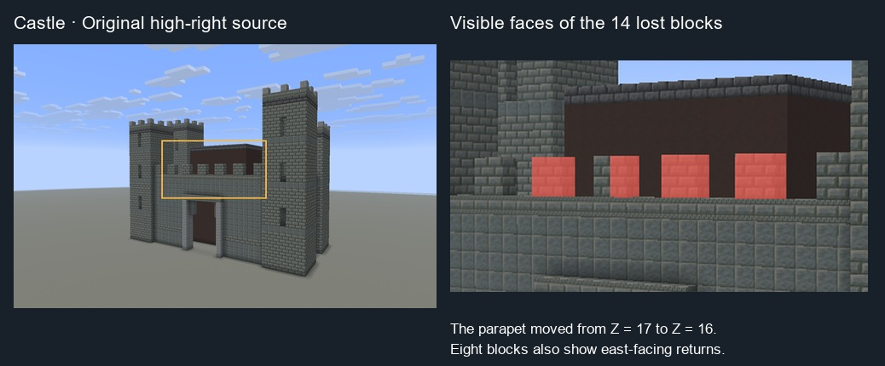

# Floating grid signoff audit

All seven comparisons in the [signoff viewer](../floating-parts-feedback-02/review.html) matched the decoded exports. The audit verifies the screenshot and scoring reference hashes, the pack bytes and the full registered block and material inventories. It then recalculates the four scores using the archived whole-build yaw and single XYZ translation. The [machine-readable receipt](audit.json.gz) includes the original review fields, the six pooled score groups and the exact frame, image, reference and pack hashes for all active conditions.

The 84 active conditions cover 82 distinct source captures. The six fixed sky composites are included in the 84. Grouping by dataset and layout places 19 conditions in the reviewed group and 65 in the transfer group. Each group includes three fixed sky composites. The reviewed layouts are Twinspire 2, Castle 01, Pillars 01, Shrine 02, Viaduct 01, Hillside Chapel 1 and Riverside Mill 1. Transfer uses other archived layouts. The active coverage is 30 of 92 Visible Builds v2 captures, 29 of 108 Visible Builds v3 captures and 23 of 40 Decorative Builds v1 captures. The full production v3 and Decorative cohorts were unmeasured in this audit.

## What the seven reviews say

| Review | Recorded feedback | Decoded result, A → B |
|---|---|---|
| Twinspire upper row | The only comparative dropdown vote was for B. Both sizes and alignments were rated right and aligned. The reviewer accepts a majority-supported partial block and identifies the brick–sandstone contact as a place to reset the grid. | 110 → 110 correct, 63 → 63 extras. The edited wall was outside the selected component. |
| Mill window and porch | Both grids have extra area. Reestablish the grid at each depth, preserve the window cross and separate the one-block relief. Use geometric evidence for the step. | 121 → 160 correct, 82 → 48 extras. |
| Viaduct projecting faces | A free-text request for local grids at the return faces and at the projecting brown base. | 111 → 170 correct, 100 → 41 extras. |
| Castle | A free-text judgment that the depth information should inform both placement and the grid. | 562 → 548 correct, 403 → 417 extras. |
| Shrine stairs | Keep the right wall and split the visible treads and risers. The tested depth rule leaves the case unresolved. | 60 → 60 correct, 64 → 64 extras. |
| Pillars ruler | B has the right block size, drifts across the wall and misses area. The free-text comment calls B's block size better but too skewed. | 69 → 45 correct, 687 → 64 extras. Assembly switches from mask-1 to mask-4. |
| Chapel left edge | B has the right size and alignment and misses area. The free-text comment favors B and asks for separate surface grids. | 107 → 109 correct, 58 → 67 extras. B is the reference-assisted origin shift. |

The approval and depth-separation dropdowns were blank on all seven cases. The receipt records free text and explicitly selected ratings independently, including Chapel's comment favoring B.

## Castle depth evidence and exported coordinates



The annotated case is Castle 01 ashlar high-right on the original RGB image. On the same 16 resolved neighboring cell pairs across the proposed patch boundary, the raw source inverse-depth readings agreed with the recorded inverse camera depth order on 12 pairs. They agreed on all seven pairs where the native sample identified different parallel planes. These comparisons use medians at the same native sample points, restricted to each cell's majority full-cube face plane. Camera-depth order incorporates along-wall perspective. An integer change along a wall normal needs a plane assignment and a separate metric estimate.

The proposal shifted a connected patch of 84 cells one block backward along the south-facing normal. Relative to the chart's modal plane at block Z=17, the native samples in that patch resolve to −11 blocks on 24 cells, −5 on 37 and zero on 16. Seven cells lack comparable native evidence. The patch crosses 16 resolved neighboring pairs with native signed gaps of zero on nine, +5 on four, −5 on two and −11 on one. The forced move got the wall-normal direction right on three of seven nonzero pairs and the magnitude on zero of 16 pairs. The archived per-part reference-step control chooses zero because the modal boundary difference is zero. Source depth provides evidence for relief. The loss comes from converting several planes and coplanar neighbors into a single one-block displacement.

The selected masks, joins and whole-build translation of `[16548, 89, 18]` are unchanged across the four arms. All 14 lost correct blocks have a south face on the parapet above the entrance, native surface 28, in rows Y=80 and 81 at Z=17. Eight also have visible east returns. The move puts them at Z=16. For example, chart cell `[-21, -9]` at source center `[567.24, 432.85]` leaves `[16527, 80, 17]` empty and places a block at `[16527, 80, 16]`. The source adjustment adds 84 extra coordinates and removes 70. The visible-reference parallel-parts replay uses the same source chart and clips native depths to one-block steps. It gains 211 correct positions and loses eight against flat placement, reaching 62.09% strict F1 and 765 / 706 / 228 compared with 46.14% and 562 / 909 / 403 for the flat chart. That isolates headroom in assigning the cells to parts. Local grid refitting and matching the full metric setback are separate interventions.

## Reproducing the audit

With the registered sibling checkouts and saved runs, use the benchmark environment. Run from this checkout.

```powershell
../mask-scalelsd/runs/env/Scripts/python.exe -m benchmark.floating_signoff_audit C:/Users/jerem/Downloads/floating-grid-signoff-feedback.json --out benchmark/reviews/floating-signoff-audit-01/audit.json.gz --castle-figure benchmark/reviews/floating-signoff-audit-01/castle-losses.jpg
```

The chart control is `e97dd44`, the depth archive is `7a09326`, the ruler archive is `bcc3afb`, and the annotation viewer is `863b4d3`. Identical controls shared the same pack hashes and scores. The audit uses saved outputs and adds no modeled predictions.

## Floating branch scorecard

The six fixed sky composites include four Visible Builds v3 and two Decorative Builds v1 images. Integration revision `baaa572` carries forward the connected-atlas behavior measured at `7033891`. Its six packs were decoded and rescored here. The same decoding and fixed reference replay verifies the benchmark alternatives. The separate fixed 104 production trend carries forward at 91.27% strict and 93.42% facade placement with 20,773 / 2,929 / 1,046 strict correct / missed / extra.

| Cohort and arm | Strict | Facade | Strict + ID | Facade + ID | Correct / missed / extra |
|---|---:|---:|---:|---:|---:|
| Fixed sky 6 · Integration | 12.64% | 12.90% | 4.68% | 4.77% | 273 / 3,768 / 5 |
| Fixed sky 6 · Large contraction | 27.50% | 27.73% | 5.96% | 5.99% | 890 / 3,151 / 1,542 |
| Fixed sky 6 · Source depth | 27.50% | 27.73% | 5.96% | 5.99% | 890 / 3,151 / 1,542 |
| Fixed sky 6 · Cross-surface ruler | 29.73% | 30.14% | 6.59% | 6.69% | 866 / 3,175 / 919 |
| Fixed sky 6 · Visible parallel parts diagnostic | 35.62% | 36.03% | 9.39% | 9.49% | 1,153 / 2,888 / 1,279 |
| Active 84 · Connected-atlas panel replay | 5.29% | 5.44% | 2.20% | 2.27% | 2,164 / 77,346 / 124 |
| Active 84 · Large contraction | 33.54% | 34.01% | 5.51% | 5.61% | 18,323 / 61,187 / 11,420 |
| Active 84 · Source depth | 33.78% | 34.28% | 5.74% | 5.84% | 18,455 / 61,055 / 11,293 |
| Active 84 · Cross-surface ruler | 33.70% | 34.18% | 5.54% | 5.65% | 18,299 / 61,211 / 10,797 |
| Active 84 · Visible parallel parts diagnostic | 38.24% | 38.92% | 7.67% | 7.85% | 20,898 / 58,612 / 8,878 |

Against large contraction, source depth gained 0.24 strict points on the 84 active conditions, with 132 more correct and 127 fewer extras. It gained 0.11 points on the 65 transfer conditions with 48 more correct and 48 fewer extras, and tied on the six sky views. The cross-surface ruler improved 2.23 strict points on fixed sky, removing 623 extras and losing 24 correct, entirely on reviewed Pillars. On the 65 transfer conditions it tied every score and count. Keep the depth and ruler methods experimental. This round lands an audit and evidence on `experiment/floating-signoff-audit`. Integration and production behavior did not change.
