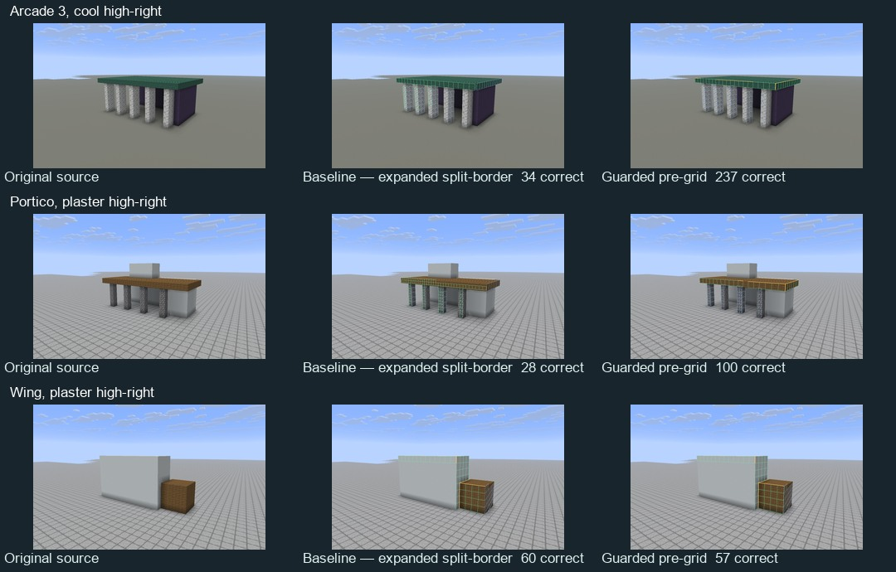

# Floating on the original Visible Builds v1 screenshots

The current guarded pre-grid method recovered 10,156 of 34,454 visible blocks across all 144 eligible original screenshots. Against the expanded split-border baseline on the same photos it gained **533 correct positions and 537 exact block IDs and removed 78 net extras**. The input images retain their photographed ground and background. The Floating predictor receives no floor pose or reference camera.

| Method and cohort | Correct / missed / extra | Strict / facade placement F1 | Strict / facade position + ID F1 | Exact IDs |
|---|---:|---:|---:|---:|
| Baseline — expanded split-border, original V1 144 | 9,623 / 24,831 / 7,052 | 37.6420 / 40.1979% | 15.1069 / 16.4243% | 3,862 |
| Candidate — guarded pre-grid, same 144 | **10,156 / 24,298 / 6,974** | **39.3766 / 41.3663%** | **17.0557 / 18.5429%** | **4,399** |

All released V1 images were inspected. Eight close-front images failed the 2% clearance rule, leaving 72 train, 12 validation, 12 test and 48 regression frames. No Orchid image was present. Seventy-two source images match the historical fixed-104 by RGB checksum. On these 72 the current Floating method scores 4,917 / 11,215 / 3,897 with 39.42 / 41.27% placement and 18.16 / 19.51% position-plus-ID. The full result above uses all 144.

All exports were nonempty. The baseline and candidate both resolved 137 orientations and failed on the same seven. The primary table charges all visible targets as misses and every exported block as extra on those seven images. For resolved images the evaluator uses the source orientation's camera-compass correspondence and a single whole-build integer translation. IDs use the geometry-selected transform. Source reference data is used only in these evaluations and recorded native-grid diagnostics.

## Historical controls

The sparse connected-atlas replay measures the effect of the earlier expansion. Its 144 V1 exports and separate scores remain in the [score archive](strict-orientation.json).

The historical evaluator also scores unresolved builds under the best of four upright rotations. Its diagnostic counts are 10,243 / 24,211 / 6,432 for expanded and 10,773 / 23,681 / 6,357 for current, with 40.07 / 42.87% versus 41.77 / 44.01% placement F1. Under these registered transforms current gains 676 and loses 146 correct coordinates, adds two and removes 77 extras, and gains 606 and loses 78 exact IDs. Only 12 of the 14 source-selected alternatives changed decoded local positions or IDs.

## Transfer

All 30 source images shared with the previous 84-condition benchmark reproduced **every local and registered coordinate and ID in every arm** from regenerated fields, source masks, charts and Java packs. Of the remaining 114 V1 images, the conservative current score gains 350 correct positions and 362 exact IDs and removes 78 extras versus expanded. These 114 are additional frames; several share architectural families with earlier work.



The light-blue overlay shows available charts, green shows the selected surfaces, and yellow marks accepted joins. Arcade 3 cool high-right gains 203 net correct positions; Portico plaster high-right gains 72 and removes 68 extras. The smooth-stone Wing plaster high-right gives an apparent three-position loss under best-yaw scoring. Its orientation is unresolved in both expanded arms so the primary scorer awards neither build coordinate credit. Wing on the light-gray floor and Terrace 2 cool high-right selected a new chart packet with identical exported blocks.

## Prediction and verification

The runner starts from `06d0d84`. The imported source proposal logic is from `e1f0218`, the edge-aligned ruler from `a0e67a7`, and the corner-pair repair from `27e86b1`. The checked-in implementations preserve their frozen thresholds. Current pre-grid fitting runs the original regional fit and component gates. No thresholds were changed for V1.

1. Verify the release source and framing fingerprints. Run pinned MoGe normals and Depth Anything depth on the original RGB. The receipt records model, source and output hashes. Produce Floating masks, outlines and counts through its ordinary sky-filtering surface handoff.
2. Regenerate source dense atlas grids, shared-row joins, native counts, registered seam and additional connected atlas walls. Export the sparse control with ordinary Java pack assembly. Expand source-visible cells and rank native materials.
3. Apply full-face large-contraction selection (four frames), the edge-aligned repeater (zero), and the counted corner-pair repair (one). Recheck selected charts for depth splitting (two frames), then apply the projected border-sky veto. This yields the expanded baseline. Fourteen current alternatives passed the later source connectivity or corner guard.
4. For the current method, fit fresh local rulers and search material repeats within native depth partitions. Separate siblings cannot rejoin on coplanar texture alone. The source assembly and nonshrinking guard select the final export. Each Java pack is decoded and checked against retained local positions and IDs. A separate repeat of all 144 expanded assemblies reproduces every decoded map, registration and score. An independent scorer verified all 432 exports.

[Original fixture manifest](fixtures.json.gz) · [Three Java packs per frame](exports.zip) · [Decoded scores, selected components, fields and provenance](conditions.json.gz) · [144 no-op receipts](no-op.json.gz) · [Primary scores by split and overlap](strict-orientation.json) · [Historical best-yaw results](summary.json)

Reproduce on this PC using the repository benchmark Python and prepared Java 26.3 atlas. The field producer needs the pinned normal and depth ONNX weights and ONNX Runtime. Source-only V1 crops, grids and renderings live under `runs/floating-v1`. Shared historic exports are used solely for the exact-overlap audit. The directory component `sky` is the existing evaluator slot for the single source image; every V1 source checksum matches the original release.

```
python -m benchmark.floating_v1_fields --workers 4
python -m benchmark.floating_v1_run --stage sparse --workers 8
python -m benchmark.floating_v1_run --stage current --workers 8
python -m benchmark.floating_v1_noop --workers 4
python -m benchmark.floating_v1_report
python -m benchmark.floating_v1_figure
python -m unittest benchmark.test_floating_v1
```

## Floating branch scorecard

Baseline — frozen expanded split-border on 84 Floating conditions, carried forward from `51bd1e9` on integration `76f995c`, scores 18,318 / 61,192 / 9,965 with 33.99 / 34.48% placement and 5.66 / 5.76% position-plus-ID. The six fixed sky images remain at 890 / 3,151 / 1,521 with 27.59 / 27.83% placement and 5.98 / 6.01% position-plus-ID. The earlier pre-grid candidate on those same 84, carried forward at `06d0d84`, scored 18,501 / 61,009 / 9,965, 34.27 / 34.77% placement and 5.97 / 6.08% position-plus-ID; all six retained their baseline. The V1 table reports a separate newly run cohort and a conservative orientation policy. Keep this replay on its experiment branch. It documents transfer of the existing method and makes no integration or mainline change.
