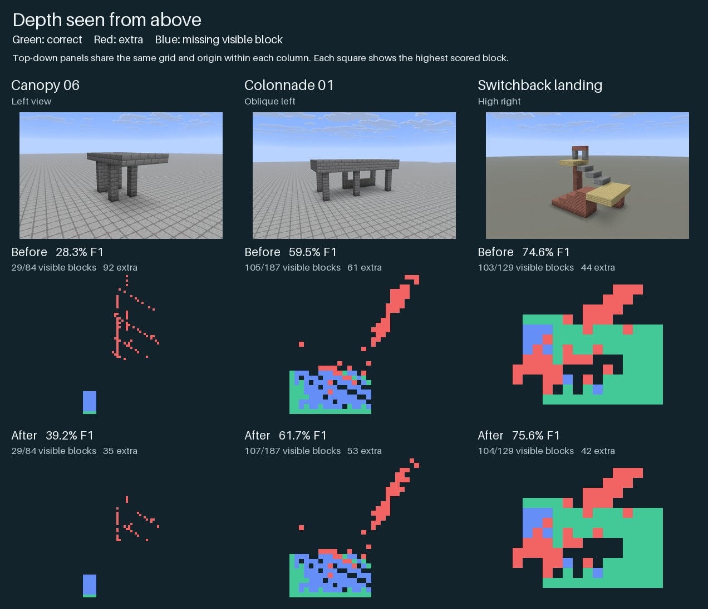

# Correcting excessive depth in single-image builds

The previous placer extended roofs, lintels and walls well beyond the photographed building. On the 104 fixed views, 1,084 of its 1,894 extra placements lay outside the source building's horizontal bounds. The new placer uses the photograph to correct these errors. It recovered 170 net visible positions and removed 703 net extras. Placements outside the source bounds fell to 478. The scorer alone has access to the source bounds. [Previous default and failure diagnosis](control/README.md)

## Results

Relative geometry F1 pools visible block coordinates after one translation of the entire build per image. All parts share this translation, so roof height, wall offsets and post spacing matter. Hidden source blocks count as extras. This measures geometry. Material identification accuracy is a separate metric.

| Cohort | Photos | Previous F1 | Default F1 | Correct / visible | Extras | Extras at hidden source positions |
| --- | ---: | ---: | ---: | ---: | ---: | ---: |
| Development | 72 | 88.30% | 91.01% | 15,952 / 18,322 | 781 | 82 |
| Fixed whole-structure evaluation | 104 | 88.22% | **90.01%** | 20,373 / 23,702 | 1,191 | 105 |
| Alternate views | 20 | 86.69% | **88.22%** | 3,535 / 4,098 | 381 | 59 |
| Four views reserved in the previous round | 4 | 82.79% | **83.64%** | 621 / 747 | 117 | 0 |
| New platform shelter and offset gate | 4 | 77.61% | **82.41%** | 677 / 764 | 202 | 10 |

The fixed evaluation gained 225 visible positions and lost 55. Eight new extras appeared and 711 disappeared. Of 104 photos, 85 improved, 15 tied and four regressed. Grouping views and palettes of the same shape, 33 of 40 shapes improved, five tied and two regressed. The 20 alternate views gained 11 net correct positions and two placements on hidden source blocks. The four new photos each improved, with 15 net correct positions gained, 78 net extras removed and one additional hidden placement. [Geometry and opening scores](summary.json) · [Per-photo scores and input hashes](cases.json) · [Shape-grouped comparison](shape-check.json) · [New captures and independent CLI check](../framed-depth-transfer-01/README.md)

All 144 active dataset frames and 56 additional benchmark frames passed the whole-structure admission check. This requires the projected full structure and observed silhouette to clear each edge by at least 2% of that image dimension. The smallest dataset margin exceeds 10%. Four newly captured photographs also passed, with at least 18.73% clearance. They remain evaluation-only. The training split has 72 images. The four new scores were opened after freezing the integrated method at `0e0c229`. [Admission rules and audit](../../../training/DATASET.md#whole-structure-admission) · [Additional view audit](../whole-structure-framing-01/evaluation-only.json) · [New capture measurements](../framed-depth-transfer-01/framing.json)

## Decisions that shipped

1. A small model uses visible floor contacts, distances and texture evidence to reject unlikely depths. A hard footprint cutoff also deleted correct blocks. Leaving out each development building family in turn supported a learned threshold of 0.85. As a standalone change it reached 89.13% on the fixed evaluation. [Ground contact experiments](https://github.com/jeremyepling/minecraft-image-reconstruction/blob/47ca147/benchmark/reviews/grounded-depth-envelope-01/README.md)
2. A second decision moves or trims a connected surface patch using evidence from the same photographed texture. Moving the patch requires a full-resolution depth check to protect clear sightlines. This guarded stage reached 88.67% alone. [Section relocation and alternatives](https://github.com/jeremyepling/minecraft-image-reconstruction/blob/2c49553/benchmark/reviews/plane-section-01/README.md)
3. When a discarded placement reveals pixels, the placer rechecks thin horizontal atlas faces against those pixels. A separate model verifies observed vertical faces using texture alignment and competing depths. The vertical check alone gained 155 correct positions at the cost of six extras on the fixed set. Its threshold of 0.80 was chosen on family-held-out development data. [Vertical atlas training, penalties and exports](../vertical-atlas-01/README.md)

The ground and vertical checks together scored 89.58% on the fixed views. Adding section trimming reached 89.94%. Unrestricted section relocation scored 90.02%, but blocked two previously clear sightlines on the fixed set and two on the alternate angles. The shipped combination scored 90.01% and kept all 243 sampled sightlines open. All 18 measured openings retained their correct width. Fixed roof cells at the correct offsets from both posts fell from 294 to 293 of 459. Alternate views rose from 232 to 308 of 398, largely because recovering a missing post cell registered an existing roof correctly. [Alternative orders and per-frame results](ablations.zip)

## Where geometry still fails



Canopy 06 left remains worst on the fixed set at 39.19%, up from 28.29%. Both outputs recover just 29 of 84 visible cells. Extras fell from 92 to 35, but the output still extends 45 blocks in depth versus 10 in the visible reference. A normal command-line build reproduced both exports, including material states. On the newly built offset gate, 105 of the 113 remaining blocks outside the footprint are at the lower lintel and roof height. [Canopy CLI readback](cli-checks.json) · [Gate photograph and footprint](../framed-depth-transfer-01/gate-footprint.png)

The next test is to fit the near and far edges of each **visible** roof strip together using its texture scale and observed post or wall contacts. Compare alternative lengths only where they explain photographed pixels. Score the number of visible roof blocks at the correct offsets from both posts, visible positions recovered, and newly blocked openings. On the fixed set, even deleting every remaining extra while recovering zero new visible cells yields only 92.45% F1. Progress toward 95% requires recovering missed visible blocks.

## Reproduce

Restore the versioned inputs described in the [control](control/README.md). The default evaluation re-runs the placer on frozen image-derived surfaces, counts and camera estimates. It decodes each exported pack before comparing against view-masked geometry. The CLI comparisons also run the upstream pipeline from RGB. The calibrated Java 26.3 atlas is required to exercise the refinement.

```powershell
python -m benchmark.framed_depth_eval --candidate benchmark.framed_geometry_order:production --out runs/production --workers 6
python -m benchmark.framed_depth_report --predictions runs/production --out benchmark/reviews/framed-depth-01
python -m benchmark.framed_depth_sheet --predictions runs/production --out benchmark/reviews/framed-depth-01/depth-comparison.jpg
python -m benchmark.framed_depth_timing --predictions runs/production --out benchmark/reviews/framed-depth-01/timing.json
```

[All 200 exported packs, coordinates and score records](scores.zip) · [Matched warm placement times on three images](timing.json) · [Independent four-view fixture](https://github.com/jeremyepling/minecraft-image-reconstruction/releases/tag/framed-depth-confirmation-v1)
