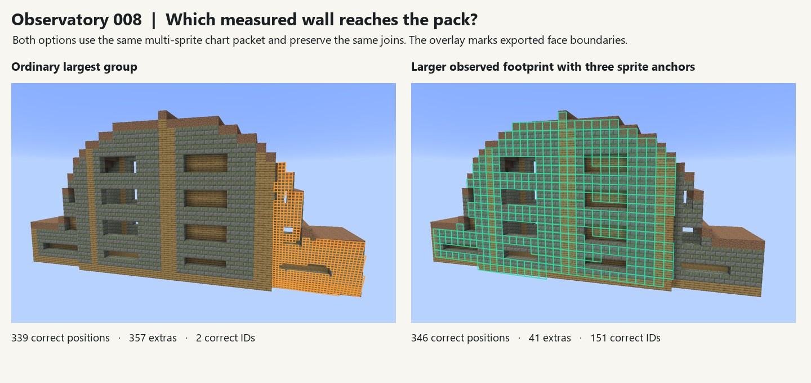

**Decision for the next round**

Keep Expanded Split-Border as the next default and retain this combination as an experimental challenger. It combines the three-sprite wall ruler with a component-selection rule. Across the full Front 100 noon cohort it removed 10,596 net extras, lost 40 correct positions, and recovered 173 net exact position-and-ID matches against the baseline. The extra component decision changed one training Observatory and has no demonstrated transfer to a new family. Nothing here changed the single-image default.

## Why the chosen wall changed

Observatory 008 had a 5,073-cell chart on its main visible wall. Three source-verified atlas sprites supported a larger block face. Once the ruler changed, the ordinary assembly selected a denser disconnected wall with 696 exported cells. The wall with independently verified scale covered substantially more of the source image.

The source-only rule operates only after a three-sprite ruler replacement. It checks whether an originally selected, corrected wall lost selection to a component without such certification. It retains the corrected group when its exported faces cover more native source samples inside their supported masks. Coverage is computed from the union of projected, sky-filtered faces on a four-pixel source lattice. Ties keep the ordinary group. Both alternatives use the same normal chart joins, rotations, assigned block IDs, orientation hint and pack writer.

## Opportunity from the actual component options

The reference-only diagnostic independently decoded both actual groups, included the ordinary winner, and selected the better strict placement F1 using evaluation labels. It found two eligible layouts, both training examples. The source arm subsequently reconstructed and ranked those options from the image before scoring the selected pack.

| Layout | Ordinary component, correct / extra / correct IDs | Corrected component, correct / extra / correct IDs | Ordinary / corrected source samples | Source choice |
| --- | --- | --- | --- | --- |
| Observatory 008 | 339 / 357 / 2 | 346 / 41 / 151 | 5,243 / 23,274 | Corrected |
| Observatory 064 | 28 / 1,789 / 7 | 28 / 214 / 0 | 7,074 / 918 | Ordinary |

The diagnostic's second switch could remove another 1,575 extras at the cost of all seven correct IDs on 064. The narrow corrected slice covered only 918 samples, so the image rule preserved the ordinary group there. Test the observed-area comparison on another family with a certified wall that actually loses selection.

## Reproduction and controls

The [three-sprite wall-ruler results](https://github.com/jeremyepling/minecraft-image-reconstruction/tree/experiment/front100-junction-scale-guard/benchmark/reviews/front100-junction-scale-guard-01) include its same-path no-op, which reproduced every coordinate and ID of the 100 archived Expanded Split-Border packs. The component replay reproduced the complete ordinary multi-sprite assembly and decoded its exact coordinate-and-ID set on both displaced cases. All other views inherited the unchanged multi-sprite export. Candidates share poses and visible labels only in their evaluator. Single-image reconstruction used the source image, its verified upstream chart handoff and the stock atlas.

Use `python -B -m benchmark.front100_junction_component --baseline <expanded-run> --multispot <three-sprite-run> --out <chooser-run>` for the diagnostic. Add `--source --workers 3` and supply a separate output directory for the source arm. The full source arm, including each case's grid, selected assembly, local source handoff, pack, aligned placements, score and portable surface evidence, is in `C:/code/minecraft/minecraft-image-reconstruction/runs/front100-loop-20261128/junction-scale-component/source`. Reference-only options and their decoded packs are in the sibling `chooser` folder. The dataset manifest SHA-256 is `f3e416acdbd6e0fa171260997fcdf62a86bc0c42c001d3a16d13e3f0e3c01187`.

There were 2,740 proposed masks, 2,721 retained and counted surfaces and 148 surfaces with both dimensions across the 100 frames. There were 359 wall charts, 328 oriented charts, 46 joins and 111 selected charts with either component rule. The combined arm exported 68,058 blocks including 67,913 assigned and 145 fallback blocks. Eight packs were empty and one nonempty pack had unresolved orientation in every arm.

## Floating branch scorecard

The measured integration base is `c33f3b0`, using the archived Expanded Split-Border predictor at `b0b6e3b`. Full-block noon accounted for all 100 measured views. The split contains 72 training, 14 validation and 14 test layouts. Each F1 pair gives strict / facade. The validation and test packs of both source challengers retained their baseline coordinates and IDs. Training strict placement F1 was 21.74% for the baseline, 23.00% for the three-sprite ruler and 23.05% for the combined arm.

| Arm | Placement F1 | Position + ID F1 | Strict correct / missed / extra | Correct gained / lost | Extras added / removed |
| --- | --- | --- | --- | --- | --- |
| Baseline — Expanded Split-Border | 23.57% / 24.66% | 4.67% / 4.89% | 25,960 / 115,612 / 52,734 | — | — |
| Candidate 1 — three sprites, `bbe2879` | 24.69% / 25.89% | 4.92% / 5.17% | 25,913 / 115,659 / 42,454 | 0 / 47 | 868 / 11,148 |
| Candidate 2 — three sprites and component coverage, `2930e58` | 24.73% / 25.94% | 5.07% / 5.33% | 25,920 / 115,652 / 42,138 | 0 / 40 | 719 / 11,315 |

The combined arm had 25,891 facade-correct positions, 105,717 facade misses and 42,138 extras. It placed the correct ID at 5,317 of 25,920 geometry-correct positions, or 20.51%. The benchmark and replay landed on `experiment/front100-junction-scale-component`. Expanded Split-Border stayed on `main`.
