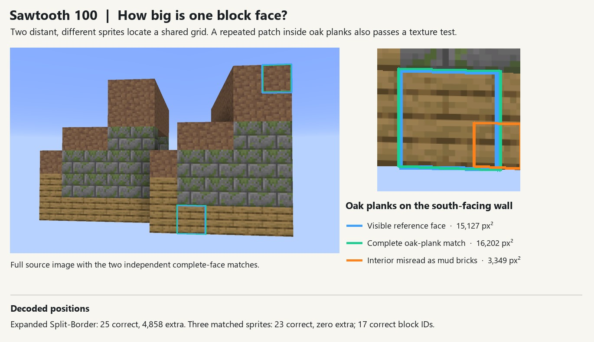

**Decision for the next round**

Keep Expanded Split-Border on `main` as the baseline for Floating Front 100. Carry the three-sprite ruler into the separate component-selection challenger. Retire the two-window rule and the sampled-coverage rule. The three-sprite ruler removed 10,280 net extra blocks and lost 47 correct blocks across 100 views. All decoded improvements came from training layouts. The experiment branch changes benchmark behavior only.

## The source decision

A dense wall can depict many distant blocks, or an internal line in a nearby texture can look like a whole block. The baseline produced 5,073 wall cells from one local atlas window on training Observatory 008. On Terrace 060 another dense wall had approximately the correct block size and crossed several depths. Both were retained as development examples, alongside Sawtooth 100 and Bell Tower 006.

The three alternatives act on the same wall chart. Each starts from the frozen single-image chart packet, recovers only native source pixels inside its existing occupied cells and depth partition, checks complete stock Java atlas sprites, and resamples that observed area. The ordinary sky veto, orientation, relative joins, pack writer, fixed-yaw decoder and one-whole-build translation score then run. An uncertain match retains the original chart. Out of 359 chart records, 84 local-atlas walls in 57 frames met the 256-cell gate.

| Candidate | Evidence required before replacing the ruler | Charts changed | Views with a chart change |
| --- | --- | ---: | ---: |
| Two independent sprite windows, `9f1c11f` | Independent left and right source regions match full sprites with compatible projected pitches. Their corners support an integer grid offset. | 19 | 16 |
| Additional coverage check, `6047a07` | Outside the discovery footprints the candidate gains full-sprite matches at the same independently chosen pixels. | 6 | 6 |
| Three independent sprites, `bbe2879` | At least three non-collinear anchors across two materials fit one grid. Each full sprite lies within 0.4 cell of the grid predicted by the other sprites. | 6 | 6 |

The first rule was frozen before evaluating other families. Its Water Tower validation results were known when designing the second rule. The third rule used native reference faces from training Sawtooth to diagnose a repeated motif, then froze its source-only matching procedure. Validation and test families for these follow-ups are regression cohorts.

## A photographed block and an internal texture repeat

On Sawtooth 100, the native reference face spans 15,127 pixels. The larger proposed oak-plank face spans 16,202 pixels, and its far packed-mud match lands three blocks sideways and five blocks upward at the same depth. The smaller proposal called a 3,349-pixel part of the oak planks mud bricks. A second apparent mud-brick match occurred inside another oak-plank face. The sampled-coverage rule favored that repeat. Its output removed 4,794 net extras but still used the wrong scale. This reference comparison took place after source-only prediction.

The three-sprite arm corroborated the larger ruler with independent oak-plank, packed-mud and mossy-stone-brick faces. Its decoded Sawtooth export contained 23 correct positions, 46 missed and zero extra, with 17 correct block IDs. The baseline had 25 correct, 44 missed and 4,858 extra, with zero correct IDs.

On Observatory 008, fixing the dominant wall made the ordinary largest-group selector switch to a different wall. That export lost 41 correct positions. The [component-selection follow-up](https://github.com/jeremyepling/minecraft-image-reconstruction/tree/experiment/front100-junction-scale-component/benchmark/reviews/front100-junction-scale-component-01) tests the original corrected component against that actual alternative.

## Split and stage checks

| Arm | Train strict F1, 72 views | Validation strict F1, 14 views | Test strict F1, 14 views | Selected charts | Joins |
| --- | ---: | ---: | ---: | ---: | ---: |
| Expanded Split-Border | 21.74% | 44.10% | 17.80% | 114 | 52 |
| Two windows | 22.89% | 41.99% | 17.80% | 108 | 37 |
| Additional sampled coverage | 22.28% | 44.10% | 17.80% | 113 | 46 |
| Three sprites | 23.00% | 44.10% | 17.80% | 111 | 46 |

All arms had eight empty exports and one unresolved nonempty export. They shared 2,740 proposed masks, 2,721 retained and counted surfaces, 148 surfaces with both Block Counter dimensions, 359 wall charts and 328 oriented charts. The three-sprite arm exported 68,367 blocks, 68,222 assigned and 145 fallback. Its 5,168 correct block IDs among 25,913 correct positions give 19.94% material accuracy.

## Reproduction and receipts

Use `python -B -m benchmark.front100_junction_replay --baseline <expanded-run> --out <private-run> --workers 4` from the measured checkout. Select the second arm with `--confirm-coverage` or the third arm with `--require-multispot`. Add `--portable` on a second invocation to materialize the full mobile surface evidence. The prepared atlas and Python environment follow [the shared fixture instructions](../../FLOATING_SHARED_DATASETS.md).

The cohort is Floating Front 100 v1 clean, full-block noon. Its release SHA-256 is `f3e416acdbd6e0fa171260997fcdf62a86bc0c42c001d3a16d13e3f0e3c01187`. The 100-case fixture manifest digest is `45a1ea6ff7e7ee3059a822201616e9acac8ccaf53e866c4fe09ec516d897440c`; the Java 26.3 atlas digest is `49b477fbfe5f2171c2529e3ffe1722f09fee5a094de2b6b99831512b8601c950`. The baseline predictor was measured at `b0b6e3b`; the experiment's integration base was `c33f3b0`. Every arm's same-path no-op reproduced all 100 baseline decoded coordinate-and-ID sets, component selections and orientations. ZIP timestamps can differ. Each arm preserves its own exact output pack hash.

On this PC the private runs are under `C:/code/minecraft/minecraft-image-reconstruction/runs/front100-loop-20261128/junction-scale-guard`. Each measured run contains portable `original/<frame>/surfaces.json`, the verified chart packet and source handoff, component selection, aligned placements and pack. The exploratory strict-phase attempt retained all four development packs. Its receipts are in `dev`. Two-window development, coverage development, initial three-sprite tests and the frozen development replay are in `dev-pairs`, `dev-coverage`, `dev-multispot`, `dev-multispot-24` and `dev-multispot-hull`. The three scored cohorts are in `frozen`, `coverage` and `multispot`. Each has a `summary.json` and 100 per-case score receipts.

## Floating branch scorecard

All entries cover the same 100 of 100 full-block noon views. Each F1 pair gives strict / facade. Counts are strict correct / missed / extra. Paired counts compare each candidate with Expanded Split-Border after individual whole-build registration.

| Arm | Placement F1 | Position + ID F1 | Correct / missed / extra | Correct gained / lost | Extras added / removed |
| --- | --- | --- | --- | --- | --- |
| Baseline — Expanded Split-Border | 23.57% / 24.66% | 4.67% / 4.89% | 25,960 / 115,612 / 52,734 | — | — |
| Candidate 1 — two windows | 24.30% / 25.49% | 4.95% / 5.20% | 25,417 / 116,155 / 42,207 | 152 / 695 | 950 / 11,477 |
| Candidate 2 — sampled coverage | 24.06% / 25.21% | 4.79% / 5.02% | 25,834 / 115,738 / 47,324 | 79 / 205 | 866 / 6,276 |
| Candidate 3 — three sprites | 24.69% / 25.89% | 4.92% / 5.17% | 25,913 / 115,659 / 42,454 | 0 / 47 | 868 / 11,148 |

No ruler change landed on `main`. The three source-only arms are on `experiment/front100-junction-scale-guard`.
