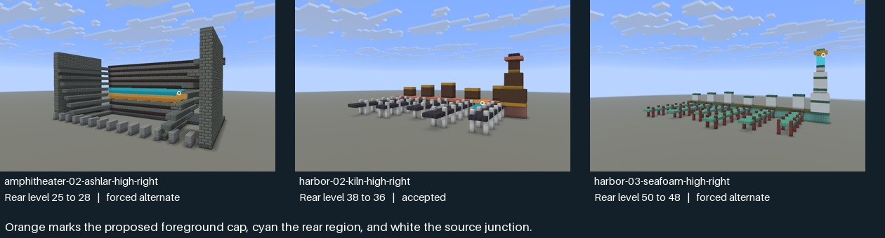

# Occlusion edges and visible wall depth

Keep `experiment/occlusion-edge-depth-proposals` experimental. The source rule accepted one of thirteen pictures and reduced pooled strict placement F1 from 54.24% to 54.21%. A reference chooser allowed to keep the original export improved only a development picture. This experiment changed benchmark code only. The ordinary default remains on `main` at the tested revision `e3bd220`.

## Decision and inputs

The test asks whether a T junction inside the largest visible vertical carrier can put an RGB-connected region at the correct integer wall depth. It uses the screenshot, the existing Regions First support and the source-estimated camera and plane levels. It retains the counted chart, the rest of the carrier at its incumbent level, ordinary face sampling, downstream refinements and material assignment. All materialized cells come from a projected, observed region of the input picture.

The rule looks for a foreground colour continuing across one half of a ring and two distinct appearance regions meeting it on the other half. The cap and both rear wedges must persist on a second ring. One wedge can be a coherent unassigned image area. The original development check required all three wedges to belong to labeled regions at both radii. It offered no move on any of the four development pictures. Allowing a coherent unassigned wedge and checking persistence at two and four samples gave moves on three development pictures. These settings were frozen before the nine published regression pictures. A colour transition can pass this test even where the two regions are coplanar.

For each foreground cap, the rule uses a stable floor intercept if available or ranks integer levels by contour alignment to a projected block grid. For each rear group, it keeps a ±12-block window around the incumbent, ranks levels behind the cap by contour alignment, covered face samples and projected spill into unassigned scene pixels. A gate requires a floor or distinct contour anchor, improved alignment, supported coverage and limited spill. One alternate per photograph limits the choice. It uses the highest-ranking eligible offer or, if none qualify, the strongest rejected offer. The reference chooser compares only its actual downstream export against the incumbent using strict placement F1. It keeps the incumbent on ties.

## Pilot on identical pictures

All thirteen controls had usable cameras. Twenty-one ordered component pairs supplied offers on seven pictures. Two pairs passed the gate, both on Harbor 02 kiln. Its top-ranked pair became the sole accepted export. The seven informative pictures each received one forced alternate export. Each candidate used the same Minecraft 26.3 pipeline that produced the control. An independent no-op replay on every informative picture reproduced the released decoded coordinate and ID inventory. Unchanged views retain their verified control inventory.

| Policy | Strict geometry | Facade geometry | Strict position + ID | Facade position + ID | Correct gained / lost | Extras added / removed |
|---|---:|---:|---:|---:|---:|---:|
| Verified default | 54.24% | 57.48% | 35.14% | 37.87% | 0 / 0 | 0 / 0 |
| Source decisions | 54.21% | 57.45% | 35.14% | 37.86% | 2 / 5 | 7 / 4 |
| Reference chooser over real exports | 54.68% | 57.98% | 35.53% | 38.29% | 61 / 9 | 6 / 54 |

The strict source counts were 6,243 correct, 7,771 missed and 2,774 extras. Exact IDs fell from 4,047 to 4,046. Each export uses its own best single whole-build integer translation for strict geometry and all typed scores use that translation. Paired counts compare aligned coordinate sets. Facade-priority scoring follows the control’s native thin-horizontal exemption.

| Cohort | Tested / available | Default strict / facade | Source strict / facade | Reference chooser strict / facade |
|---|---:|---:|---:|---:|
| Fixed structures | 2 / 104 | 87.02 / 92.52 | 87.02 / 92.52 | 87.02 / 92.52 |
| Visible Builds v3 | 9 / 144 | 51.91 / 55.26 | 51.88 / 55.22 | 52.40 / 55.82 |
| Decorative Builds v1 | 2 / 40 | 64.82 / 65.53 | 64.82 / 65.53 | 64.82 / 65.53 |
| Development | 4 / 4 | 64.40 / 65.16 | 64.40 / 65.16 | 65.78 / 66.62 |
| Reviewed regressions | 9 / 9 | 49.47 / 53.49 | 49.43 / 53.44 | 49.47 / 53.49 |

The full 104-view default remains at 91.27 / 93.42 strict / facade, with 20,773 correct, 2,929 missed and 1,046 extras. Full-cohort default scores of 46.63 / 48.04 for Visible Builds v3 and 63.46 / 65.23 for Decorative Builds v1 are carried forward. The challenger was evaluated only on the thirteen listed pictures. The fixed 112 historical replay was outside this pilot.

## What reached the build

- **Harbor 03 seafoam.** The strongest proposal on mask-0 put rear component 3 at local Z48, matching 133 of 133 visible same-axis reference samples. The weaker, ambiguous cap kept this out of the source export. Forcing the move reduced strict F1 from 17.23% to 16.91%, with zero gained, four lost, twelve extras added and eight removed. The comparison measures the same-axis face depth in camera-registered coordinates and final placement after whole-build alignment. A correct per-sample metric depth did not improve the finished placement. The second rear component covered 54 samples at Z47. The strict behind-cap constraint excluded Z47 and proposed Z49. Most of the carrier received no T-derived proposal.
- **Harbor 02 kiln.** A distinct contour promoted the wrong foreground level for all 74 same-axis foreground samples. The selected rear group was placed at Z36. Its visible reference was Z37 for 70 of 71 same-axis samples, and Z37 remained available after applying the order bound. Source strict F1 fell from 18.13% to 17.72%.
- **Amphitheater.** The alternate reached level 28, correct for 706 of 707 same-axis rear samples. Forcing it raised strict F1 from 52.85% to 56.06%. Its ambiguous foreground contour failed the source gate. This one development result accounts for the entire finite-chooser gain.
- **Shrine.** The ±12 window reached a rear patch eleven blocks from the incumbent. Its forced level matched 100 of 102 same-axis samples. Strict F1 fell from 47.50% to 47.33%.
- **Castle.** Each largest carrier yielded only one retained RGB component, so neither view supplied a T junction. The coordinator’s separate reference replay found that changing the smaller Castle 02 rear mask-1 from X17 to X16 raised strict F1 from 56.94% to 66.90%. A source method for choosing a different carrier would address a measured omission here.



## Replay and evidence

Use the workspace benchmark Python with NumPy and Pillow, the shared Java 26.3 atlas and the saved input artifacts in the sibling control worktree. Run the following from this branch. The source plan is written before the grading code opens native labels. Each regression score is based on the previously frozen development rule.

```powershell
python -m benchmark.occlusion_edge_run plan dev
python -m benchmark.occlusion_edge_run plan hold
python -m benchmark.occlusion_edge_run export dev
python -m benchmark.occlusion_edge_run export hold
python -m benchmark.occlusion_edge_run control dev
python -m benchmark.occlusion_edge_run control hold
python -m benchmark.occlusion_edge_report
```

Private exports and region maps are in `runs/oe/<frame>`. The tracked machine-readable report includes reference histograms for expanded-cohort component pairs, source and pack hashes, actual offer inventory, source gate decision, per-frame decoded effects and exact-ID scores. The reference histogram samples the native frontmost face at the pixel nearest each four-pixel placement sample centre. [Frozen plans and paired frame scores](cases.json.gz) · [Pooled scores and input fingerprint](summary.json)
