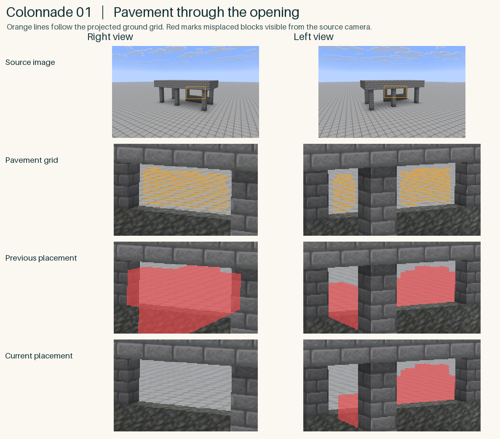

# Pavement seen through the Colonnade openings

The ordinary Java 26.3 placer clears the eight false shelf blocks in the right Colonnade 01 view and six false blocks in the left view. The right opening goes from **5,349 of 5,456 source pixels obstructed to zero**. The low wall, pillars and roof retain every previously correct block. The left view still has 2,963 of 4,048 opening pixels obstructed, down from 3,543. Many of the remaining blocks are at the base course, which also occurs on real platforms. [Before and after on both source images](openings.jpg) · [Scored ordinary exports and sightline counts](summary.json)



[Open the interactive weakest-structures viewer](../shared-face-round-01/viewer.html) to inspect the corrected export, the facade-priority gap, and the layouts or source images that could reach 95% with perfect fixes. Rebuild the page with `python -m benchmark.current_placement_viewer`.

## How concentrated is the gap to 95%?

Starting from 92.9145% facade-priority F1, correcting all required misses and removing all extras across Shopfront's eight views would reach 93.81%. Adding Portico's eight gives 94.39%, Galleries' four gives 94.92%, and Workshop's four gives **95.40%**. These four layouts contain 634 required misses and 361 extras. Shopfront contributes 74 uncovered blocks with incomplete dimensions. On Portico 74 misses have the correct projected face axis at the wrong coordinate. Galleries and Workshop contribute 60 and 55 wrong-axis misses respectively.

Four is the minimum number of perfectly corrected layouts under this scenario. For a target of 95%, recovering a required miss contributes 105 units toward crossing the threshold and removing an extra contributes 95, from rearranging the pooled F1 formula. Sorting disjoint groups by that sum maximizes progress toward the threshold for each group count. The best three layouts reach only 94.92%. Selecting individual source images instead requires at least ten. These scenarios assume independent perfect fixes and hold every other prediction fixed.

The ten strict-ranked images shown first in the viewer account for 217 required misses and 149 extras. Their **12.77%** share of all 2,867 facade-priority errors contributes **0.90 points** to the current 7.09-point gap to 100%. All 38 fixed views of those layouts contribute **2.93 points**. This attribution uses today's pooled denominator. The cumulative-score scenarios recalculate it after each fix.

## What the source image establishes

The Surface Finder supplies a horizontal patch. To use it as evidence, the placer requires vertical surfaces beside the patch and along its head and sill. The estimated camera projects the ground grid into the patch. The implementation learns the pavement texture from RGB pixels outside the building on the left and right independently, then compares each prediction with two disjoint groups of pixels inside the opening. All four comparisons must favor the predicted ground alignment over shifted textures. On the right view the four correlations are 0.913–0.936 and the smallest lead over a shifted texture is 0.117. The original captured camera and world labels enter only during evaluation. [Per-view measurements](cases.json)

A ground-aligned texture can be a real platform. The default keeps its mask and count. At placement, a cube above the base course qualifies for removal only when at least four samples, a majority of one visible face, and at least a fifth of its total visible footprint fall inside the same verified patch. A three-source-pixel margin protects the neighboring pillars. After each removal the placer projects the remaining cubes again. A cube behind the first one can be removed once its own face is visible and meets the same checks. The manifest records the matched surface IDs and removed local XYZ positions under `placement.pavement_openings`.

## Placement across all 204 whole-structure source images

| Cohort | Changed / views | Strict F1 before → after | Facade-priority F1 before → after |
| --- | ---: | ---: | ---: |
| Fixed structures | 1 / 104 | 90.7966% → **90.8126%** | 92.8961% → **92.9145%** |
| Alternate views | 1 / 20 | 90.0235% → **90.0905%** | 90.1756% → **90.2613%** |
| Development | 0 / 72 | 91.4073% → 91.4073% | 94.1980% → 94.1980% |
| New buildings | 0 / 4 | 83.5801% → 83.5801% | 85.7778% → 85.7778% |
| Shelter and gate | 0 / 4 | 83.4741% → 83.4741% | 82.3779% → 82.3779% |

On the fixed suite the change from `a6e0195` is **zero correct positions gained or lost and eight extras removed**. The new totals are **20,619 correct, 3,083 missed and 1,089 extra**. Camera-registered strict F1 also measures 90.8126%. Historical 112-view strict F1 moves from 90.04% to 90.05%. The eight retired wall close-ups are confined to that historical comparison. The two improved views show the same layout. The other 202 views supply regression evidence. [Local and pooled counts](summary.json) · [Verified datapacks for both changed source images](default-exports.zip)

| Colonnade 01 | Correct / missed / extra before → after | Strict F1 before → after | Facade-priority F1 before → after |
| --- | --- | ---: | ---: |
| Right, fixed | 126 / 65 / 18 → **126 / 65 / 10** | 75.22% → **77.06%** | 88.89% → **92.63%** |
| Left, alternate | 118 / 69 / 53 → **118 / 69 / 47** | 65.92% → **67.05%** | 76.60% → **78.60%** |

## Why the whole-surface version stayed experimental

Suppressing every matching surface and rebuilding improved both Colonnade views. On the right it gained seven correct blocks and lost two previously correct roof blocks. It removed eight extras and introduced two others, including a hidden block. On the left it removed 46 extras and gained three correct blocks. The local version changes only the blocks inside the measured sightlines. A single untrimmed pass removed seven and nine extras respectively. Reprojection recovered the eighth shelf block on the right. The rim margin gives up three removals on the left and protects the projected edge of a real neighboring cube in a regression test. [Whole-surface rebuild scores and per-case results](../pavement-opening-round-01/summary.json) · [Focused edge test](../../../tests/test_pavement_opening.py)

A finite flush deck with a visible contrasting border produced the same pavement signal in the opening. Suppressing the mask would discard 5,396 genuine floor pixels. The local placer kept all 320 supplied deck and trim coordinates, all 60 visible cells on a raised same-material platform and all nine on a separate flush pad. Six native source images of the Loading Dock, Switchback and Platform Shelter contributed 317 visible platform-face appearances. Their geometry and masks were preserved. Fresh ordinary builds from the high-right Loading Dock and Platform Shelter source images also reproduced their prior exported block coordinates and material assignments exactly. [Platform images and controls](../pavement-platform-controls-01/README.md)

## Replay

Use the registered frozen fixtures and the prepared Java 26.3 atlas. The five commands below reproduce the frozen baseline, experimental rebuild, placement-only replay and platform controls.

```powershell
python -m benchmark.pavement_opening_eval baseline
python -m benchmark.pavement_opening_eval candidate
python -m benchmark.pavement_opening_eval report
python -m benchmark.pavement_local_eval --out benchmark/reviews/pavement-local-01/cases.json
python -m benchmark.pavement_platform_controls
```

To verify the public command, run `Invoke-WallRecovery.ps1` on each original `test-colonnade-01-oblique-{right,left}.png` from the `inverse-voxels-26.3/confirm/captures` fixture. Use `-Through placement` and `-Out runs/pavement-cli-right` or `runs/pavement-cli-left` respectively. Also run the same command for `holdout-loadingdock-timber-high-right.png` from the registered `visible-geometry-new-shapes/runs/blind-input/scoring/captures` and `holdout-platformshelter-copper-high-right.png` from `framed-depth-transfer/runs/transfer-input/scoring/captures`. Use destinations `runs/pavement-cli-loadingdock` and `runs/pavement-cli-platformshelter`. Then run `python -m benchmark.pavement_opening_release`. It checks the source hashes, actual exported block-state maps, local coordinates and all 204 baseline pack identities before writing the summary and illustration. The pack for an unaffected case comes from the preceding release; the two replacements and their SHA-256 digests are in this review.
