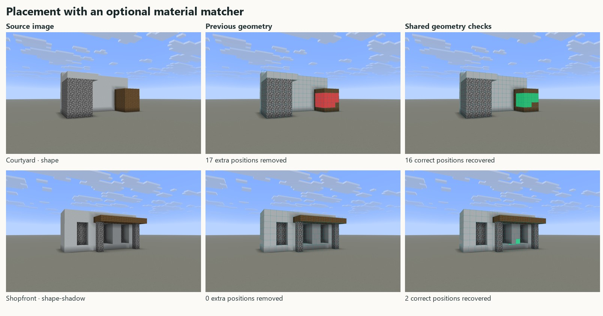

# Pipeline consistency review

We traced the Java 26.3 single-source-image workflow from the ordinary Wall Recovery command through surface inference, outline cleanup, camera fitting, counting, material matching, placement, datapack export, scoring and the review viewer. Three comparisons used the same 204 distinct source images as the previous release. The 104 fixed whole-structure views determine the headline score. The other 100 check transfer and regressions and include additional views of related structures. Separate ordinary builds exercised the material options, partial-stage exits and atlas failures. The reference geometry entered on the evaluation side only.

## Where sharing evidence helped

| Stage | Finding | Result |
| --- | --- | --- |
| Camera and atlas | Camera and plane depth assumed a file named `atlas.png`. Outlining and counting used the sheet named in `atlas.json`. | A valid renamed sheet previously lost the camera on Workshop and Offset Gate. After the fix, the standard and renamed sheets produced byte-identical surface, count and position files on Offset Gate, with all 211 exported positions matching the ordinary control. A corrupt atlas produced an empty build there. Shopfront retained its independent seam fit. The atlas-repeat counter can also continue to a working automatically discovered installation. |
| Surface Finder and Block Counter | Some newly refined outlines legitimately differ from the masks that measured the texture. | On 204 views, 29 of 3,094 surfaces used an earlier measurement mask after outline repair. Across 24 views that preserved a distinction covering 115,069 outline pixels. Zero excluded background pixels reappeared in those measurement masks. In 14 ordinary exports, all 265 native surface masks, surface IDs, camera matrices and measured chart quads agreed with replay. |
| Material Matcher and placement | Choosing `shape`, `shape-shadow` or `exposure` skipped checks for smooth walls and adjoining counted faces. These checks use source geometry. The matcher chooses material labels for the count report. | Placement now runs the checks for each matcher. On three source images the corrected exports matched the default block coordinates exactly. Within each matcher, the before/after count files, including material assignments, had identical hashes. |
| Block Grouper | We tried giving the grouper the placement camera’s focal length. | Zero grouping links changed on 564 recorded complete face footprints across 29 views. Sharing a camera by itself supplied no additional cross-surface matches here. |
| Export and manifest | In 11 of 14 checked manifests, the ranked placer's strict and added counts summed to an intermediate build size. Later surface checks could both add and remove cells. | The manifest now records `placement.final_refinement` with the ranked input size, net distinct cells added and removed, and final output size. On Courtyard those values were 176, 16, 17 and 175. The decoded pack and position file agreed. |
| Scoring and viewer | The archived fixed-suite counts represent bare geometry. Atlas-enabled ordinary counting found additional grid origins. The face-corner and scored-build overlays also use different cameras. | The atlas recovers 62 additional axis origins on 35 of 1,431 surfaces in 28 of 104 views. Dimensions, chart quads and counting methods agreed. The median difference between the two camera projections was 0.23 source pixels across view medians. The score uses decoded block coordinates after a single whole-build translation. |

**Stopping after counting exposed a real failure.** On Sawtooth2 and the corner-mixed oblique Facade, cleaning up the background removed a surface that an inset check still expected. Counting alone tried to look it up and could fail, while the placement run retained a private copy for fitting. Both exits now validate the public host dimensions. Only placement reconstructs the earlier context for its fit. Four fresh runs verified byte-identical public surface and count files between stage exits, all 97 referenced crops and samples, and the original 221 and 336 exported positions respectively. The two oblique Facade fixtures mentioned in this report belong to different capture series.

[Counting versus placement verification](host-parity.json) · [Ordinary atlas successes and failure controls](ordinary-compare.json) · [Stage comparisons, score verification and original manifest counts](stage-audit.json)

## Ordinary placement results

Counts are **correct / missed / extra** visible block positions after one translation for the entire build. Each material example uses the same source image, calibrated atlas, material mode and geometry evaluator on both revisions. These are improvements to optional material runs. The ordinary geometry path already used the corrected checks.

| Source image and material mode | Previous strict counts | Current strict counts | Strict F1 before → after |
| --- | ---: | ---: | ---: |
| Courtyard, plaster low-left, shape | 146 / 30 / 30 | 162 / 14 / 13 | 82.95% → 92.31% |
| Shopfront, plaster low-left, shape-shadow | 103 / 66 / 21 | 105 / 64 / 21 | 70.31% → 71.19% |
| Portico, plaster low-left, exposure | 148 / 61 / 30 | 148 / 61 / 30 | 76.49% → 76.49% |

The baseline is `9e69d7c`, and the combined pipeline revision is `260d17f`. We decoded and rescored all 204 saved baseline exports. Each per-image result and pooled score reproduced, including the camera-registered diagnostic. The standard-atlas geometry calculation follows the same path after the fixes. We ran fresh source-image inference on the affected paths and used the frozen exports for suite-wide scoring.

| Suite and metric | Correct | Missed | Extras | F1 | Change from previous default |
| --- | ---: | ---: | ---: | ---: | ---: |
| Fixed 104, strict | 20,773 | 2,929 | 1,046 | 91.2678% | 0.0000 percentage points |
| Fixed 104, facade-priority | 18,952 | 1,624 | 1,046 | 93.4194% | 0.0000 percentage points |
| Other 100, strict | 21,008 | 2,923 | 1,288 | 90.89% | — |
| Other 100, facade-priority | 18,631 | 1,443 | 1,288 | 93.17% | — |

Fixed camera-registered strict F1 was 91.2678%. Historical 112-view strict F1 was 90.5043%. The historical set includes eight whole-frame wall views excluded from the active structure suite. [Ordinary material runs, source and count hashes, decoded positions and scores](material-results.json)

## Which order to keep

| Order tested | Outcome on 204 source images | Decision |
| --- | --- | --- |
| Revisit wall and counted-corner checks on views already handled by the inset or pavement-opening passes | All 21 skipped views were screened. None supplied an additional smooth region or a corner edit. | Keep the current order. A future mixed-feature fixture could test whether eligibility should move from the whole view to an individual surface. |
| Repeat exterior removal after the first placement cleanup | None of the ten changed builds exposed another removable exterior cell. | Keep one pass. |
| Delete every cube with no visible pixel in a final projection of the export | This removed 20 correct blocks and one extra across 11 views. The fixed 104 lost nine correct positions and zero extras, dropping strict F1 to 91.2463% and facade-priority F1 to 93.3958%. | Keep final occlusion as a diagnostic. A wrongly placed front block can hide the correct rear block in the reconstruction. |

The last test points to a more useful local check. All 20 correct blocks that it would have deleted had an extra block in front of some of their source-image footprint. On Relief 00 left, extras covered 228 of 685 projected pixels for one correct block and 401 of 668 for another. Compare the competing foreground and background placements against the source texture, visible rim and adjoining face while keeping unrelated blocks fixed. This tests which placement explains the evidence. Of the fixed suite’s 1,624 required misses, 526 already project onto the right face axis at the wrong coordinate, 331 project onto the wrong axis, 765 are mostly uncovered and two tie. These are diagnostic categories, not an estimate of what a new rule would recover. [Coordinates and cohort scores](order-checks.json) · [Native-pixel obstruction traces](terminal-ray-obstructions.json)

## What atlas offsets can contribute

Across 204 views the atlas supplied 114 additional axis offsets and completed 59 grids. Those grids produced 356 new face footprints on 18 views. At least half the union of the candidate and reference pixels overlapped for 304 distinct new face matches. All 52 failures at that threshold came from the rim-series oblique Facade image, where only two of 54 candidates matched. The fixed 104 alone would have missed this failure.

We joined those matched faces to the visible blocks in the scored exports. **303 of 304 already belonged to correctly placed blocks.** On the fixed suite, 129 of 130 were correct. One required block was missing on Cloister 3, cool palette, low-left. All 174 matching faces in the other views belonged to correctly placed blocks. Even perfectly adding the missing block would raise fixed facade-priority F1 by only 0.0026 percentage points. That makes the measured grids better candidates for *anchoring a neighboring depth decision* than for adding blocks directly. The placer already reads the sampling quadrilateral and row/column counts. The next experiment would also use a confirmed grid origin, where available, during the local foreground-versus-background comparison. Grade which true positions it recovers or loses, and keep the difficult oblique Facade as a control. [Per-view face matches](atlas-grid-quality.json) · [Reference-only ceiling for direct placement](atlas-face-placement.json)

## Review and replay

Run `python benchmark/reviews/pipeline-consistency-01/replay_order_checks.py --out runs/placement-order-review` from a checkout with the frozen inputs installed. The runner checks source and export hashes, evaluates the alternate orderings, and writes per-view scores and coordinates. For the material comparison, use `Invoke-WallRecovery.ps1 -Through placement` on the named source images, set `-MaterialMatch` to the table entry, and use the same calibrated atlas for both runs. Exposure also takes the matching calibrated face library via `-Library`. The manifest records which material matcher actually ran. The independent camera still uses visible pavement seams first.

Two remaining diagnostic limits matter when inspecting these runs. An observed span across a recessed wall is a separate measurement from the number of complete rows and columns in its rectified crop. The ordinary Sawtooth2 export recorded a 2 × 4 visible inset span even though its cropped count resolved only one axis. Also, a reused output folder can retain files from an earlier run. In two existing folders we found five orphan images. Use the current manifest and the paths in its surface and count records when reading a run. A future artifact-publishing change should address partial reruns without discarding unrelated files.

The legacy assembly command has a separate explicit shell-extrusion option. The reviewed visible-only Wall Recovery path does not invoke it. [Product intent](../../../PRODUCT_INTENT.md) · [Interactive pipeline review](../shared-face-round-01/viewer.html)
