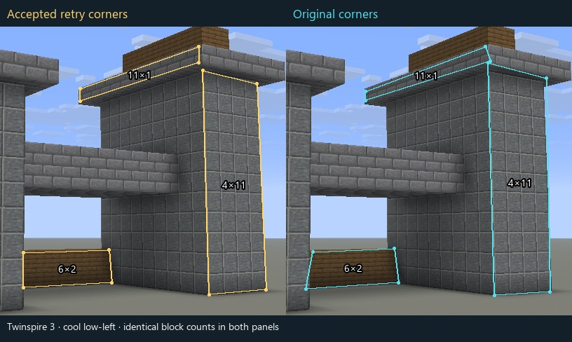

# Where should the placer anchor a texture-guided count?

**Keep experiment/placement-grid-choice experimental.** Restoring the original chart can fix a misplaced wall even when the retry measured its size correctly. The image-only rule missed all three recoverable fixed-suite gains and regressed one Workshop view. Every offered combination produced the same decoded geometry and IDs on both expanded datasets.

## Ordinary exports

Each score is a percentage pooled across the stated cohort. Strict and facade use the same geometry-selected whole-build translation. Joint F1 requires both a correct position and the exact block ID. ID accuracy uses correctly placed positions as its denominator.

| Cohort and choice | Geometry strict | Geometry facade | Joint strict | Joint facade | ID accuracy | Facade views better / worse / tied |
|---|---:|---:|---:|---:|---:|---:|
| Fixed 104 · KEEP | 91.2678 | 93.4194 | 84.6818 | 88.5099 | 92.7839 | 0 / 0 / 104 |
| Fixed 104 · all original corners | 91.3809 | 93.5440 | 84.9215 | 88.7766 | 92.9313 | 3 / 1 / 100 |
| Fixed 104 · image-only choice | 91.2503 | 93.4004 | 84.7989 | 88.6424 | 92.9301 | 0 / 1 / 103 |
| Fixed 104 · reference choice | 91.3983 | 93.5630 | 84.8043 | 88.6441 | 92.7854 | 3 / 0 / 101 |
| Visible Builds v3 · all four choices, 144/144 | 8.0753 | 8.5068 | 6.1561 | 6.5006 | 76.2340 | 0 / 0 / 144 |
| Decorative Builds v1 · all four choices, 40/40 | 54.3346 | 56.1097 | 43.4295 | 45.3351 | 79.9298 | 0 / 0 / 40 |

Fixed strict correct / missed / extra positions were 20,773 / 2,929 / 1,046 for KEEP, 20,764 / 2,938 / 1,044 for the image rule and 20,805 / 2,897 / 1,019 for the reference choice. Fixed facade counts were 18,952 / 1,624 / 1,046, 18,943 / 1,633 / 1,044 and 18,983 / 1,593 / 1,019 respectively. The historical 112-frame strict geometry score was 90.5043%, including eight whole-frame wall images excluded from this round.

The fixed validation and test splits each gained one view under the reference chooser. The remaining gain was on the native Recess example. The frozen image rule lost one regression view. The fresh and old splits tied throughout. On the two expansions every train, validation and test view tied. No expansion training building supplied a positive placement example for a decision model. Camera failures remained in the denominators, 108/144 on v3 and 10/40 on Decorative. [All split metrics and position counts](summary.json)

## Which corners changed the build?

| Fixed view | Surface restored | Facade KEEP → original | Strict correct gained / lost | Extras added / removed |
|---|---|---:|---:|---:|
| Twinspire 3, cool low-left | mask-3 | 88.82 → 97.77 | 29 / 0 | 0 / 27 |
| Cloister 3, cool low-left | mask-2 | 96.13 → 96.58 | 1 / 0 | 0 / 1 |
| Recess 28, right | mask-5 | 94.52 → 94.55 | 3 / 1 | 2 / 1 |
| Workshop, light gray concrete, plaster high-right | mask-1-junction-0 | 91.42 → 89.80 | 3 / 12 | 1 / 3 |

On Twinspire, all eight combinations retained the measured dimensions of 4×11, 11×1 and 6×2. Restoring only the tall 4×11 wall's original corners produced the best export. Its average endpoint-neighborhood distance to the surface boundary worsened from 0.78 to 3.42 native pixels, while its adjoining edge residual improved from 7.16 to 3.52 pixels. The combined improvement of 0.99 pixels fell just below the frozen one-pixel threshold. Changing the threshold after seeing Twinspire would fit a previously reviewed example. The Workshop switch actually improved joint facade F1 from 70.66% to 81.22% while losing nine net correct positions, illustrating the difference between the two objectives.

## Handoff and ceiling

The branch uses the production pipeline at 1ca8822. A candidate must reproduce the accepted retry's named chart from the source region and preserve its UV axis order. For each such surface, independently choose its accepted or original four native-pixel corners at the private placement chart adapter. The counter's entire report, including raw fractional spacings, rounded sizes, partial counts and dimensionless atlas phase entries, stays intact. Placement consumes the two raw spacings only if both are available. Its adapter carries no explicit phase, so changing corners changes where a counted span projects while leaving every phase value in the measured chart's coordinates. The ranked placer and counted-ground-corner refinement both see the selected chart. Other consumers receive the ordinary counter output.

The image rule was fixed before outcome scoring. It compares boundary distances near the outer 10% of the four projected edges and the maximum endpoint discrepancy against each possible adjoining edge. These endpoint neighborhoods sit outside the envelope fitter's central 12–88% sampling span. The rule uses the original corners when the summed distances improve by more than one native pixel and the adjoining edge residual does not increase. This is local support from a predicted mask and other detected surfaces in the same image. The reference choice instead selects the actual exported option with highest per-frame facade geometry F1, keeping the ordinary output on a baseline tie.

Across fixed / v3 / Decorative respectively, there were 83 / 12 / 36 eligible charts on camera-supported views and 233 / 160 / 152 per-frame combinations including KEEP. All combinations were enumerated. On supported cameras, every accepted retry labeled with a non-original chart supplied a verified alternative. When the complete ordered set of lifted carrier planes and the grounded-corner anchors matched, downstream consumers received equivalent inputs and shared one scored export. There were 177 / 149 / 61 distinct placement inputs and 108 / 144 / 40 distinct decoded results summed by frame. The union of all registered options still missed 1,589 / 192,072 / 8,592 required facade positions. The local rule selected an original for 11 / 0 / 2 charts, changing the decoded export on just the Workshop view. [All offered combinations, source measurements, evaluator hashes and changed world coordinates](cases.json.gz)

## Reproduce

Run `python -m benchmark.placement_grid_choice --workers 4` then `python -m benchmark.placement_grid_report`. The fixed reruns use the verified pre-inset handoffs. Expanded reruns use the baseline source fields around an ordinary Java 26.3 build, checking its complete serialized counter and region inputs against the stored handoff before applying private corners. Data, fields and shared controls come from the existing full-expanded-controls checkout. Every export comparison uses decoded coordinates and IDs with a canonical fingerprint. Python 3.13.5 and the baseline Python 3.12.14 can encode different gzip OS bytes for identical block inventories. The separate Twinspire confirmation uses the baseline interpreter and verifies byte-exact KEEP and the complete counter-report hash across the candidate. [Run fingerprints](manifest.json) · [Twinspire confirmation](twinspire-confirmation.json)
